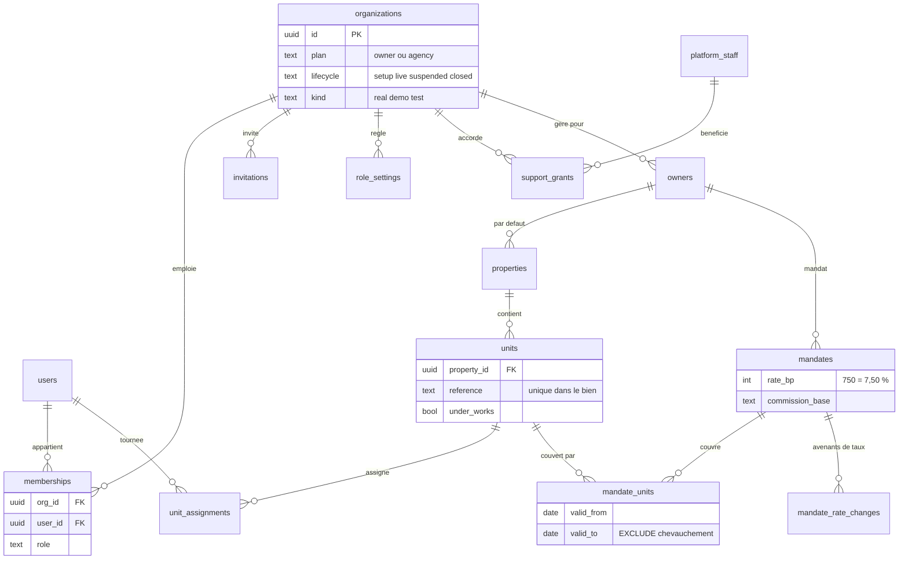
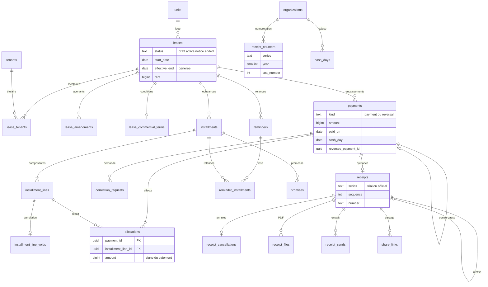
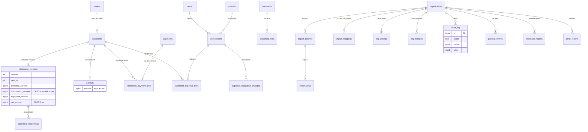

# Immo Suite — Schéma de base de données

| Champ | Valeur |
|---|---|
| Statut | Propriétaire des tables, colonnes, contraintes, déclencheurs, droits et fonctions SQL. Les choix techniques sont pris par DP-55 à DP-61, DP-67 (voir « Décisions à enregistrer » en fin de document) ; ceux qui n'ont pas d'entrée DP-xx restent [À valider]. Le schéma a été exécuté et testé sur PGlite (PostgreSQL 18 en WebAssembly) ; il n'a pas encore été exécuté sur le PostgreSQL de production (Neon, prototype b), voir section 9 |
| Date | 30/10/2026 |
| Dépend de | `DECISIONS.md` (état au 30/10/2026), dossier de cadrage v1.0 (§11.2, §12.1, §15, §16, §19), `ARCHITECTURE.md` v0.2 (§2.3, §4, §5, §8, §10), `DOMAINE.md` (R-001 à R-110, E-01 à E-48), `CONTEXTE.md`, `UI_UX_DESIGN.md`, `MAQUETTE.md`, `AUDIT_COHERENCE.md`, `maquette/data/*.js` |
| Alimente | `SECURITY.md`, `API_CONTRACTS.md`, `CODING_RULES.md`, `TESTING_QA.md`, `DEPLOYMENT.md`, `specs/`, `CLAUDE.md` |
| Version | 0.2 |

Légende des marqueurs ([PILOTE], [APRÈS], [À valider], [Hypothèse], [À VÉRIFIER AVEC UN JURISTE]) et hiérarchie en cas de conflit : voir `CLAUDE.md` (hiérarchie par sujet). Pour les tables, colonnes, contraintes, déclencheurs, droits et fonctions SQL, **ce document est propriétaire**. Là où il manque une règle métier, il le dit (section « Questions ouvertes ») et ne la devine pas. Les points d'`ARCHITECTURE.md` relevés en section 11.2 ont été repris dans `ARCHITECTURE.md` le 30/10/2026.

Résumé de ce qui est indispensable avant le premier pilote :

- **[PILOTE]** Les 60 tables « P » de la section 3, avec leurs contraintes, déclencheurs et droits. Les trois tables « A » (`cash_days`, `documents`, `document_links`) sont créées vides ou plus tard.
- **[PILOTE]** Les garanties de la section 4 : un bail en cours par lot, montants entiers bornés, écritures en ajout seul à deux barrières, quittances sans trou, avenants non rétroactifs, affectations bornées, contre-passation exacte.
- **[PILOTE]** L'isolation de la section 6 : RLS forcée sur 55 tables, rôle applicatif sans contournement, contexte posé par transaction, tests d'étanchéité bloquants.
- **[PILOTE]** Les règles d'évolution (section 7), la reprise et la purge d'une organisation en phase `setup` (section 8), l'export complet.
- **[PILOTE]** `row_version` sur les 11 tables modifiables (édition concurrente, `If-Match`) et `sessions.reauth_until` (confirmation du mot de passe), dès la migration initiale (DP-56, décision n° 64).
- **[APRÈS]** Table de synthèse des soldes, chaîne de hachage de l'audit, partitionnement de `audit_log` et `product_events`, recherche `pg_trgm`.

## 1. Principes

### 1.1 Conventions de nommage

| Élément | Convention | Exemple |
|---|---|---|
| Langue | Anglais pour tables, colonnes, contraintes, valeurs d'énumération (décision n° 18 proposée par `ARCHITECTURE.md`). Les textes affichés restent en français | `payments.method = 'mobile_money'` |
| Tables | `snake_case`, pluriel. Table d'association : les deux noms | `lease_tenants`, `mandate_units` |
| Colonnes | `snake_case`. Clé étrangère : `<objet>_id`. Instant : suffixe `_at`. Date d'événement : suffixe `_on`. Date de contrat : `_date`, `_from`, `_to` | `recorded_at`, `paid_on`, `start_date`, `effective_from` |
| Montants | Aucun suffixe d'unité : toujours des FCFA entiers. Taux : suffixe `_bp` (centièmes de point) | `amount`, `rent`, `rate_bp` |
| Contraintes | `<table>_<règle>` pour une règle métier ; nom automatique pour un format de colonne | `leases_no_overlap`, `payments_amount_sign` |
| Index | `<table>_by_<colonnes>` ou `<table>_<usage>` | `payments_by_lease`, `receipts_one_replacement` |
| Déclencheurs | `<table>_<rôle>` | `payments_no_mutation`, `receipts_before_insert` |
| Fonctions | `snake_case` ; `chk_*` pour un contrôle différé, `*_guard` pour une garde | `chk_allocation`, `leases_guard` |

Correspondance des termes du domaine :

| Domaine | Code | Domaine | Code |
|---|---|---|---|
| organisation | `organizations` | échéance | `installments` |
| utilisateur, adhésion | `users`, `memberships` | ligne d'échéance | `installment_lines` |
| mandant | `owners` | paiement, contre-passation | `payments` (`kind` = `payment` ou `reversal`) |
| mandat | `mandates`, `mandate_units` | affectation | `allocations` |
| bien, lot | `properties`, `units` | quittance | `receipts` |
| locataire | `tenants` | relance, promesse | `reminders`, `promises` |
| bail, avenant | `leases`, `lease_amendments` | compte rendu, reversement | `statements`, `statement_versions`, `payouts` |

### 1.2 Décisions de conception

Chaque décision suit le même format. Les numéros « n° » sont ceux des décisions ouvertes à ajouter à `DECISIONS.md`.

#### Montants : `bigint` borné (n° 35)

- **Contexte** : R-001 impose des entiers de FCFA. DP-45 retient `BIGINT` et refuse `NUMERIC`. Le front reçoit du JSON : un nombre JavaScript n'est exact que jusqu'à 2^53 − 1. `ARCHITECTURE.md` §4.2 teste le montant en lettres de 0 à 999 999 999.
- **Options** : (a) `bigint` sans borne ; (b) `bigint` avec `CHECK` de bornes ; (c) `DOMAIN` PostgreSQL `fcfa`.
- **Choix recommandé** : (b), bornes de 1 à 999 999 999 en valeur absolue pour paiements, loyers, lignes et reversements, 0 à 999 999 999 pour charges, dépôts et dépenses [À valider].
- **Raison** : la borne supérieure garde tout montant dans la plage où le montant en lettres est testé et où les sommes restent exactes en JSON. Un `DOMAIN` n'est pas retenu pour ne pas dépendre du comportement des outils de vérification SQLx [Hypothèse, à contrôler au prototype b].
- **Conséquences** : une agence qui gère un loyer annuel supérieur à 999 999 999 FCFA doit relever la borne par migration. **Limite constatée au test** : PostgreSQL arrondit silencieusement un littéral décimal à l'affectation dans une colonne `bigint` (`74999.6` devient `75000`). La base ne peut donc pas, seule, refuser un décimal ; la protection est le type Rust `Fcfa(i64)` et le fait que SQLx lie des entiers, jamais des décimaux.

#### Énumérations : texte et `CHECK` (n° 30)

- **Contexte** : une trentaine de colonnes ont des valeurs fermées (rôle, mode de paiement, statut du bail). Le pilote fera apparaître des valeurs manquantes.
- **Options** : (a) types `ENUM` PostgreSQL ; (b) colonne `text` avec `CHECK (col IN (…))` ; (c) tables de référence avec clé étrangère.
- **Choix recommandé** : (b) [À valider].
- **Raison** : on ne peut pas retirer une valeur d'un `ENUM`, et en ajouter une demande des précautions avec les transactions. Un `CHECK` se remplace sans verrou long (section 7.3). Une table de référence est trop lourde pour des listes de cinq valeurs.
- **Conséquences** : les valeurs sont écrites en anglais, `snake_case`, et dupliquées dans une énumération Rust ; un test compare les deux. Les libellés français vivent dans l'interface, jamais en base.

#### Identifiants : UUID v4 (n° 31)

- **Contexte** : `ARCHITECTURE.md` §5.1 veut des identifiants non devinables, générés par le serveur, jamais réutilisés.
- **Options** : (a) UUID v4 (`gen_random_uuid()`, de base depuis PostgreSQL 13) ; (b) UUID v7 (`uuidv7()`, PostgreSQL 18 seulement) ; (c) `bigint` séquentiel.
- **Choix recommandé** : (a) [À valider].
- **Raison** : (c) est devinable, donc contraire à la réponse « introuvable » de R-004 qui ne doit rien révéler. (b) est mieux ordonné pour les index mais n'existe pas dans un service managé en version 16 [Hypothèse]. L'écart de performance (a) contre (b) est négligeable aux volumes du pilote (section 12.2 d'`ARCHITECTURE.md`).
- **Conséquences** : exceptions assumées : `audit_log`, `product_events`, `login_attempts`, `platform_events` utilisent un `bigint` auto-incrémenté (journaux ordonnés, jamais exposés par une adresse). Les trous de ces séquences sont sans conséquence ; **seule la numérotation des quittances** doit être sans trou (DP-46).

#### Dates et instants (DP-50, prise)

- **Contexte** : R-002 fixe le fuseau `Africa/Ouagadougou`. `ARCHITECTURE.md` §4.6 interdit `CURRENT_DATE` et l'heure du serveur : « aujourd'hui » vient du service `Clock`, injectable.
- **Décision proposée comme prise** : dates métier en `date`, instants en `timestamptz` (UTC). En SQL, toute lecture de l'heure passe par une seule fonction `app_now()` (en production : `now()` ; en essai et en test : redéfinie par le propriétaire du schéma, jamais par un paramètre que le rôle applicatif pourrait modifier). La date locale se calcule par `org_local_date(org_id)`.
- **Alternatives écartées** : `CURRENT_DATE` (heure du serveur, non testable) ; un paramètre de session `app.today` (le rôle applicatif pourrait le falsifier et donc antidater un paiement).
- **Conséquences** : les tests fixent l'horloge au 13/11/2026 09:15 (date de la maquette) sans toucher aux données. Le service d'application garde son `Clock` pour ses propres calculs ; les deux doivent rester d'accord, ce que vérifie un test de parité.

#### Suppression, archivage, écriture seule

Cinq catégories de tables (colonne « Suppression » de la section 3) :

| Catégorie | Règle | Tables |
|---|---|---|
| Écriture seule | Aucun `UPDATE` ni `DELETE`, y compris pour le rôle applicatif ; garde par déclencheur pour le propriétaire du schéma | `payments`, `allocations`, `receipts` et ses satellites, `payouts`, `statement_*`, `reminders`, `audit_log`, `installments`, `installment_lines`, `lease_amendments`, `mandate_rate_changes`… (25 tables portent la garde, section 4.3) |
| Archivage logique | Colonnes `archived_at`, `archived_by` ; jamais de suppression (R-005) | `owners`, `properties`, `units`, `tenants`, `providers`, `interventions`, `documents` |
| État à colonnes limitées | `UPDATE` autorisé sur quelques colonnes seulement (privilège de colonne) | `correction_requests`, `promises`, `invitations`, `support_grants`, `share_links`, `mandates.end_date`, `memberships` |
| Configuration | Modifiable ; chaque changement est tracé dans `audit_log` | `org_settings`, `org_features`, `role_settings`, `message_templates`, `import_mappings` |
| Technique | Purgeable par tâche de fond | `sessions`, `login_attempts`, `password_resets`, `idempotency_keys`, `jobs`, `import_rows` (contenu brut), `product_events`, `error_reports` |

Deux exceptions encadrées à R-005, par fonctions à droits du propriétaire du schéma (section 4.3) : l'annulation d'un import non utilisé (R-080, E-21) et la purge d'une organisation en phase `setup` (décision n° 25).

#### Clés étrangères composites (n° 32)

- **Contexte** : `ARCHITECTURE.md` §5.1 demande qu'une ligne ne puisse pas référencer une ligne d'une autre organisation, même par erreur de code.
- **Options** : (a) clé étrangère simple sur `id` ; (b) clé composite `(org_id, id)` systématique entre tables métier.
- **Choix recommandé** : (b) [À valider]. Chaque table cible porte `UNIQUE (org_id, id)`.
- **Raison** : avec (a), un `lease_id` d'une autre organisation passe la contrainte. Avec (b) la base refuse (test ISO-3). Les vérifications d'intégrité référentielle s'exécutent avec les droits du propriétaire de la table et ne sont pas filtrées par la RLS : c'est donc la clé composite, pas la RLS, qui ferme ce cas.
- **Conséquences** : un index unique de plus par table cible ; des requêtes de jointure qui portent toujours `org_id` (ce que le code fait déjà, `ARCHITECTURE.md` §5.2).

#### Champs communs

| Champ | Tables | Règle |
|---|---|---|
| `id uuid` | toutes, sauf clés primaires composites | `DEFAULT gen_random_uuid()` |
| `org_id uuid NOT NULL` | toutes les tables métier | clé étrangère vers `organizations(id)`, première colonne des index, RLS |
| `created_at timestamptz` | toutes | `DEFAULT app_now()` |
| `created_by uuid` | tables métier | clé étrangère vers `users(id)` ; nul pour une action du système (génération d'échéances) |
| `archived_at`, `archived_by` | tables archivables | archivage logique |
| `recorded_at`, `issued_at`, `occurred_at` | écritures | imposés par un déclencheur : la valeur envoyée par le client est ignorée |
| `updated_at`, `updated_by` | **absents** | l'historique des changements est dans `audit_log` (avant, après) |
| `row_version integer NOT NULL DEFAULT 1` | les 11 tables modifiables : `properties`, `units`, `tenants`, `owners`, `mandates`, `leases`, `interventions`, `providers`, `message_templates`, `org_settings`, `role_settings` (DP-56, décision n° 64) | édition concurrente : la couche service écrit `UPDATE … SET row_version = row_version + 1 WHERE id = $1 AND row_version = $2` (en-tête `If-Match` de l'API) ; zéro ligne modifiée = conflit (412). Les 25 tables en écriture seule n'en ont pas besoin. Les gardes de mise à jour de ces tables (par exemple `leases_guard`) doivent laisser `row_version` modifiable : cas de test à ajouter à la tranche verticale |

#### Données sensibles dans le schéma

Colonnes qui contiennent ou peuvent contenir des données personnelles ou secrètes. Leur protection est traitée dans `SECURITY.md`.

| Colonne | Nature | Protection |
|---|---|---|
| `users.login_phone`, `login_email`, `display_name` | identité | accès par rôle, jamais dans les journaux |
| `users.password_hash`, `totp_secret_enc` | secrets | empreinte argon2id ; secret TOTP chiffré par l'application |
| `tenants.*` (nom, téléphone, e-mail, contact de secours) | identité | RLS ; masqués selon le rôle |
| `tenants.id_document_enc` | pièce d'identité | chiffrement applicatif ; champ désactivé au pilote |
| `owners.payout_details_enc` | coordonnées de paiement | chiffrement applicatif ; **[PILOTE]** |
| `reminders.body`, `receipts.snapshot`, `statement_versions.snapshot` | noms, montants, adresses | écriture seule : durée de conservation à fixer (SECURITY.md) |
| `import_rows.raw` | fichier du client | purgé après confirmation |
| `audit_log.ip`, `login_attempts.ip`, `sessions.ip` | adresse IP | durée de conservation à fixer |
| `*_token_hash`, `sessions.id_hash` | empreintes de jetons | jamais le jeton lui-même |

## 2. Diagrammes entité-relation

Les attributs montrés sont les clés et les colonnes qui portent une règle. Chaque table porte aussi `org_id` (clé étrangère vers `organizations`), omis des liens pour la lisibilité.

### 2.1 Identité et patrimoine



### 2.2 Baux, échéances, encaissements, quittances, relances



### 2.3 Comptes rendus, dépenses, import, audit, paramètres



## 3. Référence des tables

Cette section est générée à partir du catalogue de la base de test (colonnes, types, contraintes, index, déclencheurs, droits), puis complétée à la main (objectif, règles, fonctionnalités, priorité). Les noms et définitions ci-dessous sont donc ceux du schéma qui a été exécuté.

Lecture :

- Toute table porte une clé primaire `id` (UUID) sauf mention contraire ; toute table métier porte `org_id` (clé étrangère vers `organizations`, non répétée). Une table cible de clés étrangères composites porte aussi `UNIQUE (org_id, id)`, non répété.
- Les contrôles dont le nom est automatique (format d'une colonne) n'ont pas de nom affiché.
- « Droits de l'application » est le privilège du rôle `immo_app`. Le rôle `immo_platform` (console HABEK) a les mêmes droits de lecture et d'insertion, sous la politique d'accord support (section 6).
- Les index créés par les clés primaires et d'unicité ne sont pas répétés dans « Index ».
- « Fonctionnalités » renvoie à F01 à F40 du dossier ; « Règles » à R-001 à R-110 de `DOMAINE.md`.

Priorités :

| Priorité | Tables |
|---|---|
| **[PILOTE]** (60) | Toutes les tables ci-dessous, sauf les trois suivantes. Aucune ne peut être reportée : y compris `audit_log`, `idempotency_keys`, `receipt_counters`, `support_grants` et les tables d'observation du pilote (`product_events`, `error_reports`, `feedback_reports`) |
| **[APRÈS]** (3) | `cash_days` (clôture de caisse F19, T3 ; **créée vide dès la première migration** car un déclencheur de `payments` la lit, et `payments.cash_day` est déjà capturé), `documents` et `document_links` (F16, T3) |

Tables prévues, non créées dans cette version (T3, **[APRÈS]**) :

| Table | Fonctionnalité | Esquisse |
|---|---|---|
| `security_deposit_events` | F20, R-066, R-067 | Événements du dépôt de garantie : réception, retenue (motif obligatoire), restitution. Écriture seule. Le montant attendu est déjà sur `leases.deposit_amount` |
| `tasks` | F17 | Tâches et alertes non financières (fin de bail à 60 jours, rappel de visite, révision à étudier). La plupart des alertes (promesse non tenue, rappel J−3) sont calculées, pas stockées |
| `notification_reads` | F22 | État « lu » des notifications calculées, par utilisateur |
| `subscriptions` | F31 | Hors MVP : l'abonnement est facturé à la main |

### Identité, accès et organisation

#### `organizations`

- **Objectif** : Espace isolé d’un client : racine de l’isolation (son `id` est l’`org_id` de toutes les autres tables). Porte le plan, le type (réelle, démonstration, essai) et le cycle de vie `setup` → `live`.
- **Priorité** : **[PILOTE]** indispensable avant le premier pilote. **Fonctionnalités** : F01. **Règles** : R-002, R-003, R-004, R-082.
- **Suppression** : archivage logique ; jamais supprimée. **Isolation** : politique sur `id`. **Droits de l’application** : SELECT, INSERT, UPDATE (city, name).

| Colonne | Type | Nul | Défaut | Rôle et contrainte |
|---|---|---|---|---|
| `id` | uuid | non | `gen_random_uuid()` | Devient `org_id` partout. |
| `name` | text | non |  |  |
| `kind` | text | non | `'real'` | `real`, `demo` ou `test` (décision n° 26). |
| `plan` | text | non |  | `owner` (plan Propriétaire) ou `agency` (plan Agence), R-082. |
| `lifecycle` | text | non | `'setup'` | `setup` (reprise, purge possible), `live` (immuabilité complète), `suspended`, `closed`. Retour à `setup` interdit par déclencheur. |
| `city` | text | oui |  |  |
| `timezone` | text | non | `'Africa/Ouagadougou'` | Une seule valeur en V1 (R-002). Toute date « du jour » passe par ce fuseau. |
| `currency` | text | non | `'XOF'` | `XOF` seulement (R-003). |
| `locale` | text | non | `'fr'` | `fr` seulement (R-003). |
| `went_live_at` | timestamptz | oui |  |  |
| `created_at` | timestamptz | non | `app_now()` |  |
| `archived_at` | timestamptz | oui |  |  |

**Clés et contraintes** :

- Contrôle : `(currency = 'XOF')`
- Contrôle : `(kind IN ('real', 'demo', 'test'))`
- Contrôle : `(lifecycle IN ('setup', 'live', 'suspended', 'closed'))`
- Contrôle `organizations_live_date` : `((lifecycle = 'setup') OR (went_live_at IS NOT NULL))`
- Contrôle : `(locale = 'fr')`
- Contrôle : `((length(btrim(name)) >= 2) AND (length(btrim(name)) <= 120))`
- Contrôle : `(plan IN ('owner', 'agency'))`
- Contrôle : `(timezone = 'Africa/Ouagadougou')`

**Déclencheurs** :

- `organizations_guard` : BEFORE UPDATE → `organizations_guard()`

#### `users`

- **Objectif** : Compte de connexion, commun à toutes les organisations (un identifiant = un compte). Table globale, sans `org_id`.
- **Priorité** : **[PILOTE]** indispensable avant le premier pilote. **Fonctionnalités** : F01. **Règles** : —.
- **Suppression** : désactivation (`status`), pas de suppression. **Isolation** : table globale, sans RLS (liste blanche). **Droits de l’application** : SELECT, INSERT, UPDATE (display_name, failed_logins, last_login_at, locked_until, login_email, login_phone, password_hash, password_set_at, status, totp_enabled_at, totp_secret_enc).

| Colonne | Type | Nul | Défaut | Rôle et contrainte |
|---|---|---|---|---|
| `id` | uuid | non | `gen_random_uuid()` |  |
| `login_phone` | text | oui |  | Format `+226` + 8 chiffres (R-018). |
| `login_email` | text | oui |  | Minuscules. Facultatif au pilote. |
| `display_name` | text | non |  |  |
| `password_hash` | text | oui |  | Empreinte argon2id uniquement (contrôle de préfixe). Nulle tant que l’invité n’a pas fixé son mot de passe. |
| `password_set_at` | timestamptz | oui |  |  |
| `status` | text | non | `'active'` |  |
| `is_demo` | boolean | non | `false` | Compte de démonstration : il n’entre que dans une organisation `demo`, et inversement (déclencheur). |
| `failed_logins` | integer | non | `0` | Compteur de verrouillage temporaire. |
| `locked_until` | timestamptz | oui |  |  |
| `last_login_at` | timestamptz | oui |  |  |
| `totp_secret_enc` | bytea | oui |  | Secret TOTP chiffré par l’application (SECURITY.md, décision n° 52). Obligatoire pour la console HABEK ; pour le gérant, avant la bascule en `live` (décision n° 50). |
| `totp_enabled_at` | timestamptz | oui |  |  |
| `created_at` | timestamptz | non | `app_now()` |  |

**Clés et contraintes** :

- Unicité `users_login_email_key` : `(login_email)`
- Unicité `users_login_phone_key` : `(login_phone)`
- Contrôle : `((length(btrim(display_name)) >= 2) AND (length(btrim(display_name)) <= 120))`
- Contrôle : `(failed_logins >= 0)`
- Contrôle `users_has_identifier` : `((login_phone IS NOT NULL) OR (login_email IS NOT NULL))`
- Contrôle `users_hash_format` : `((password_hash IS NULL) OR (password_hash LIKE '$argon2id$%'))`
- Contrôle : `((login_email = lower(login_email)) AND (login_email ~ '^[^@[:space:]]+@[^@[:space:]]+$'))`
- Contrôle : `(login_phone ~ '^\+226[0-9]{8}$')`
- Contrôle : `(status IN ('active', 'disabled'))`

#### `memberships`

- **Objectif** : Appartenance d’un utilisateur à une organisation avec son rôle. Le dernier gérant actif ne peut pas être retiré.
- **Priorité** : **[PILOTE]** indispensable avant le premier pilote. **Fonctionnalités** : F01, F02. **Règles** : R-081.
- **Suppression** : désactivation (`status`). **Isolation** : RLS forcée, politique `org_isolation`. **Droits de l’application** : SELECT, INSERT, UPDATE (disabled_at, role, status).

| Colonne | Type | Nul | Défaut | Rôle et contrainte |
|---|---|---|---|---|
| `id` | uuid | non | `gen_random_uuid()` |  |
| `org_id` | uuid | non |  |  |
| `user_id` | uuid | non |  |  |
| `role` | text | non |  | Sept valeurs : cinq rôles de l’agence plus `owner` et `collaborator` du plan Propriétaire (décision n° 45). |
| `status` | text | non | `'active'` |  |
| `invited_by` | uuid | oui |  |  |
| `created_at` | timestamptz | non | `app_now()` |  |
| `disabled_at` | timestamptz | oui |  |  |

**Clés et contraintes** :

- Unicité `memberships_org_id_user_id_key` : `(org_id, user_id)`
- Clés étrangères : `(invited_by) → users(id)`, `(user_id) → users(id)`
- Contrôle `memberships_disabled_date` : `((status = 'disabled') = (disabled_at IS NOT NULL))`
- Contrôle : `(role IN ('manager', 'property_manager', 'cashier', 'field_agent', 'accountant', 'owner', 'collaborator'))`
- Contrôle : `(status IN ('active', 'disabled'))`

**Déclencheurs** :

- `memberships_demo_guard`
- `memberships_last_manager` : AFTER DELETE OR UPDATE (différé à la fin de la transaction) → `chk_last_manager()`

#### `invitations`

- **Objectif** : Invitation d’un collaborateur par lien à usage unique valable 7 jours, copiable dans WhatsApp (pas d’e-mail au pilote, décision n° 27).
- **Priorité** : **[PILOTE]** indispensable avant le premier pilote. **Fonctionnalités** : F01. **Règles** : —.
- **Suppression** : technique, purgeable par tâche de fond. **Isolation** : RLS forcée, politique `org_isolation`. **Droits de l’application** : SELECT, INSERT, UPDATE (accepted_at, accepted_user_id, revoked_at).

| Colonne | Type | Nul | Défaut | Rôle et contrainte |
|---|---|---|---|---|
| `id` | uuid | non | `gen_random_uuid()` |  |
| `org_id` | uuid | non |  |  |
| `invitee_phone` | text | oui |  |  |
| `invitee_email` | text | oui |  |  |
| `role` | text | non |  |  |
| `unit_ids` | uuid[] | non | `'{}'::uuid[]` | Lots à assigner à un agent terrain à l’acceptation (sans clé étrangère : liste temporaire). |
| `token_hash` | bytea | non |  | Empreinte SHA-256 du jeton. Le jeton n’est jamais stocké. |
| `created_by` | uuid | non |  |  |
| `created_at` | timestamptz | non | `app_now()` |  |
| `expires_at` | timestamptz | non |  | Au plus 7 jours après la création (contrainte). |
| `accepted_at` | timestamptz | oui |  |  |
| `accepted_user_id` | uuid | oui |  |  |
| `revoked_at` | timestamptz | oui |  |  |

**Clés et contraintes** :

- Unicité `invitations_token_hash_key` : `(token_hash)`
- Clés étrangères : `(accepted_user_id) → users(id)`, `(created_by) → users(id)`
- Contrôle `invitations_accept` : `((accepted_at IS NULL) = (accepted_user_id IS NULL))`
- Contrôle `invitations_expiry` : `((expires_at > created_at) AND (expires_at <= (created_at + '7 days')))`
- Contrôle : `(invitee_email = lower(invitee_email))`
- Contrôle : `(invitee_phone ~ '^\+226[0-9]{8}$')`
- Contrôle : `(role IN ('manager', 'property_manager', 'cashier', 'field_agent', 'accountant', 'collaborator'))`
- Contrôle `invitations_target` : `((invitee_phone IS NOT NULL) OR (invitee_email IS NOT NULL))`
- Contrôle : `(octet_length(token_hash) = 32)`

#### `sessions`

- **Objectif** : Sessions côté serveur (cookie `HttpOnly`). Table globale. L’identifiant de session n’est jamais stocké : seule son empreinte l’est.
- **Priorité** : **[PILOTE]** indispensable avant le premier pilote. **Fonctionnalités** : F01. **Règles** : —.
- **Suppression** : technique, purgeable par tâche de fond. **Isolation** : table globale, sans RLS (liste blanche). **Droits de l’application** : SELECT, INSERT, UPDATE (idle_expires_at, last_seen_at, org_id, reauth_until, revoked_at), DELETE.

| Colonne | Type | Nul | Défaut | Rôle et contrainte |
|---|---|---|---|---|
| `id_hash` | bytea | non |  | SHA-256 de l’identifiant du cookie. |
| `user_id` | uuid | non |  |  |
| `org_id` | uuid | oui |  | Organisation active (changement par appel explicite qui revérifie l’adhésion). |
| `csrf_hash` | bytea | non |  | SHA-256 du jeton anti-falsification de requête de la session. |
| `created_at` | timestamptz | non | `app_now()` |  |
| `last_seen_at` | timestamptz | non | `app_now()` |  |
| `idle_expires_at` | timestamptz | non |  | Expiration après inactivité. |
| `absolute_expires_at` | timestamptz | non |  | Expiration absolue. |
| `ip` | inet | oui |  |  |
| `user_agent` | text | oui |  |  |
| `revoked_at` | timestamptz | oui |  |  |
| `reauth_until` | timestamptz | oui |  | Fin de validité de la confirmation du mot de passe (5 minutes, `API_CONTRACTS.md` §4.6) ; nulle si la session n’a pas été confirmée (DP-56, décision n° 64). |

**Clés et contraintes** :

- Clé primaire : `(id_hash)`
- Clés étrangères : `(user_id) → users(id)`
- Contrôle : `(octet_length(csrf_hash) = 32)`
- Contrôle `sessions_expiry` : `(idle_expires_at <= absolute_expires_at)`
- Contrôle : `(octet_length(id_hash) = 32)`

#### `login_attempts`

- **Objectif** : Tentatives de connexion pour la limitation du débit et le verrouillage. Conservées 30 jours. Table globale.
- **Priorité** : **[PILOTE]** indispensable avant le premier pilote. **Fonctionnalités** : F01. **Règles** : —.
- **Suppression** : technique, purgeable par tâche de fond. **Isolation** : table globale, sans RLS (liste blanche). **Droits de l’application** : SELECT, INSERT, DELETE.

| Colonne | Type | Nul | Défaut | Rôle et contrainte |
|---|---|---|---|---|
| `id` | bigint | non | identité auto |  |
| `identifier_hash` | bytea | non |  | Empreinte de l’identifiant saisi (pas de numéro en clair). |
| `ip` | inet | oui |  | Adresse IP de la tentative (donnée personnelle, conservation courte). |
| `success` | boolean | non |  |  |
| `attempted_at` | timestamptz | non | `app_now()` |  |

**Clé primaire** : `id`.

#### `password_resets`

- **Objectif** : Liens de réinitialisation de mot de passe générés par le gérant ou le support (décision n° 27).
- **Priorité** : **[PILOTE]** indispensable avant le premier pilote. **Fonctionnalités** : F01. **Règles** : —.
- **Suppression** : technique, purgeable par tâche de fond. **Isolation** : table globale, sans RLS (liste blanche). **Droits de l’application** : SELECT, INSERT, UPDATE (used_at), DELETE.

| Colonne | Type | Nul | Défaut | Rôle et contrainte |
|---|---|---|---|---|
| `id` | uuid | non | `gen_random_uuid()` |  |
| `user_id` | uuid | non |  |  |
| `token_hash` | bytea | non |  |  |
| `issued_by` | uuid | oui |  | Gérant émetteur. |
| `issued_by_staff` | uuid | oui |  | Agent HABEK émetteur (le cas échéant). |
| `created_at` | timestamptz | non | `app_now()` |  |
| `expires_at` | timestamptz | non |  |  |
| `used_at` | timestamptz | oui |  |  |

**Clés et contraintes** :

- Unicité `password_resets_token_hash_key` : `(token_hash)`
- Clés étrangères : `(issued_by) → users(id)`, `(user_id) → users(id)`
- Contrôle `password_resets_expiry` : `((expires_at > created_at) AND (expires_at <= (created_at + '01:00:00')))`
- Contrôle : `(octet_length(token_hash) = 32)`

#### `role_settings`

- **Objectif** : Droits réglables du gestionnaire et du collaborateur : encaisser, importer, exporter. Complète la matrice fixe de CONTEXTE.md.
- **Priorité** : **[PILOTE]** indispensable avant le premier pilote. **Fonctionnalités** : F02. **Règles** : R-081.
- **Suppression** : modifiable (configuration), changements tracés dans l’audit. **Isolation** : RLS forcée, politique `org_isolation`. **Droits de l’application** : SELECT, INSERT, UPDATE (allowed, set_at, set_by, row_version).

| Colonne | Type | Nul | Défaut | Rôle et contrainte |
|---|---|---|---|---|
| `org_id` | uuid | non |  |  |
| `role` | text | non |  |  |
| `action` | text | non |  |  |
| `allowed` | boolean | non |  |  |
| `set_by` | uuid | non |  |  |
| `set_at` | timestamptz | non | `app_now()` |  |
| `row_version` | integer | non | `1` | Numéro de version pour l’édition concurrente (`If-Match`, DP-56) : au moins 1, augmenté de 1 à chaque modification. |

**Clés et contraintes** :

- Clé primaire : `(org_id, role, action)`
- Clés étrangères : `(set_by) → users(id)`
- Contrôle : `(action IN ('record_payment', 'import_data', 'export_data'))`
- Contrôle : `(role IN ('property_manager', 'collaborator'))`

#### `unit_assignments`

- **Objectif** : Lots assignés à un agent terrain ou à un gestionnaire. Sert de filtre de portée.
- **Priorité** : **[PILOTE]** indispensable avant le premier pilote. **Fonctionnalités** : F02. **Règles** : R-081.
- **Suppression** : révocation (`revoked_at`). **Isolation** : RLS forcée, politique `org_isolation`. **Droits de l’application** : SELECT, INSERT, UPDATE (revoked_at).

| Colonne | Type | Nul | Défaut | Rôle et contrainte |
|---|---|---|---|---|
| `id` | uuid | non | `gen_random_uuid()` |  |
| `org_id` | uuid | non |  |  |
| `unit_id` | uuid | non |  |  |
| `user_id` | uuid | non |  |  |
| `assigned_by` | uuid | non |  |  |
| `assigned_at` | timestamptz | non | `app_now()` |  |
| `revoked_at` | timestamptz | oui |  |  |

**Clés et contraintes** :

- Clés étrangères : `(assigned_by) → users(id)`, `(org_id, unit_id) → units(org_id, id)`, `(org_id, user_id) → memberships(org_id, user_id)`, `(user_id) → users(id)`

**Index** (hors clés) :

- `UNIQUE INDEX unit_assignments_active ON unit_assignments (org_id, unit_id, user_id) WHERE (revoked_at IS NULL)`

#### `support_grants`

- **Objectif** : Accord donné par le client à un agent HABEK, pour une durée limitée. La politique d’isolation du rôle `immo_platform` exige un accord valide.
- **Priorité** : **[PILOTE]** indispensable avant le premier pilote. **Fonctionnalités** : F40, F03. **Règles** : R-009.
- **Suppression** : révocation (`revoked_at`) ; jamais supprimé. **Isolation** : RLS forcée, politique `org_isolation`. **Droits de l’application** : SELECT, INSERT, UPDATE (revoked_at).

| Colonne | Type | Nul | Défaut | Rôle et contrainte |
|---|---|---|---|---|
| `id` | uuid | non | `gen_random_uuid()` |  |
| `org_id` | uuid | non |  |  |
| `staff_id` | uuid | non |  |  |
| `scope` | text | non | `'read'` | `read` ou `import_assist`. |
| `reason` | text | non |  |  |
| `granted_by` | uuid | non |  | Utilisateur du client qui accorde. |
| `granted_at` | timestamptz | non | `app_now()` |  |
| `expires_at` | timestamptz | non |  | Au plus 7 jours après l’octroi (valeur proposée, décision n° 38). |
| `revoked_at` | timestamptz | oui |  |  |

**Clés et contraintes** :

- Clés étrangères : `(granted_by) → users(id)`, `(staff_id) → platform_staff(id)`
- Contrôle `support_grants_duration` : `((expires_at > granted_at) AND (expires_at <= (granted_at + '7 days')))`
- Contrôle : `(length(btrim(reason)) >= 5)`
- Contrôle : `(scope IN ('read', 'import_assist'))`

### Patrimoine, mandants et mandats

#### `owners`

- **Objectif** : Propriétaire (mandant) à qui l’on rend compte. Dans le plan Propriétaire, une ligne `is_self` est créée avec l’organisation.
- **Priorité** : **[PILOTE]** indispensable avant le premier pilote. **Fonctionnalités** : F05. **Règles** : R-016.
- **Suppression** : archivage logique (archived_at). **Isolation** : RLS forcée, politique `org_isolation`. **Droits de l’application** : SELECT, INSERT, UPDATE.

| Colonne | Type | Nul | Défaut | Rôle et contrainte |
|---|---|---|---|---|
| `id` | uuid | non | `gen_random_uuid()` |  |
| `org_id` | uuid | non |  |  |
| `kind` | text | non | `'person'` |  |
| `display_name` | text | non |  |  |
| `phone` | text | oui |  |  |
| `payout_method` | text | oui |  |  |
| `payout_details_enc` | bytea | oui |  | Coordonnées de paiement du mandant, chiffrées par l’application. |
| `is_self` | boolean | non | `false` | Propriétaire direct de son propre patrimoine (R-016). |
| `import_batch_id` | uuid | oui |  | Lot d’import d’origine (annulation exacte, R-080). |
| `created_at` | timestamptz | non | `app_now()` |  |
| `created_by` | uuid | oui |  |  |
| `archived_at` | timestamptz | oui |  |  |
| `archived_by` | uuid | oui |  |  |
| `row_version` | integer | non | `1` | Numéro de version pour l’édition concurrente (`If-Match`, DP-56) : au moins 1, augmenté de 1 à chaque modification. |

**Clés et contraintes** :

- Clés étrangères : `(archived_by) → users(id)`, `(created_by) → users(id)`
- Contrôle : `((length(btrim(display_name)) >= 2) AND (length(btrim(display_name)) <= 160))`
- Contrôle : `(kind IN ('person', 'company'))`
- Contrôle : `(payout_method IN ('cash', 'mobile_money', 'bank_transfer', 'cheque'))`
- Contrôle : `(phone ~ '^\+226[0-9]{8}$')`

**Index** (hors clés) :

- `UNIQUE INDEX owners_one_self ON owners (org_id) WHERE (is_self AND (archived_at IS NULL))`
- Contrôle `owners_self_not_archived` : `(NOT (is_self AND archived_at IS NOT NULL))` (DP-92)
- La fiche `is_self` est créée par le déclencheur `organizations_defaults` pour une organisation du plan `owner` (comme `org_settings`, DP-89, DP-92), et par la migration de l'étape 05 pour les organisations existantes
- Colonne générée `search_key` = `app_fold(display_name)`

#### `properties`

- **Objectif** : Bien : un emplacement (immeuble, cour, site). Une maison seule crée un bien et un lot (R-010).
- **Priorité** : **[PILOTE]** indispensable avant le premier pilote. **Fonctionnalités** : F04. **Règles** : R-005, R-010.
- **Suppression** : archivage logique (archived_at). **Isolation** : RLS forcée, politique `org_isolation`. **Droits de l’application** : SELECT, INSERT, UPDATE.

| Colonne | Type | Nul | Défaut | Rôle et contrainte |
|---|---|---|---|---|
| `id` | uuid | non | `gen_random_uuid()` |  |
| `org_id` | uuid | non |  |  |
| `name` | text | non |  |  |
| `address` | text | oui |  |  |
| `district` | text | oui |  |  |
| `city` | text | oui |  |  |
| `default_owner_id` | uuid | oui |  | Propriétaire par défaut (maquette : `biens.mandantId`). |
| `notes` | text | oui |  |  |
| `import_batch_id` | uuid | oui |  |  |
| `created_at` | timestamptz | non | `app_now()` |  |
| `created_by` | uuid | oui |  |  |
| `archived_at` | timestamptz | oui |  |  |
| `archived_by` | uuid | oui |  |  |
| `row_version` | integer | non | `1` | Numéro de version pour l’édition concurrente (`If-Match`, DP-56) : au moins 1, augmenté de 1 à chaque modification. |

**Clés et contraintes** :

- Clés étrangères : `(archived_by) → users(id)`, `(created_by) → users(id)`, `(org_id, default_owner_id) → owners(org_id, id)`
- Contrôle : `((length(btrim(name)) >= 1) AND (length(btrim(name)) <= 160))`
- Colonne générée `search_key` = `app_fold(name || ' ' || coalesce(district, '') || ' ' || coalesce(city, ''))` ; `app_fold(text)` est une fonction SQL `IMMUTABLE` (minuscules et lettres accentuées du français ramenées à leur lettre de base, sans extension, F04 §3 point 3)

#### `units`

- **Objectif** : Lot : ce que l’on loue. Le statut « occupé » ou « vacant » est dérivé du bail en cours ; seuls « en travaux » et « archivé » sont posés à la main.
- **Priorité** : **[PILOTE]** indispensable avant le premier pilote. **Fonctionnalités** : F04. **Règles** : R-005, R-006, R-011, R-012, R-093, R-094.
- **Suppression** : archivage logique (archived_at). **Isolation** : RLS forcée, politique `org_isolation`. **Droits de l’application** : SELECT, INSERT, UPDATE.

| Colonne | Type | Nul | Défaut | Rôle et contrainte |
|---|---|---|---|---|
| `id` | uuid | non | `gen_random_uuid()` |  |
| `org_id` | uuid | non |  |  |
| `property_id` | uuid | non |  |  |
| `reference` | text | non |  | Unique dans le bien (R-011), archivés compris. |
| `kind` | text | non |  |  |
| `usage` | text | non |  | `residential`, `commercial`, `mixed` (R-094). |
| `surface_m2` | numeric(8,2) | oui |  |  |
| `reference_rent` | bigint | oui |  | Loyer indicatif ; seul le loyer du bail fait foi. |
| `permitted_activity` | text | oui |  | Activité autorisée, réservée aux lots non résidentiels (R-012, DP-41). |
| `under_works` | boolean | non | `false` | « En travaux » (R-093). Refusé si un bail est en cours. |
| `works_since` | date | oui |  |  |
| `import_batch_id` | uuid | oui |  |  |
| `created_at` | timestamptz | non | `app_now()` |  |
| `created_by` | uuid | oui |  |  |
| `archived_at` | timestamptz | oui |  |  |
| `archived_by` | uuid | oui |  |  |
| `row_version` | integer | non | `1` | Numéro de version pour l’édition concurrente (`If-Match`, DP-56) : au moins 1, augmenté de 1 à chaque modification. |

**Clés et contraintes** :

- Unicité `units_reference_ci` : `UNIQUE INDEX (org_id, property_id, lower(btrim(reference)))`, archivés compris, sans tenir compte de la casse (DP-92 ; remplace `UNIQUE (org_id, property_id, reference)`)
- Colonne générée `search_key` = `app_fold(reference)`, index `(org_id, search_key text_pattern_ops)` (recherche unique, F04 §4.1)
- Clés étrangères : `(archived_by) → users(id)`, `(created_by) → users(id)`, `(org_id, property_id) → properties(org_id, id)`
- Contrôle `units_activity_only_commercial` : `((permitted_activity IS NULL) OR (usage <> 'residential'))`
- Contrôle : `(kind IN ('house', 'apartment', 'villa', 'studio', 'room', 'shop', 'workshop', 'warehouse', 'office', 'premises', 'other'))`
- Contrôle `units_not_works_and_archived` : `(NOT (under_works AND (archived_at IS NOT NULL)))`
- Contrôle : `((length(btrim(reference)) >= 1) AND (length(btrim(reference)) <= 40))`
- Contrôle : `((reference_rent >= 1) AND (reference_rent <= 999999999))`
- Contrôle : `(surface_m2 > (0)::numeric)`
- Contrôle : `(usage IN ('residential', 'commercial', 'mixed'))`
- Contrôle `units_works_date` : `(under_works = (works_since IS NOT NULL))`

**Déclencheurs** :

- `units_works_guard` : BEFORE UPDATE → `units_works_guard()`

#### `mandates`

- **Objectif** : Contrat de gestion entre l’agence et un mandant : taux initial et base de commission. Plan Agence seulement (déclencheur).
- **Priorité** : **[PILOTE]** indispensable avant le premier pilote. **Fonctionnalités** : F05. **Règles** : R-014, R-015, R-068, R-082.
- **Suppression** : clôture par `end_date`. **Isolation** : RLS forcée, politique `org_isolation`. **Droits de l’application** : SELECT, INSERT, UPDATE (end_date, row_version).

| Colonne | Type | Nul | Défaut | Rôle et contrainte |
|---|---|---|---|---|
| `id` | uuid | non | `gen_random_uuid()` |  |
| `org_id` | uuid | non |  |  |
| `owner_id` | uuid | non |  |  |
| `start_date` | date | non |  |  |
| `end_date` | date | oui |  |  |
| `rate_bp` | integer | non |  | Taux en centièmes de point : 750 = 7,50 % (décision n° 29 ouverte). 0 à 10 000 (R-015). |
| `commission_base` | text | non | `'rent'` | `rent` (défaut, DP-16) ou `rent_and_charges`. |
| `created_at` | timestamptz | non | `app_now()` |  |
| `created_by` | uuid | oui |  |  |
| `row_version` | integer | non | `1` | Numéro de version pour l’édition concurrente (`If-Match`, DP-56) : au moins 1, augmenté de 1 à chaque modification. |

**Clés et contraintes** :

- Clés étrangères : `(created_by) → users(id)`, `(org_id, owner_id) → owners(org_id, id)`
- Contrôle : `(commission_base IN ('rent', 'rent_and_charges'))`
- Contrôle `mandates_dates` : `((end_date IS NULL) OR (end_date >= start_date))`
- Contrôle : `((rate_bp >= 0) AND (rate_bp <= 10000))`

**Déclencheurs** :

- `mandates_agency_only` : BEFORE INSERT → `mandates_agency_only()`

#### `mandate_units`

- **Objectif** : Lots couverts par un mandat, avec leurs dates. Un lot n’a jamais deux mandats à la même date (contrainte d’exclusion).
- **Priorité** : **[PILOTE]** indispensable avant le premier pilote. **Fonctionnalités** : F05. **Règles** : R-014.
- **Suppression** : clôture par `valid_to`. **Isolation** : RLS forcée, politique `org_isolation`. **Droits de l’application** : SELECT, INSERT, UPDATE (valid_to).

| Colonne | Type | Nul | Défaut | Rôle et contrainte |
|---|---|---|---|---|
| `id` | uuid | non | `gen_random_uuid()` |  |
| `org_id` | uuid | non |  |  |
| `mandate_id` | uuid | non |  |  |
| `unit_id` | uuid | non |  |  |
| `valid_from` | date | non |  |  |
| `valid_to` | date | oui |  |  |
| `created_at` | timestamptz | non | `app_now()` |  |
| `created_by` | uuid | oui |  |  |

**Clés et contraintes** :

- Exclusion `mandate_units_no_overlap` : `EXCLUDE USING gist (org_id WITH =, unit_id WITH =, daterange(valid_from, valid_to, '[]') WITH &&)`
- Clés étrangères : `(created_by) → users(id)`, `(org_id, mandate_id) → mandates(org_id, id)`, `(org_id, unit_id) → units(org_id, id)`
- Contrôle `mandate_units_dates` : `((valid_to IS NULL) OR (valid_to >= valid_from))`

**Déclencheurs** :

- `mandate_units_within_mandate` : BEFORE INSERT OR UPDATE → `mandate_units_within_mandate()`

#### `mandate_rate_changes`

- **Objectif** : Avenants de taux. Prennent effet le 1er d’un mois futur : jamais rétroactifs.
- **Priorité** : **[PILOTE]** indispensable avant le premier pilote. **Fonctionnalités** : F05. **Règles** : R-069.
- **Suppression** : ajout seul (aucun UPDATE ni DELETE). **Isolation** : RLS forcée, politique `org_isolation`. **Droits de l’application** : SELECT, INSERT.

| Colonne | Type | Nul | Défaut | Rôle et contrainte |
|---|---|---|---|---|
| `id` | uuid | non | `gen_random_uuid()` |  |
| `org_id` | uuid | non |  |  |
| `mandate_id` | uuid | non |  |  |
| `effective_from` | date | non |  |  |
| `rate_bp` | integer | non |  |  |
| `created_at` | timestamptz | non | `app_now()` |  |
| `created_by` | uuid | non |  |  |

**Clés et contraintes** :

- Unicité `mandate_rate_changes_org_id_mandate_id_effective_from_key` : `(org_id, mandate_id, effective_from)`
- Clés étrangères : `(created_by) → users(id)`, `(org_id, mandate_id) → mandates(org_id, id)`
- Contrôle : `((rate_bp >= 0) AND (rate_bp <= 10000))`
- Contrôle `mandate_rate_first_of_month` : `(EXTRACT(day FROM effective_from) = (1)::numeric)`

**Déclencheurs** :

- `mandate_rate_changes_no_mutation` : BEFORE DELETE OR UPDATE → `forbid_mutation()`
- `mandate_rate_changes_no_truncate` : BEFORE TRUNCATE → `forbid_truncate()`
- `mandate_rate_not_retroactive` : BEFORE INSERT → `mandate_rate_not_retroactive()`

### Locataires, baux et échéances

#### `tenants`

- **Objectif** : Locataire (personne ou société). Téléphone unique parmi les fiches non archivées.
- **Priorité** : **[PILOTE]** indispensable avant le premier pilote. **Fonctionnalités** : F06. **Règles** : R-017, R-018, R-019.
- **Suppression** : archivage logique (archived_at) ; fusion par `merged_into_id`. **Isolation** : RLS forcée, politique `org_isolation`. **Droits de l’application** : SELECT, INSERT, UPDATE.

| Colonne | Type | Nul | Défaut | Rôle et contrainte |
|---|---|---|---|---|
| `id` | uuid | non | `gen_random_uuid()` |  |
| `org_id` | uuid | non |  |  |
| `kind` | text | non | `'person'` |  |
| `last_name` | text | non |  |  |
| `first_name` | text | oui |  |  |
| `trade_activity` | text | oui |  | Activité exercée (locataire commercial). |
| `phone` | text | oui |  | Format `+226` + 8 chiffres. |
| `phone_is_whatsapp` | boolean | non | `false` |  |
| `email` | text | oui |  |  |
| `backup_contact_name` | text | oui |  |  |
| `backup_contact_phone` | text | oui |  |  |
| `id_document_enc` | bytea | oui |  | Pièce d’identité chiffrée par l’application. Champ désactivé par interrupteur au pilote. |
| `notes` | text | oui |  |  |
| `merged_into_id` | uuid | oui |  | Fiche conservée de la fusion. L’historique reste sur l’ancien `id` (les écritures sont immuables). |
| `import_batch_id` | uuid | oui |  |  |
| `created_at` | timestamptz | non | `app_now()` |  |
| `created_by` | uuid | oui |  |  |
| `archived_at` | timestamptz | oui |  |  |
| `archived_by` | uuid | oui |  |  |
| `row_version` | integer | non | `1` | Numéro de version pour l’édition concurrente (`If-Match`, DP-56) : au moins 1, augmenté de 1 à chaque modification. |

**Clés et contraintes** :

- Clés étrangères : `(archived_by) → users(id)`, `(created_by) → users(id)`, `(org_id, merged_into_id) → tenants(org_id, id)`
- Contrôle : `(backup_contact_phone ~ '^\+226[0-9]{8}$')`
- Contrôle : `(email = lower(email))`
- Contrôle : `((first_name IS NULL) OR ((length(btrim(first_name)) >= 1) AND (length(btrim(first_name)) <= 120)))`
- Contrôle : `(kind IN ('person', 'company'))`
- Contrôle : `((length(btrim(last_name)) >= 1) AND (length(btrim(last_name)) <= 120))`
- Contrôle `tenants_merge_archives` : `((merged_into_id IS NULL) OR (archived_at IS NOT NULL))`
- Contrôle `tenants_merge_not_self` : `(merged_into_id <> id)` (DP-92)
- Colonne générée `search_key` = `app_fold(coalesce(first_name || ' ', '') || last_name)` (recherche unique, F06)
- Contrôle : `(phone ~ '^\+226[0-9]{8}$')`
- Contrôle `tenants_whatsapp_needs_phone` : `((NOT phone_is_whatsapp) OR (phone IS NOT NULL))`

**Index** (hors clés) :

- `UNIQUE INDEX tenants_phone_unique ON tenants (org_id, phone) WHERE ((phone IS NOT NULL) AND (archived_at IS NULL))`

#### `leases`

- **Objectif** : Bail. Loyer et charges ici sont les valeurs initiales, figées à l’activation ; les changements passent par `lease_amendments`.
- **Priorité** : **[PILOTE]** indispensable avant le premier pilote. **Fonctionnalités** : F07, F23. **Règles** : R-020 à R-025, R-090, R-091, R-092, R-093.
- **Suppression** : jamais supprimé ; état `ended`. **Isolation** : RLS forcée, politique `org_isolation`. **Droits de l’application** : SELECT, INSERT, UPDATE.

| Colonne | Type | Nul | Défaut | Rôle et contrainte |
|---|---|---|---|---|
| `id` | uuid | non | `gen_random_uuid()` |  |
| `org_id` | uuid | non |  |  |
| `unit_id` | uuid | non |  |  |
| `kind` | text | non |  |  |
| `status` | text | non | `'draft'` | `draft`, `active`, `notice`, `ended` (DP-24). |
| `start_date` | date | non |  |  |
| `end_date` | date | oui |  |  |
| `rent` | bigint | non |  | Loyer initial, figé après l’activation (R-023). |
| `charges` | bigint | non | `0` |  |
| `due_day` | smallint | non | `1` | Jour d’échéance 1 à 31 ; `due_day_defaulted` signale le défaut (R-031). |
| `due_day_defaulted` | boolean | non | `false` |  |
| `deposit_amount` | bigint | non | `0` |  |
| `vat_included` | boolean | non | `false` | Indicateur « TVA incluse », bail commercial seulement (R-092). |
| `notice_given_on` | date | oui |  |  |
| `departure_date` | date | oui |  | Date de départ saisie au préavis. |
| `terminated_on` | date | oui |  |  |
| `termination_reason` | text | oui |  |  |
| `activated_at` | timestamptz | oui |  |  |
| `activated_by` | uuid | oui |  |  |
| `import_batch_id` | uuid | oui |  |  |
| `created_at` | timestamptz | non | `app_now()` |  |
| `created_by` | uuid | oui |  |  |
| `effective_end` | date | oui | `GÉNÉRÉE : COALESCE(terminated_on, departure_date, end_date)` | Colonne générée : date de fin de résiliation, sinon de départ, sinon de fin du bail. Sert à la contrainte d’exclusion. |
| `row_version` | integer | non | `1` | Numéro de version pour l’édition concurrente (`If-Match`, DP-56) : au moins 1, augmenté de 1 à chaque modification. |

**Clés et contraintes** :

- Exclusion `leases_no_overlap` : `EXCLUDE USING gist (org_id WITH =, unit_id WITH =, daterange(start_date, effective_end, '[]') WITH &&) WHERE ((status IN ('active', 'notice', 'ended')))`
- Clés étrangères : `(activated_by) → users(id)`, `(created_by) → users(id)`, `(org_id, unit_id) → units(org_id, id)`
- Contrôle : `((charges >= 0) AND (charges <= 999999999))`
- Contrôle `leases_dates_order` : `((end_date IS NULL) OR (end_date >= start_date))`
- Contrôle `leases_departure_order` : `((departure_date IS NULL) OR (departure_date >= start_date))`
- Contrôle : `((deposit_amount >= 0) AND (deposit_amount <= 999999999))`
- Contrôle `leases_draft_state` : `((status = 'draft') = (activated_at IS NULL))`
- Contrôle : `((due_day >= 1) AND (due_day <= 31))`
- Contrôle `leases_ended_state` : `((status = 'ended') = (terminated_on IS NOT NULL))`
- Contrôle : `(kind IN ('residential', 'commercial'))`
- Contrôle `leases_not_notice_no_departure` : `((status <> ALL (ARRAY['draft', 'active'])) OR (departure_date IS NULL))`
- Contrôle `leases_notice_state` : `(((status = 'notice') AND (departure_date IS NOT NULL) AND (notice_given_on IS NOT NULL)) OR (status <> 'notice'))`
- Contrôle : `((rent >= 1) AND (rent <= 999999999))`
- Contrôle : `(status IN ('draft', 'active', 'notice', 'ended'))`
- Contrôle `leases_termination_order` : `((terminated_on IS NULL) OR (terminated_on >= start_date))`
- Contrôle `leases_vat_commercial` : `((NOT vat_included) OR (kind = 'commercial'))`

**Index** (hors clés) :

- `INDEX leases_by_unit ON leases (org_id, unit_id)`

**Déclencheurs** :

- `leases_guard` : BEFORE UPDATE → `leases_guard()`

#### `lease_tenants`

- **Objectif** : Locataires d’un bail (colocation possible). Un seul principal par bail.
- **Priorité** : **[PILOTE]** indispensable avant le premier pilote. **Fonctionnalités** : F07. **Règles** : R-088.
- **Suppression** : figé après activation. **Isolation** : RLS forcée, politique `org_isolation`. **Droits de l’application** : SELECT, INSERT.

| Colonne | Type | Nul | Défaut | Rôle et contrainte |
|---|---|---|---|---|
| `org_id` | uuid | non |  |  |
| `lease_id` | uuid | non |  |  |
| `tenant_id` | uuid | non |  |  |
| `is_primary` | boolean | non | `false` |  |

**Clés et contraintes** :

- Clé primaire : `(org_id, lease_id, tenant_id)`
- Clés étrangères : `(org_id, lease_id) → leases(org_id, id)`, `(org_id, tenant_id) → tenants(org_id, id)`

**Index** (hors clés) :

- `INDEX lease_tenants_by_tenant ON lease_tenants (org_id, tenant_id)`
- `UNIQUE INDEX lease_tenants_one_primary ON lease_tenants (org_id, lease_id) WHERE is_primary`

**Déclencheurs** :

- `lease_tenants_guard` : BEFORE INSERT OR DELETE OR UPDATE → `lease_tenants_guard()`

#### `lease_commercial_terms`

- **Objectif** : Conditions propres au bail commercial : durée et note d’indexation. Aucune indexation automatique (R-026).
- **Priorité** : **[PILOTE]** indispensable avant le premier pilote. **Fonctionnalités** : F07. **Règles** : R-025, R-026.
- **Suppression** : modifiable (configuration), changements tracés dans l’audit. **Isolation** : RLS forcée, politique `org_isolation`. **Droits de l’application** : SELECT, INSERT, UPDATE.

| Colonne | Type | Nul | Défaut | Rôle et contrainte |
|---|---|---|---|---|
| `org_id` | uuid | non |  |  |
| `lease_id` | uuid | non |  |  |
| `duration_months` | integer | oui |  |  |
| `indexation_note` | text | oui |  |  |

**Clés et contraintes** :

- Clé primaire : `(org_id, lease_id)`
- Clés étrangères : `(org_id, lease_id) → leases(org_id, id)`
- Contrôle : `((duration_months >= 1) AND (duration_months <= 600))`

#### `lease_amendments`

- **Objectif** : Avenants datés : nouveau loyer, nouvelles charges ou nouvelle date de fin. Jamais rétroactifs (déclencheur, décision n° 42).
- **Priorité** : **[PILOTE]** indispensable avant le premier pilote. **Fonctionnalités** : F07. **Règles** : R-023, R-091.
- **Suppression** : ajout seul (aucun UPDATE ni DELETE). **Isolation** : RLS forcée, politique `org_isolation`. **Droits de l’application** : SELECT, INSERT.

| Colonne | Type | Nul | Défaut | Rôle et contrainte |
|---|---|---|---|---|
| `id` | uuid | non | `gen_random_uuid()` |  |
| `org_id` | uuid | non |  |  |
| `lease_id` | uuid | non |  |  |
| `effective_from` | date | non |  | Date d’effet. Refusée si une échéance dont la date est postérieure a déjà reçu un paiement. |
| `new_rent` | bigint | oui |  |  |
| `new_charges` | bigint | oui |  |  |
| `new_end_date` | date | oui |  |  |
| `note` | text | oui |  |  |
| `created_at` | timestamptz | non | `app_now()` |  |
| `created_by` | uuid | non |  |  |

**Clés et contraintes** :

- Unicité `lease_amendments_org_id_lease_id_effective_from_key` : `(org_id, lease_id, effective_from)`
- Clés étrangères : `(created_by) → users(id)`, `(org_id, lease_id) → leases(org_id, id)`
- Contrôle : `((new_charges >= 0) AND (new_charges <= 999999999))`
- Contrôle : `((new_rent >= 1) AND (new_rent <= 999999999))`
- Contrôle `lease_amendments_not_empty` : `((new_rent IS NOT NULL) OR (new_charges IS NOT NULL) OR (new_end_date IS NOT NULL))`

**Déclencheurs** :

- `lease_amendments_guard` : BEFORE INSERT → `lease_amendments_guard()`
- `lease_amendments_no_mutation` : BEFORE DELETE OR UPDATE → `forbid_mutation()`
- `lease_amendments_no_truncate` : BEFORE TRUNCATE → `forbid_truncate()`

#### `installments`

- **Objectif** : Échéance : une par bail et par période. Son statut (à venir, due, partielle, payée, en retard) n’est jamais stocké (R-034).
- **Priorité** : **[PILOTE]** indispensable avant le premier pilote. **Fonctionnalités** : F08. **Règles** : R-027, R-029, R-030.
- **Suppression** : ajout seul (aucun UPDATE ni DELETE) ; suppression réservée à l’annulation d’import. **Isolation** : RLS forcée, politique `org_isolation`. **Droits de l’application** : SELECT, INSERT.

| Colonne | Type | Nul | Défaut | Rôle et contrainte |
|---|---|---|---|---|
| `id` | uuid | non | `gen_random_uuid()` |  |
| `org_id` | uuid | non |  |  |
| `lease_id` | uuid | non |  |  |
| `period` | date | non |  | Premier jour du mois couvert. |
| `due_date` | date | non |  | Doit tomber dans le mois de la période. |
| `created_at` | timestamptz | non | `app_now()` |  |
| `created_by` | uuid | oui |  |  |

**Clés et contraintes** :

- Unicité `installments_org_id_id_lease_id_key` : `(org_id, id, lease_id)`
- Unicité `installments_org_id_lease_id_period_key` : `(org_id, lease_id, period)`
- Clés étrangères : `(created_by) → users(id)`, `(org_id, lease_id) → leases(org_id, id)`
- Contrôle `installments_due_in_period` : `((date_trunc('month', (due_date))) = period)`
- Contrôle : `(EXTRACT(day FROM period) = (1)::numeric)`

**Index** (hors clés) :

- `INDEX installments_by_due ON installments (org_id, due_date)`

**Déclencheurs** :

- `installments_no_mutation` : BEFORE DELETE OR UPDATE → `forbid_mutation()`
- `installments_no_truncate` : BEFORE TRUNCATE → `forbid_truncate()`

#### `installment_lines`

- **Objectif** : Composantes d’une échéance : loyer, charges, arriéré, ligne exceptionnelle. Montant dû = somme des lignes non annulées.
- **Priorité** : **[PILOTE]** indispensable avant le premier pilote. **Fonctionnalités** : F08. **Règles** : R-035, R-036, R-087.
- **Suppression** : ajout seul (aucun UPDATE ni DELETE) ; suppression réservée à l’annulation d’import. **Isolation** : RLS forcée, politique `org_isolation`. **Droits de l’application** : SELECT, INSERT.

| Colonne | Type | Nul | Défaut | Rôle et contrainte |
|---|---|---|---|---|
| `id` | uuid | non | `gen_random_uuid()` |  |
| `org_id` | uuid | non |  |  |
| `lease_id` | uuid | non |  |  |
| `installment_id` | uuid | non |  |  |
| `kind` | text | non |  | `rent`, `charges`, `arrears`, `exceptional`. Ordre d’affectation : date, puis loyer, charges, exceptionnelles (R-087). |
| `label` | text | oui |  |  |
| `amount` | bigint | non |  |  |
| `due_date` | date | non |  | Date servant au tri d’affectation (arriérés datés, R-035). |
| `amendment_id` | uuid | oui |  | Avenant en vigueur à la génération. |
| `created_at` | timestamptz | non | `app_now()` |  |
| `created_by` | uuid | oui |  |  |

**Clés et contraintes** :

- Unicité `installment_lines_org_id_id_lease_id_key` : `(org_id, id, lease_id)`
- Clés étrangères : `(created_by) → users(id)`, `(org_id, amendment_id) → lease_amendments(org_id, id)`, `(org_id, installment_id, lease_id) → installments(org_id, id, lease_id)`
- Contrôle : `((amount >= 1) AND (amount <= 999999999))`
- Contrôle : `(kind IN ('rent', 'charges', 'arrears', 'exceptional'))`
- Contrôle `installment_lines_label` : `((kind IN ('rent', 'charges')) OR (label IS NOT NULL))`

**Index** (hors clés) :

- `INDEX installment_lines_by_installment ON installment_lines (org_id, installment_id)`
- `UNIQUE INDEX installment_lines_one_rent_charges ON installment_lines (org_id, installment_id, kind, coalesce(amendment_id, '00000000-0000-0000-0000-000000000000')) WHERE (kind IN ('rent', 'charges'))` : une ligne de loyer et une de charges par échéance **et par version des conditions** ; un avenant annule l'ancienne ligne et ajoute la nouvelle (DP-94)

**Déclencheurs** :

- `installment_lines_no_mutation` : BEFORE DELETE OR UPDATE → `forbid_mutation()`
- `installment_lines_no_truncate` : BEFORE TRUNCATE → `forbid_truncate()`

#### `installment_line_voids`

- **Objectif** : Annulation motivée d’une ligne. Refusée si la ligne porte des affectations nettes.
- **Priorité** : **[PILOTE]** indispensable avant le premier pilote. **Fonctionnalités** : F08. **Règles** : R-036.
- **Suppression** : ajout seul (aucun UPDATE ni DELETE). **Isolation** : RLS forcée, politique `org_isolation`. **Droits de l’application** : SELECT, INSERT.

| Colonne | Type | Nul | Défaut | Rôle et contrainte |
|---|---|---|---|---|
| `org_id` | uuid | non |  |  |
| `line_id` | uuid | non |  |  |
| `reason` | text | non |  |  |
| `voided_by` | uuid | non |  |  |
| `voided_at` | timestamptz | non | `app_now()` |  |

**Clés et contraintes** :

- Clé primaire : `(org_id, line_id)`
- Clés étrangères : `(org_id, line_id) → installment_lines(org_id, id)`, `(voided_by) → users(id)`
- Contrôle : `(length(btrim(reason)) >= 3)`

**Déclencheurs** :

- `installment_line_voids_no_truncate` : BEFORE TRUNCATE → `forbid_truncate()`
- `void_line_guard` : BEFORE INSERT → `void_line_guard()`
- `voids_no_mutation` : BEFORE DELETE OR UPDATE → `forbid_mutation()`

### Encaissements

#### `cash_days`

- **Objectif** : Clôture de la journée de caisse d’un caissier (T3). La table est créée vide dès la première migration : `payments.cash_day` est déjà capturé.
- **Priorité** : **[APRÈS]** peut venir pendant les essais. **Fonctionnalités** : F19. **Règles** : R-079, R-089.
- **Suppression** : ajout seul (aucun UPDATE ni DELETE). **Isolation** : RLS forcée, politique `org_isolation`. **Droits de l’application** : SELECT, INSERT.

| Colonne | Type | Nul | Défaut | Rôle et contrainte |
|---|---|---|---|---|
| `org_id` | uuid | non |  |  |
| `cash_day` | date | non |  |  |
| `cashier_id` | uuid | non |  |  |
| `expected_amount` | bigint | non |  |  |
| `counted_amount` | bigint | non |  |  |
| `variance` | bigint | oui | `GÉNÉRÉE : (counted_amount - expected_amount)` | Colonne générée : compté − attendu. |
| `variance_reason` | text | oui |  | Obligatoire si l’écart n’est pas nul. |
| `closed_by` | uuid | non |  |  |
| `closed_at` | timestamptz | non | `app_now()` |  |

**Clés et contraintes** :

- Clé primaire : `(org_id, cash_day, cashier_id)`
- Clés étrangères : `(cashier_id) → users(id)`, `(closed_by) → users(id)`
- Contrôle : `(counted_amount >= 0)`
- Contrôle : `(expected_amount >= 0)`
- Contrôle `cash_days_variance_reason` : `((counted_amount = expected_amount) OR ((variance_reason IS NOT NULL) AND (length(btrim(variance_reason)) >= 3)))`

**Déclencheurs** :

- `cash_days_no_mutation` : BEFORE DELETE OR UPDATE → `forbid_mutation()`
- `cash_days_no_truncate` : BEFORE TRUNCATE → `forbid_truncate()`

#### `payments`

- **Objectif** : Livre des encaissements : paiements et contre-passations. Jamais modifié, jamais supprimé, y compris par le rôle applicatif.
- **Priorité** : **[PILOTE]** indispensable avant le premier pilote. **Fonctionnalités** : F09, F10. **Règles** : R-001, R-037, R-039, R-040, R-041, R-042, R-047, R-048, R-088, R-089, R-096.
- **Suppression** : ajout seul (aucun UPDATE ni DELETE). **Isolation** : RLS forcée, politique `org_isolation`. **Droits de l’application** : SELECT, INSERT.

| Colonne | Type | Nul | Défaut | Rôle et contrainte |
|---|---|---|---|---|
| `id` | uuid | non | `gen_random_uuid()` |  |
| `org_id` | uuid | non |  |  |
| `lease_id` | uuid | non |  |  |
| `kind` | text | non |  | `payment` (montant > 0) ou `reversal` (montant < 0, inverse exact d’un paiement du même bail). |
| `amount` | bigint | non |  | Entier de FCFA, 1 à 999 999 999 en valeur absolue (décision n° 35). |
| `method` | text | non |  | `cash`, `mobile_money`, `bank_transfer`, `cheque` (R-040). |
| `external_ref` | text | oui |  | Référence mobile money ou virement. Non unique en base (décision R-041 ouverte). |
| `paid_on` | date | non |  | Date de l’encaissement ; jamais future au fuseau de l’organisation (R-039). |
| `cash_day` | date | non |  | Journée de caisse = jour de la saisie (DP-23). Capturée dès le pilote ; exploitée par F19 (T3). |
| `recorded_at` | timestamptz | non | `app_now()` | Imposé par la base (déclencheur), non falsifiable. |
| `created_by` | uuid | non |  | « Reçu par » de la maquette (`recuPar`). |
| `payer_kind` | text | oui |  | `tenant` ou `third_party` (R-088). Nul pour une contre-passation. |
| `payer_tenant_id` | uuid | oui |  |  |
| `payer_third_party_name` | text | oui |  |  |
| `payer_third_party_phone` | text | oui |  |  |
| `note` | text | oui |  |  |
| `reverses_payment_id` | uuid | oui |  | Paiement corrigé (contre-passation seulement). Unique : un paiement n’est contre-passé qu’une fois. |
| `reversal_reason` | text | oui |  | Motif obligatoire. |
| `replaces_payment_id` | uuid | oui |  | Paiement contre-passé que ce paiement remplace (R-096). |

**Clés et contraintes** :

- Unicité `payments_org_id_id_kind_key` : `(org_id, id, kind)`
- Unicité `payments_org_id_id_lease_id_key` : `(org_id, id, lease_id)`
- Clés étrangères : `(created_by) → users(id)`, `(org_id, lease_id) → leases(org_id, id)`, `(org_id, payer_tenant_id) → tenants(org_id, id)`, `(org_id, replaces_payment_id) → payments(org_id, id)`, `(org_id, reverses_payment_id) → payments(org_id, id)`
- Contrôle `payments_amount_sign` : `(((kind = 'payment') AND ((amount >= 1) AND (amount <= 999999999))) OR ((kind = 'reversal') AND ((amount >= '-999999999') AND (amount <= '-1'))))`
- Contrôle `payments_cash_day_after_paid` : `(cash_day >= paid_on)`
- Contrôle : `((external_ref IS NULL) OR ((length(btrim(external_ref)) >= 1) AND (length(btrim(external_ref)) <= 100)))`
- Contrôle : `(kind IN ('payment', 'reversal'))`
- Contrôle : `(method IN ('cash', 'mobile_money', 'bank_transfer', 'cheque'))`
- Contrôle `payments_payer_fields` : `(((kind = 'reversal') AND (payer_kind IS NULL) AND (payer_tenant_id IS NULL) AND (payer_third_party_name IS NULL)) OR ((kind = 'payment') AND (payer_kind = 'tenant') AND (payer_tenant_id IS NOT NULL) AND (payer_third_party_name IS NULL)) OR ((kind = 'payment') AND (payer_kind = 'third_party') AND (payer_tenant_id IS NULL) AND (payer_third_party_name IS NOT NULL)))`
- Contrôle : `(payer_kind IN ('tenant', 'third_party'))`
- Contrôle : `(payer_third_party_phone ~ '^\+226[0-9]{8}$')`
- Contrôle `payments_replaces_only_payment` : `((replaces_payment_id IS NULL) OR (kind = 'payment'))`
- Contrôle `payments_reversal_fields` : `(((kind = 'reversal') = (reverses_payment_id IS NOT NULL)) AND ((kind = 'reversal') = (reversal_reason IS NOT NULL)) AND ((reversal_reason IS NULL) OR (length(btrim(reversal_reason)) >= 3)))`

**Index** (hors clés) :

- `INDEX payments_by_cash_day ON payments (org_id, cash_day, created_by)`
- `INDEX payments_by_lease ON payments (org_id, lease_id, paid_on)`
- `INDEX payments_by_paid_on ON payments (org_id, paid_on)`
- `INDEX payments_by_ref ON payments (org_id, method, external_ref) WHERE (external_ref IS NOT NULL)`
- `UNIQUE INDEX payments_one_replacement ON payments (org_id, replaces_payment_id) WHERE (replaces_payment_id IS NOT NULL)`
- `UNIQUE INDEX payments_one_reversal_per_payment ON payments (org_id, reverses_payment_id) WHERE (reverses_payment_id IS NOT NULL)`

**Déclencheurs** :

- `payments_before_insert` : BEFORE INSERT → `payments_before_insert()`
- `payments_no_mutation` : BEFORE DELETE OR UPDATE → `forbid_mutation()`
- `payments_no_truncate` : BEFORE TRUNCATE → `forbid_truncate()`
- `payments_reversal_check` : AFTER INSERT (différé à la fin de la transaction) si (new.kind = 'reversal') → `chk_reversal_cancels()`

#### `allocations`

- **Objectif** : Part d’un paiement imputée à une ligne d’échéance. Une contre-passation ajoute des affectations négatives qui annulent exactement les positives. Le crédit du bail (avance sans échéance) est la différence entre le paiement et la somme de ses affectations.
- **Priorité** : **[PILOTE]** indispensable avant le premier pilote. **Fonctionnalités** : F09. **Règles** : R-043, R-044, R-046, R-086, R-087.
- **Suppression** : ajout seul (aucun UPDATE ni DELETE). **Isolation** : RLS forcée, politique `org_isolation`. **Droits de l’application** : SELECT, INSERT.

| Colonne | Type | Nul | Défaut | Rôle et contrainte |
|---|---|---|---|---|
| `id` | uuid | non | `gen_random_uuid()` |  |
| `org_id` | uuid | non |  |  |
| `lease_id` | uuid | non |  | Bail commun du paiement et de la ligne (deux clés étrangères composites). |
| `payment_id` | uuid | non |  |  |
| `payment_kind` | text | non |  |  |
| `installment_line_id` | uuid | non |  |  |
| `amount` | bigint | non |  | Positif pour un paiement, négatif pour une contre-passation (contrainte). |
| `allocated_at` | timestamptz | non | `app_now()` |  |
| `created_by` | uuid | oui |  |  |

**Clés et contraintes** :

- Clés étrangères : `(created_by) → users(id)`, `(org_id, installment_line_id, lease_id) → installment_lines(org_id, id, lease_id)`, `(org_id, payment_id, lease_id) → payments(org_id, id, lease_id)`, `(org_id, payment_id, payment_kind) → payments(org_id, id, kind)`
- Contrôle : `(amount <> 0)`
- Contrôle : `(payment_kind IN ('payment', 'reversal'))`
- Contrôle `allocations_sign` : `(((payment_kind = 'payment') AND (amount > 0)) OR ((payment_kind = 'reversal') AND (amount < 0)))`

**Index** (hors clés) :

- `INDEX allocations_by_line ON allocations (org_id, installment_line_id)`
- `INDEX allocations_by_payment ON allocations (org_id, payment_id)`

**Déclencheurs** :

- `allocations_before_insert` : BEFORE INSERT → `allocations_before_insert()`
- `allocations_check` : AFTER INSERT (différé à la fin de la transaction) → `chk_allocation()`
- `allocations_no_mutation` : BEFORE DELETE OR UPDATE → `forbid_mutation()`
- `allocations_no_truncate` : BEFORE TRUNCATE → `forbid_truncate()`

#### `correction_requests`

- **Objectif** : Demande de correction d’un caissier ou d’un gestionnaire. Ne modifie rien seule : le gérant la résout par une contre-passation.
- **Priorité** : **[PILOTE]** indispensable avant le premier pilote. **Fonctionnalités** : F09. **Règles** : R-048.
- **Suppression** : état modifiable : résolution seulement (colonnes limitées). **Isolation** : RLS forcée, politique `org_isolation`. **Droits de l’application** : SELECT, INSERT, UPDATE (resolution_note, resolved_at, resolved_by, reversal_payment_id, status).

| Colonne | Type | Nul | Défaut | Rôle et contrainte |
|---|---|---|---|---|
| `id` | uuid | non | `gen_random_uuid()` |  |
| `org_id` | uuid | non |  |  |
| `payment_id` | uuid | non |  |  |
| `requested_by` | uuid | non |  |  |
| `reason` | text | non |  |  |
| `requested_at` | timestamptz | non | `app_now()` |  |
| `status` | text | non | `'pending'` |  |
| `resolved_by` | uuid | oui |  |  |
| `resolved_at` | timestamptz | oui |  |  |
| `resolution_note` | text | oui |  |  |
| `reversal_payment_id` | uuid | oui |  |  |

**Clés et contraintes** :

- Clés étrangères : `(org_id, payment_id) → payments(org_id, id)`, `(org_id, reversal_payment_id) → payments(org_id, id)`, `(requested_by) → users(id)`, `(resolved_by) → users(id)`
- Contrôle : `(length(btrim(reason)) >= 5)`
- Contrôle `correction_requests_resolution` : `(((status = 'pending') AND (resolved_at IS NULL) AND (resolved_by IS NULL) AND (reversal_payment_id IS NULL)) OR ((status = 'resolved') AND (resolved_at IS NOT NULL) AND (resolved_by IS NOT NULL) AND (reversal_payment_id IS NOT NULL)) OR ((status = 'rejected') AND (resolved_at IS NOT NULL) AND (resolved_by IS NOT NULL) AND (reversal_payment_id IS NULL)))`
- Contrôle : `(status IN ('pending', 'resolved', 'rejected'))`

**Index** (hors clés) :

- `UNIQUE INDEX correction_requests_one_pending ON correction_requests (org_id, payment_id) WHERE (status = 'pending')`

#### `idempotency_keys`

- **Objectif** : Clé d’idempotence des écritures d’argent (DP-49), insérée dans la même transaction que l’écriture, avec la réponse rendue.
- **Priorité** : **[PILOTE]** indispensable avant le premier pilote. **Fonctionnalités** : F09. **Règles** : R-042.
- **Suppression** : technique, purgeable par tâche de fond (30 jours). **Isolation** : RLS forcée, politique `org_isolation`. **Droits de l’application** : SELECT, INSERT, DELETE.

| Colonne | Type | Nul | Défaut | Rôle et contrainte |
|---|---|---|---|---|
| `org_id` | uuid | non |  |  |
| `key` | uuid | non |  |  |
| `user_id` | uuid | non |  |  |
| `route` | text | non |  |  |
| `request_hash` | bytea | non |  | Empreinte du contenu : même clé et contenu différent → refus 422. |
| `response_status` | integer | non |  |  |
| `response_body` | jsonb | non |  |  |
| `created_at` | timestamptz | non | `app_now()` |  |

**Clés et contraintes** :

- Clé primaire : `(org_id, key)`
- Clés étrangères : `(user_id) → users(id)`
- Contrôle : `(octet_length(request_hash) = 32)`

### Quittances et liens de partage

#### `receipt_counters`

- **Objectif** : Compteur de numérotation par organisation, série et année (DP-46). Incrémenté par `INSERT … ON CONFLICT DO UPDATE` dans la transaction du paiement ; ne peut qu’avancer de 1.
- **Priorité** : **[PILOTE]** indispensable avant le premier pilote. **Fonctionnalités** : F10. **Règles** : R-050.
- **Suppression** : jamais supprimé (suppression réservée à la purge en `setup`). **Isolation** : RLS forcée, politique `org_isolation`. **Droits de l’application** : SELECT, INSERT, UPDATE (last_number).

| Colonne | Type | Nul | Défaut | Rôle et contrainte |
|---|---|---|---|---|
| `org_id` | uuid | non |  |  |
| `series` | text | non |  | `trial` en phase `setup`, `official` ensuite (décision n° 36). |
| `year` | smallint | non |  |  |
| `last_number` | integer | non |  |  |

**Clés et contraintes** :

- Clé primaire : `(org_id, series, year)`
- Contrôle : `((last_number >= 1) AND (last_number <= 999999))`
- Contrôle : `(series IN ('trial', 'official'))`
- Contrôle : `((year >= 2020) AND (year <= 2100))`

**Déclencheurs** :

- `receipt_counters_guard` : BEFORE INSERT OR UPDATE → `receipt_counters_guard()`
- `receipt_counters_no_delete` : BEFORE DELETE → `forbid_mutation()`
- `receipt_counters_no_truncate` : BEFORE TRUNCATE → `forbid_truncate()`

#### `receipts`

- **Objectif** : Quittance : une par paiement, numérotée sans trou, stockée en instantané complet. Le PDF est un rendu de cet instantané.
- **Priorité** : **[PILOTE]** indispensable avant le premier pilote. **Fonctionnalités** : F10. **Règles** : R-049, R-050, R-051, R-052, R-053, R-096.
- **Suppression** : ajout seul (aucun UPDATE ni DELETE). **Isolation** : RLS forcée, politique `org_isolation`. **Droits de l’application** : SELECT, INSERT.

| Colonne | Type | Nul | Défaut | Rôle et contrainte |
|---|---|---|---|---|
| `id` | uuid | non | `gen_random_uuid()` |  |
| `org_id` | uuid | non |  |  |
| `payment_id` | uuid | non |  |  |
| `payment_kind` | text | non | `'payment'` |  |
| `series` | text | non |  |  |
| `numbering_year` | smallint | non |  | Année d’émission (décision n° 36, question 5 d’ARCHITECTURE). |
| `sequence` | integer | non |  | 1 à 999 999. Doit égaler le compteur et suivre le dernier numéro (déclencheur). |
| `number` | text | non |  | Préfixe + année + séquence sur 6 chiffres (DP-37) ; préfixe `ESSAI-` en série d’essai. |
| `kind` | text | non | `'standard'` | `standard` ou `corrective` (rectificative, R-051). |
| `replaces_receipt_id` | uuid | oui |  | Quittance annulée que la rectificative remplace. |
| `amount` | bigint | non |  |  |
| `issued_on` | date | non |  |  |
| `issued_at` | timestamptz | non | `app_now()` |  |
| `issued_by` | uuid | non |  |  |
| `snapshot` | jsonb | non |  | Contenu figé : parties, lot, période, ventilation, montant en lettres, solde restant, avance, payeur, mentions. |

**Clés et contraintes** :

- Unicité `receipts_org_id_number_key` : `(org_id, number)`
- Unicité `receipts_org_id_payment_id_key` : `(org_id, payment_id)`
- Unicité `receipts_org_id_series_numbering_year_sequence_key` : `(org_id, series, numbering_year, sequence)`
- Clés étrangères : `(issued_by) → users(id)`, `(org_id, payment_id, payment_kind) → payments(org_id, id, kind)`, `(org_id, replaces_receipt_id) → receipts(org_id, id)`
- Contrôle : `((amount >= 1) AND (amount <= 999999999))`
- Contrôle `receipts_corrective` : `((kind = 'corrective') = (replaces_receipt_id IS NOT NULL))`
- Contrôle : `(kind IN ('standard', 'corrective'))`
- Contrôle `receipts_number_format` : `(number LIKE ((('%-' || numbering_year) || '-') || lpad((sequence), 6, '0')))`
- Contrôle : `(payment_kind = 'payment')`
- Contrôle : `((sequence >= 1) AND (sequence <= 999999))`
- Contrôle : `(series IN ('trial', 'official'))`
- Contrôle `receipts_trial_label` : `((series = 'trial') = (number LIKE 'ESSAI-%'))`
- Contrôle `receipts_year_is_issue_year` : `((numbering_year)::numeric = EXTRACT(year FROM issued_on))`

**Index** (hors clés) :

- `INDEX receipts_by_issued_on ON receipts (org_id, issued_on)`
- `UNIQUE INDEX receipts_one_replacement ON receipts (org_id, replaces_receipt_id) WHERE (replaces_receipt_id IS NOT NULL)`

**Déclencheurs** :

- `receipts_before_insert` : BEFORE INSERT → `receipts_before_insert()`
- `receipts_no_mutation` : BEFORE DELETE OR UPDATE → `forbid_mutation()`
- `receipts_no_truncate` : BEFORE TRUNCATE → `forbid_truncate()`

#### `receipt_cancellations`

- **Objectif** : Annulation d’une quittance, par contre-passation du paiement ou par quittance rectificative. Le statut « Annulée » est dérivé de l’existence de cette ligne.
- **Priorité** : **[PILOTE]** indispensable avant le premier pilote. **Fonctionnalités** : F10. **Règles** : R-051, R-096.
- **Suppression** : ajout seul (aucun UPDATE ni DELETE). **Isolation** : RLS forcée, politique `org_isolation`. **Droits de l’application** : SELECT, INSERT.

| Colonne | Type | Nul | Défaut | Rôle et contrainte |
|---|---|---|---|---|
| `org_id` | uuid | non |  |  |
| `receipt_id` | uuid | non |  |  |
| `cause` | text | non |  |  |
| `reversal_payment_id` | uuid | oui |  |  |
| `corrective_receipt_id` | uuid | oui |  |  |
| `cancelled_by` | uuid | non |  |  |
| `cancelled_at` | timestamptz | non | `app_now()` |  |

**Clés et contraintes** :

- Clé primaire : `(org_id, receipt_id)`
- Clés étrangères : `(cancelled_by) → users(id)`, `(org_id, corrective_receipt_id) → receipts(org_id, id)`, `(org_id, receipt_id) → receipts(org_id, id)`, `(org_id, reversal_payment_id) → payments(org_id, id)`
- Contrôle `receipt_cancellations_cause` : `(((cause = 'payment_reversal') AND (reversal_payment_id IS NOT NULL) AND (corrective_receipt_id IS NULL)) OR ((cause = 'corrective_receipt') AND (corrective_receipt_id IS NOT NULL) AND (reversal_payment_id IS NULL)))`
- Contrôle : `(cause IN ('payment_reversal', 'corrective_receipt'))`

**Déclencheurs** :

- `receipt_cancellations_guard` : BEFORE INSERT → `receipt_cancellations_guard()`
- `receipt_cancellations_no_mutation` : BEFORE DELETE OR UPDATE → `forbid_mutation()`
- `receipt_cancellations_no_truncate` : BEFORE TRUNCATE → `forbid_truncate()`

#### `receipt_files`

- **Objectif** : Fichiers PDF rendus (A4 ou A5) avec leur empreinte SHA-256. Un échec de rendu ne touche pas la quittance.
- **Priorité** : **[PILOTE]** indispensable avant le premier pilote. **Fonctionnalités** : F10. **Règles** : R-049, R-056.
- **Suppression** : ajout seul (aucun UPDATE ni DELETE). **Isolation** : RLS forcée, politique `org_isolation`. **Droits de l’application** : SELECT, INSERT.

| Colonne | Type | Nul | Défaut | Rôle et contrainte |
|---|---|---|---|---|
| `id` | uuid | non | `gen_random_uuid()` |  |
| `org_id` | uuid | non |  |  |
| `receipt_id` | uuid | non |  |  |
| `paper` | text | non |  |  |
| `renderer_version` | text | non |  |  |
| `storage_key` | text | non |  |  |
| `sha256` | bytea | non |  |  |
| `size_bytes` | integer | non |  |  |
| `rendered_at` | timestamptz | non | `app_now()` |  |

**Clés et contraintes** :

- Unicité `receipt_files_org_id_receipt_id_paper_renderer_version_key` : `(org_id, receipt_id, paper, renderer_version)`
- Clés étrangères : `(org_id, receipt_id) → receipts(org_id, id)`
- Contrôle : `(paper IN ('a4', 'a5'))`
- Contrôle : `(octet_length(sha256) = 32)`
- Contrôle : `(size_bytes > 0)`

**Déclencheurs** :

- `receipt_files_no_mutation` : BEFORE DELETE OR UPDATE → `forbid_mutation()`
- `receipt_files_no_truncate` : BEFORE TRUNCATE → `forbid_truncate()`

#### `receipt_sends`

- **Objectif** : Historique des envois et impressions d’une quittance.
- **Priorité** : **[PILOTE]** indispensable avant le premier pilote. **Fonctionnalités** : F10. **Règles** : R-055.
- **Suppression** : ajout seul (aucun UPDATE ni DELETE). **Isolation** : RLS forcée, politique `org_isolation`. **Droits de l’application** : SELECT, INSERT.

| Colonne | Type | Nul | Défaut | Rôle et contrainte |
|---|---|---|---|---|
| `id` | uuid | non | `gen_random_uuid()` |  |
| `org_id` | uuid | non |  |  |
| `receipt_id` | uuid | non |  |  |
| `channel` | text | non |  |  |
| `sent_by` | uuid | non |  |  |
| `sent_at` | timestamptz | non | `app_now()` |  |

**Clés et contraintes** :

- Clés étrangères : `(org_id, receipt_id) → receipts(org_id, id)`, `(sent_by) → users(id)`
- Contrôle : `(channel IN ('whatsapp', 'print_a4', 'print_a5', 'link_copied', 'sms'))`

**Déclencheurs** :

- `receipt_sends_no_mutation` : BEFORE DELETE OR UPDATE → `forbid_mutation()`
- `receipt_sends_no_truncate` : BEFORE TRUNCATE → `forbid_truncate()`

#### `share_links`

- **Objectif** : Liens de partage publics (page S26) vers une quittance ou une version de compte rendu. Le jeton n’est jamais stocké, seule son empreinte.
- **Priorité** : **[PILOTE]** indispensable avant le premier pilote. **Fonctionnalités** : F10, F13. **Règles** : R-054.
- **Suppression** : révocation (`revoked_at`). **Isolation** : RLS forcée, politique `org_isolation`. **Droits de l’application** : SELECT, INSERT, UPDATE (revoked_at).

| Colonne | Type | Nul | Défaut | Rôle et contrainte |
|---|---|---|---|---|
| `id` | uuid | non | `gen_random_uuid()` |  |
| `org_id` | uuid | non |  |  |
| `target_kind` | text | non |  |  |
| `receipt_id` | uuid | oui |  |  |
| `statement_version_id` | uuid | oui |  |  |
| `token_hash` | bytea | non |  | SHA-256 du jeton de 128 bits au moins. |
| `created_by` | uuid | non |  |  |
| `created_at` | timestamptz | non | `app_now()` |  |
| `expires_at` | timestamptz | non |  | Durée du paramètre d’organisation (30 jours par défaut), 365 jours au plus. |
| `revoked_at` | timestamptz | oui |  |  |

**Clés et contraintes** :

- Unicité `share_links_token_hash_key` : `(token_hash)`
- Clés étrangères : `(created_by) → users(id)`, `(org_id, receipt_id) → receipts(org_id, id)`, `(org_id, statement_version_id) → statement_versions(org_id, id)`
- Contrôle `share_links_expiry` : `((expires_at > created_at) AND (expires_at <= (created_at + '365 days')))`
- Contrôle `share_links_target` : `(((target_kind = 'receipt') AND (receipt_id IS NOT NULL) AND (statement_version_id IS NULL)) OR ((target_kind = 'statement_version') AND (statement_version_id IS NOT NULL) AND (receipt_id IS NULL)))`
- Contrôle : `(target_kind IN ('receipt', 'statement_version'))`
- Contrôle : `(octet_length(token_hash) = 32)`

### Relances et promesses

#### `message_templates`

- **Objectif** : Modèles de relance par étape (J−3, J+1, J+5, J+10). Un seul modèle actif par étape.
- **Priorité** : **[PILOTE]** indispensable avant le premier pilote. **Fonctionnalités** : F12. **Règles** : R-060, R-064.
- **Suppression** : modifiable (configuration), changements tracés dans l’audit. **Isolation** : RLS forcée, politique `org_isolation`. **Droits de l’application** : SELECT, INSERT, UPDATE.

| Colonne | Type | Nul | Défaut | Rôle et contrainte |
|---|---|---|---|---|
| `id` | uuid | non | `gen_random_uuid()` |  |
| `org_id` | uuid | non |  |  |
| `step_offset` | smallint | non |  | −3, 1, 5 ou 10 (jours par rapport à l’échéance). |
| `tone` | text | non |  |  |
| `label` | text | non |  |  |
| `body` | text | non |  |  |
| `active` | boolean | non | `true` |  |
| `updated_at` | timestamptz | non | `app_now()` |  |
| `updated_by` | uuid | oui |  |  |
| `row_version` | integer | non | `1` | Numéro de version pour l’édition concurrente (`If-Match`, DP-56) : au moins 1, augmenté de 1 à chaque modification. |

**Clés et contraintes** :

- Clés étrangères : `(updated_by) → users(id)`
- Contrôle : `((length(body) >= 10) AND (length(body) <= 1500))`
- Contrôle : `(step_offset IN ('-3', 1, 5, 10))`
- Contrôle : `(tone IN ('reminder', 'courteous', 'firm', 'final_notice'))`

**Index** (hors clés) :

- `UNIQUE INDEX message_templates_one_active ON message_templates (org_id, step_offset) WHERE active`

#### `reminders`

- **Objectif** : Journal des relances : auteur, canal, texte envoyé, résultat. Non modifiable (R-062).
- **Priorité** : **[PILOTE]** indispensable avant le premier pilote. **Fonctionnalités** : F12. **Règles** : R-061, R-062, R-063, R-097.
- **Suppression** : ajout seul (aucun UPDATE ni DELETE). **Isolation** : RLS forcée, politique `org_isolation`. **Droits de l’application** : SELECT, INSERT.

| Colonne | Type | Nul | Défaut | Rôle et contrainte |
|---|---|---|---|---|
| `id` | uuid | non | `gen_random_uuid()` |  |
| `org_id` | uuid | non |  |  |
| `lease_id` | uuid | non |  |  |
| `tenant_id` | uuid | non |  |  |
| `channel` | text | non |  |  |
| `step_offset` | smallint | oui |  |  |
| `tone` | text | oui |  |  |
| `template_id` | uuid | oui |  |  |
| `body` | text | oui |  | Texte réellement envoyé (obligatoire pour WhatsApp et SMS). Contient des données personnelles : voir SECURITY.md. |
| `outcome` | text | non |  |  |
| `next_action_on` | date | oui |  |  |
| `next_action_note` | text | oui |  |  |
| `created_by` | uuid | non |  |  |
| `occurred_at` | timestamptz | non | `app_now()` |  |

**Clés et contraintes** :

- Clés étrangères : `(created_by) → users(id)`, `(org_id, lease_id) → leases(org_id, id)`, `(org_id, template_id) → message_templates(org_id, id)`, `(org_id, tenant_id) → tenants(org_id, id)`
- Contrôle `reminders_body_for_messages` : `((channel = 'call') OR (body IS NOT NULL))`
- Contrôle : `(channel IN ('whatsapp', 'sms', 'call'))`
- Contrôle : `(outcome IN ('message_sent', 'promise', 'no_answer', 'call_completed'))`
- Contrôle : `(step_offset IN ('-3', 1, 5, 10))`
- Contrôle : `(tone IN ('reminder', 'courteous', 'firm', 'final_notice'))`

**Index** (hors clés) :

- `INDEX reminders_by_lease ON reminders (org_id, lease_id, occurred_at DESC)`

**Déclencheurs** :

- `reminders_no_mutation` : BEFORE DELETE OR UPDATE → `forbid_mutation()`
- `reminders_no_truncate` : BEFORE TRUNCATE → `forbid_truncate()`

#### `reminder_installments`

- **Objectif** : Échéances visées par une relance (une relance peut en citer plusieurs).
- **Priorité** : **[PILOTE]** indispensable avant le premier pilote. **Fonctionnalités** : F12. **Règles** : R-062.
- **Suppression** : ajout seul (aucun UPDATE ni DELETE). **Isolation** : RLS forcée, politique `org_isolation`. **Droits de l’application** : SELECT, INSERT.

| Colonne | Type | Nul | Défaut | Rôle et contrainte |
|---|---|---|---|---|
| `org_id` | uuid | non |  |  |
| `reminder_id` | uuid | non |  |  |
| `installment_id` | uuid | non |  |  |

**Clés et contraintes** :

- Clé primaire : `(org_id, reminder_id, installment_id)`
- Clés étrangères : `(org_id, installment_id) → installments(org_id, id)`, `(org_id, reminder_id) → reminders(org_id, id)`

**Déclencheurs** :

- `reminder_installments_no_mutation` : BEFORE DELETE OR UPDATE → `forbid_mutation()`
- `reminder_installments_no_truncate` : BEFORE TRUNCATE → `forbid_truncate()`

#### `promises`

- **Objectif** : Promesse de paiement datée. « Tenue », « non tenue » et « en cours » sont calculés à la lecture ; seule la clôture manuelle est écrite.
- **Priorité** : **[PILOTE]** indispensable avant le premier pilote. **Fonctionnalités** : F12. **Règles** : R-059, R-065, DP-36.
- **Suppression** : état modifiable : clôture seulement. **Isolation** : RLS forcée, politique `org_isolation`. **Droits de l’application** : SELECT, INSERT, UPDATE (close_reason, closed_at, closed_by).

| Colonne | Type | Nul | Défaut | Rôle et contrainte |
|---|---|---|---|---|
| `id` | uuid | non | `gen_random_uuid()` |  |
| `org_id` | uuid | non |  |  |
| `lease_id` | uuid | non |  |  |
| `installment_id` | uuid | non |  |  |
| `tenant_id` | uuid | non |  |  |
| `reminder_id` | uuid | oui |  |  |
| `promised_on` | date | non |  |  |
| `amount` | bigint | non |  |  |
| `created_by` | uuid | non |  |  |
| `created_at` | timestamptz | non | `app_now()` |  |
| `closed_at` | timestamptz | oui |  |  |
| `closed_by` | uuid | oui |  |  |
| `close_reason` | text | oui |  |  |

**Clés et contraintes** :

- Clés étrangères : `(closed_by) → users(id)`, `(created_by) → users(id)`, `(org_id, installment_id) → installments(org_id, id)`, `(org_id, lease_id) → leases(org_id, id)`, `(org_id, reminder_id) → reminders(org_id, id)`, `(org_id, tenant_id) → tenants(org_id, id)`
- Contrôle : `((amount >= 1) AND (amount <= 999999999))`
- Contrôle `promises_close` : `((closed_at IS NULL) = (closed_by IS NULL))`

**Index** (hors clés) :

- `INDEX promises_open ON promises (org_id, promised_on) WHERE (closed_at IS NULL)`

### Comptes rendus et reversements

#### `statements`

- **Objectif** : Compte rendu d’un mandant pour un mois : identité stable. Le contenu vit dans les versions validées ; l’aperçu est calculé (décision n° 44).
- **Priorité** : **[PILOTE]** indispensable avant le premier pilote. **Fonctionnalités** : F13. **Règles** : R-072.
- **Suppression** : ajout seul (aucun UPDATE ni DELETE). **Isolation** : RLS forcée, politique `org_isolation`. **Droits de l’application** : SELECT, INSERT.

| Colonne | Type | Nul | Défaut | Rôle et contrainte |
|---|---|---|---|---|
| `id` | uuid | non | `gen_random_uuid()` |  |
| `org_id` | uuid | non |  |  |
| `owner_id` | uuid | non |  |  |
| `period` | date | non |  |  |
| `created_at` | timestamptz | non | `app_now()` |  |
| `created_by` | uuid | oui |  |  |

**Clés et contraintes** :

- Unicité `statements_org_id_owner_id_period_key` : `(org_id, owner_id, period)`
- Clés étrangères : `(created_by) → users(id)`, `(org_id, owner_id) → owners(org_id, id)`
- Contrôle : `(EXTRACT(day FROM period) = (1)::numeric)`

**Déclencheurs** :

- `statements_no_mutation` : BEFORE DELETE OR UPDATE → `forbid_mutation()`
- `statements_no_truncate` : BEFORE TRUNCATE → `forbid_truncate()`

#### `statement_versions`

- **Objectif** : Version validée d’un compte rendu, en instantané complet. La base vérifie la commission (arrondi entier) et le net.
- **Priorité** : **[PILOTE]** indispensable avant le premier pilote. **Fonctionnalités** : F13. **Règles** : R-068, R-070, R-073, R-074, R-076, R-083.
- **Suppression** : ajout seul (aucun UPDATE ni DELETE). **Isolation** : RLS forcée, politique `org_isolation`. **Droits de l’application** : SELECT, INSERT.

| Colonne | Type | Nul | Défaut | Rôle et contrainte |
|---|---|---|---|---|
| `id` | uuid | non | `gen_random_uuid()` |  |
| `org_id` | uuid | non |  |  |
| `statement_id` | uuid | non |  |  |
| `version` | integer | non |  |  |
| `rate_bp` | integer | non |  | Taux appliqué, en centièmes de point. |
| `commission_base` | text | non |  |  |
| `collected_amount` | bigint | non |  |  |
| `commission_base_amount` | bigint | non |  | Base de commission (loyers seuls ou loyers et charges selon le mandat). |
| `commission_amount` | bigint | non |  | Égal à `(base × taux + 5 000) / 10 000` en division entière (contrainte). |
| `expenses_amount` | bigint | non |  |  |
| `previous_adjustment` | bigint | non | `0` | Ajustement de la période précédente, signé. |
| `net_amount` | bigint | non |  | Égal à encaissé − commission − dépenses + ajustement (contrainte). Peut être négatif. |
| `snapshot` | jsonb | non |  |  |
| `validated_by` | uuid | non |  |  |
| `validated_at` | timestamptz | non | `app_now()` |  |

**Clés et contraintes** :

- Unicité `statement_versions_org_id_statement_id_version_key` : `(org_id, statement_id, version)`
- Clés étrangères : `(org_id, statement_id) → statements(org_id, id)`, `(validated_by) → users(id)`
- Contrôle `statement_versions_base_le_collected` : `(commission_base_amount <= collected_amount)`
- Contrôle : `(collected_amount >= 0)`
- Contrôle `statement_versions_commission` : `(commission_amount = (((commission_base_amount * rate_bp) + 5000) / 10000))`
- Contrôle : `(commission_amount >= 0)`
- Contrôle : `(commission_base_amount >= 0)`
- Contrôle : `(commission_base IN ('rent', 'rent_and_charges'))`
- Contrôle : `(expenses_amount >= 0)`
- Contrôle `statement_versions_net` : `(net_amount = (((collected_amount - commission_amount) - expenses_amount) + previous_adjustment))`
- Contrôle : `((rate_bp >= 0) AND (rate_bp <= 10000))`
- Contrôle : `(version >= 1)`

**Déclencheurs** :

- `statement_versions_guard` : BEFORE INSERT → `statement_versions_guard()`
- `statement_versions_no_mutation` : BEFORE DELETE OR UPDATE → `forbid_mutation()`
- `statement_versions_no_truncate` : BEFORE TRUNCATE → `forbid_truncate()`

#### `statement_reopenings`

- **Objectif** : Réouverture motivée d’une version validée, avant tout reversement. La version suivante exige cette ligne.
- **Priorité** : **[PILOTE]** indispensable avant le premier pilote. **Fonctionnalités** : F13. **Règles** : R-083.
- **Suppression** : ajout seul (aucun UPDATE ni DELETE). **Isolation** : RLS forcée, politique `org_isolation`. **Droits de l’application** : SELECT, INSERT.

| Colonne | Type | Nul | Défaut | Rôle et contrainte |
|---|---|---|---|---|
| `id` | uuid | non | `gen_random_uuid()` |  |
| `org_id` | uuid | non |  |  |
| `statement_id` | uuid | non |  |  |
| `from_version` | integer | non |  |  |
| `reason` | text | non |  |  |
| `reopened_by` | uuid | non |  |  |
| `reopened_at` | timestamptz | non | `app_now()` |  |

**Clés et contraintes** :

- Unicité `statement_reopenings_org_id_statement_id_from_version_key` : `(org_id, statement_id, from_version)`
- Clés étrangères : `(org_id, statement_id, from_version) → statement_versions(org_id, statement_id, version)`, `(reopened_by) → users(id)`
- Contrôle : `(length(btrim(reason)) >= 5)`

**Déclencheurs** :

- `statement_reopenings_guard` : BEFORE INSERT → `statement_reopenings_guard()`
- `statement_reopenings_no_mutation` : BEFORE DELETE OR UPDATE → `forbid_mutation()`
- `statement_reopenings_no_truncate` : BEFORE TRUNCATE → `forbid_truncate()`

#### `statement_payment_links`

- **Objectif** : Rattache chaque paiement (et chaque contre-passation) à un seul compte rendu : clé primaire sur `(org_id, payment_id)`.
- **Priorité** : **[PILOTE]** indispensable avant le premier pilote. **Fonctionnalités** : F13. **Règles** : R-072, R-073.
- **Suppression** : ajout seul (aucun UPDATE ni DELETE). **Isolation** : RLS forcée, politique `org_isolation`. **Droits de l’application** : SELECT, INSERT.

| Colonne | Type | Nul | Défaut | Rôle et contrainte |
|---|---|---|---|---|
| `org_id` | uuid | non |  |  |
| `statement_id` | uuid | non |  |  |
| `payment_id` | uuid | non |  |  |
| `first_version` | integer | non |  |  |
| `linked_at` | timestamptz | non | `app_now()` |  |

**Clés et contraintes** :

- Clé primaire : `(org_id, payment_id)`
- Clés étrangères : `(org_id, payment_id) → payments(org_id, id)`, `(org_id, statement_id) → statements(org_id, id)`
- Contrôle : `(first_version >= 1)`

**Déclencheurs** :

- `statement_payment_links_no_mutation` : BEFORE DELETE OR UPDATE → `forbid_mutation()`
- `statement_payment_links_no_truncate` : BEFORE TRUNCATE → `forbid_truncate()`

#### `statement_expense_links`

- **Objectif** : Rattache chaque dépense imputée à un seul compte rendu ; la dépense est ensuite figée.
- **Priorité** : **[PILOTE]** indispensable avant le premier pilote. **Fonctionnalités** : F13, F15. **Règles** : R-084, R-074.
- **Suppression** : ajout seul (aucun UPDATE ni DELETE). **Isolation** : RLS forcée, politique `org_isolation`. **Droits de l’application** : SELECT, INSERT.

| Colonne | Type | Nul | Défaut | Rôle et contrainte |
|---|---|---|---|---|
| `org_id` | uuid | non |  |  |
| `statement_id` | uuid | non |  |  |
| `intervention_id` | uuid | non |  |  |
| `first_version` | integer | non |  |  |
| `linked_at` | timestamptz | non | `app_now()` |  |

**Clés et contraintes** :

- Clé primaire : `(org_id, intervention_id)`
- Clés étrangères : `(org_id, intervention_id) → interventions(org_id, id)`, `(org_id, statement_id) → statements(org_id, id)`
- Contrôle : `(first_version >= 1)`

**Déclencheurs** :

- `statement_expense_links_no_mutation` : BEFORE DELETE OR UPDATE → `forbid_mutation()`
- `statement_expense_links_no_truncate` : BEFORE TRUNCATE → `forbid_truncate()`

#### `payouts`

- **Objectif** : Reversement au mandant : un seul par compte rendu, du montant exact du net de la dernière version, par le gérant.
- **Priorité** : **[PILOTE]** indispensable avant le premier pilote. **Fonctionnalités** : F13. **Règles** : R-076, R-077, R-083.
- **Suppression** : ajout seul (aucun UPDATE ni DELETE). **Isolation** : RLS forcée, politique `org_isolation`. **Droits de l’application** : SELECT, INSERT.

| Colonne | Type | Nul | Défaut | Rôle et contrainte |
|---|---|---|---|---|
| `id` | uuid | non | `gen_random_uuid()` |  |
| `org_id` | uuid | non |  |  |
| `statement_id` | uuid | non |  |  |
| `version` | integer | non |  |  |
| `paid_on` | date | non |  |  |
| `method` | text | non |  |  |
| `external_ref` | text | oui |  |  |
| `amount` | bigint | non |  |  |
| `created_by` | uuid | non |  |  |
| `created_at` | timestamptz | non | `app_now()` |  |

**Clés et contraintes** :

- Unicité `payouts_org_id_statement_id_key` : `(org_id, statement_id)`
- Clés étrangères : `(created_by) → users(id)`, `(org_id, statement_id, version) → statement_versions(org_id, statement_id, version)`
- Contrôle : `((amount >= 1) AND (amount <= 999999999))`
- Contrôle : `(method IN ('cash', 'mobile_money', 'bank_transfer', 'cheque'))`

**Déclencheurs** :

- `payouts_guard` : BEFORE INSERT → `payouts_guard()`
- `payouts_no_mutation` : BEFORE DELETE OR UPDATE → `forbid_mutation()`
- `payouts_no_truncate` : BEFORE TRUNCATE → `forbid_truncate()`

### Dépenses et travaux

#### `providers`

- **Objectif** : Prestataires (artisans, entreprises). Sans compte.
- **Priorité** : **[PILOTE]** indispensable avant le premier pilote. **Fonctionnalités** : F15. **Règles** : —.
- **Suppression** : archivage logique (archived_at). **Isolation** : RLS forcée, politique `org_isolation`. **Droits de l’application** : SELECT, INSERT, UPDATE.

| Colonne | Type | Nul | Défaut | Rôle et contrainte |
|---|---|---|---|---|
| `id` | uuid | non | `gen_random_uuid()` |  |
| `org_id` | uuid | non |  |  |
| `name` | text | non |  |  |
| `trade` | text | oui |  |  |
| `phone` | text | oui |  |  |
| `created_at` | timestamptz | non | `app_now()` |  |
| `created_by` | uuid | oui |  |  |
| `archived_at` | timestamptz | oui |  |  |
| `row_version` | integer | non | `1` | Numéro de version pour l’édition concurrente (`If-Match`, DP-56) : au moins 1, augmenté de 1 à chaque modification. |

**Clés et contraintes** :

- Clés étrangères : `(created_by) → users(id)`
- Contrôle : `((length(btrim(name)) >= 2) AND (length(btrim(name)) <= 160))`
- Contrôle : `(phone ~ '^\+226[0-9]{8}$')`

#### `interventions`

- **Objectif** : Intervention ou dépense sur un lot. Version minimale en T2 (dépense imputable), journal complet en T3.
- **Priorité** : **[PILOTE]** indispensable avant le premier pilote. **Fonctionnalités** : F15. **Règles** : R-078, R-084.
- **Suppression** : archivage logique (archived_at). **Isolation** : RLS forcée, politique `org_isolation`. **Droits de l’application** : SELECT, INSERT, UPDATE.

| Colonne | Type | Nul | Défaut | Rôle et contrainte |
|---|---|---|---|---|
| `id` | uuid | non | `gen_random_uuid()` |  |
| `org_id` | uuid | non |  |  |
| `unit_id` | uuid | non |  |  |
| `provider_id` | uuid | oui |  |  |
| `occurred_on` | date | non |  |  |
| `nature` | text | non |  |  |
| `description` | text | oui |  |  |
| `cost` | bigint | non |  | Montant figé dès qu’il est imputé à un compte rendu (déclencheur). |
| `payer` | text | non |  | `owner`, `agency` ou `tenant`. |
| `status` | text | non | `'planned'` |  |
| `before_adoption` | boolean | non | `false` | Travail antérieur à l’usage d’Immo Suite (maquette : `horsHistorique`). |
| `default_imputable` | boolean | oui | `GÉNÉRÉE : (payer = 'agency')` | Colonne générée : vrai si l’agence a payé (DP-18, R-084). |
| `created_at` | timestamptz | non | `app_now()` |  |
| `created_by` | uuid | oui |  |  |
| `archived_at` | timestamptz | oui |  |  |
| `row_version` | integer | non | `1` | Numéro de version pour l’édition concurrente (`If-Match`, DP-56) : au moins 1, augmenté de 1 à chaque modification. |

**Clés et contraintes** :

- Clés étrangères : `(created_by) → users(id)`, `(org_id, provider_id) → providers(org_id, id)`, `(org_id, unit_id) → units(org_id, id)`
- Contrôle : `((cost >= 0) AND (cost <= 999999999))`
- Contrôle : `((length(btrim(nature)) >= 2) AND (length(btrim(nature)) <= 200))`
- Contrôle : `(payer IN ('owner', 'agency', 'tenant'))`
- Contrôle : `(status IN ('planned', 'in_progress', 'done'))`

**Déclencheurs** :

- `interventions_guard` : BEFORE UPDATE → `interventions_guard()`

#### `expense_imputation_changes`

- **Objectif** : Changement d’imputation d’une dépense, motivé et tracé. L’imputation courante est le dernier changement, à défaut `default_imputable`.
- **Priorité** : **[PILOTE]** indispensable avant le premier pilote. **Fonctionnalités** : F13, F15. **Règles** : R-084.
- **Suppression** : ajout seul (aucun UPDATE ni DELETE). **Isolation** : RLS forcée, politique `org_isolation`. **Droits de l’application** : SELECT, INSERT.

| Colonne | Type | Nul | Défaut | Rôle et contrainte |
|---|---|---|---|---|
| `id` | uuid | non | `gen_random_uuid()` |  |
| `org_id` | uuid | non |  |  |
| `intervention_id` | uuid | non |  |  |
| `imputable` | boolean | non |  |  |
| `reason` | text | non |  |  |
| `changed_by` | uuid | non |  |  |
| `changed_at` | timestamptz | non | `app_now()` |  |

**Clés et contraintes** :

- Clés étrangères : `(changed_by) → users(id)`, `(org_id, intervention_id) → interventions(org_id, id)`
- Contrôle : `(length(btrim(reason)) >= 3)`

**Index** (hors clés) :

- `INDEX expense_imputation_latest ON expense_imputation_changes (org_id, intervention_id, changed_at DESC)`

**Déclencheurs** :

- `expense_imputation_changes_no_truncate` : BEFORE TRUNCATE → `forbid_truncate()`
- `expense_imputation_no_mutation` : BEFORE DELETE OR UPDATE → `forbid_mutation()`

### Documents

#### `documents`

- **Objectif** : Métadonnées des pièces jointes (T3). Fichiers dans le stockage objet privé.
- **Priorité** : **[APRÈS]** peut venir pendant les essais. **Fonctionnalités** : F16. **Règles** : —.
- **Suppression** : archivage logique (archived_at). **Isolation** : RLS forcée, politique `org_isolation`. **Droits de l’application** : SELECT, INSERT, UPDATE (archived_at).

| Colonne | Type | Nul | Défaut | Rôle et contrainte |
|---|---|---|---|---|
| `id` | uuid | non | `gen_random_uuid()` |  |
| `org_id` | uuid | non |  |  |
| `name` | text | non |  |  |
| `doc_type` | text | non |  |  |
| `content_type` | text | non |  |  |
| `size_bytes` | integer | non |  |  |
| `sha256` | bytea | non |  |  |
| `storage_key` | text | non |  |  |
| `uploaded_by` | uuid | non |  |  |
| `uploaded_at` | timestamptz | non | `app_now()` |  |
| `archived_at` | timestamptz | oui |  |  |

**Clés et contraintes** :

- Clés étrangères : `(uploaded_by) → users(id)`
- Contrôle : `(content_type IN ('application/pdf', 'image/jpeg', 'image/png'))`
- Contrôle : `(doc_type IN ('lease', 'inspection', 'invoice', 'photo', 'quote', 'mandate', 'id_document', 'other'))`
- Contrôle : `((length(btrim(name)) >= 1) AND (length(btrim(name)) <= 200))`
- Contrôle : `(octet_length(sha256) = 32)`
- Contrôle : `((size_bytes >= 1) AND (size_bytes <= 10485760))`

#### `document_links`

- **Objectif** : Rattachement d’un document à exactement un objet (bien, lot, locataire, bail, mandant ou intervention), avec une vraie clé étrangère.
- **Priorité** : **[APRÈS]** peut venir pendant les essais. **Fonctionnalités** : F16. **Règles** : —.
- **Suppression** : ajout seul (aucun UPDATE ni DELETE). **Isolation** : RLS forcée, politique `org_isolation`. **Droits de l’application** : SELECT, INSERT.

| Colonne | Type | Nul | Défaut | Rôle et contrainte |
|---|---|---|---|---|
| `id` | uuid | non | `gen_random_uuid()` |  |
| `org_id` | uuid | non |  |  |
| `document_id` | uuid | non |  |  |
| `property_id` | uuid | oui |  |  |
| `unit_id` | uuid | oui |  |  |
| `tenant_id` | uuid | oui |  |  |
| `lease_id` | uuid | oui |  |  |
| `owner_id` | uuid | oui |  |  |
| `intervention_id` | uuid | oui |  |  |

**Clés et contraintes** :

- Clés étrangères : `(org_id, document_id) → documents(org_id, id)`, `(org_id, intervention_id) → interventions(org_id, id)`, `(org_id, lease_id) → leases(org_id, id)`, `(org_id, owner_id) → owners(org_id, id)`, `(org_id, property_id) → properties(org_id, id)`, `(org_id, tenant_id) → tenants(org_id, id)`, `(org_id, unit_id) → units(org_id, id)`
- Contrôle `document_links_exactly_one` : `(num_nonnulls(property_id, unit_id, tenant_id, lease_id, owner_id, intervention_id) = 1)`

**Déclencheurs** :

- `document_links_no_mutation` : BEFORE DELETE OR UPDATE → `forbid_mutation()`
- `document_links_no_truncate` : BEFORE TRUNCATE → `forbid_truncate()`

### Import

#### `import_batches`

- **Objectif** : Lot d’import (CSV ou XLSX), de l’analyse à la confirmation ou l’annulation. Chaque ligne créée porte `import_batch_id`.
- **Priorité** : **[PILOTE]** indispensable avant le premier pilote. **Fonctionnalités** : F14, F40. **Règles** : R-080.
- **Suppression** : état modifiable (statut) ; jamais supprimé. **Isolation** : RLS forcée, politique `org_isolation`. **Droits de l’application** : SELECT, INSERT, UPDATE.

| Colonne | Type | Nul | Défaut | Rôle et contrainte |
|---|---|---|---|---|
| `id` | uuid | non | `gen_random_uuid()` |  |
| `org_id` | uuid | non |  |  |
| `file_name` | text | non |  |  |
| `file_sha256` | bytea | non |  |  |
| `file_size` | integer | non |  |  |
| `storage_key` | text | non |  |  |
| `status` | text | non | `'uploaded'` |  |
| `total_rows` | integer | oui |  |  |
| `valid_rows` | integer | oui |  |  |
| `warning_rows` | integer | oui |  |  |
| `error_rows` | integer | oui |  |  |
| `assisted_by_staff` | uuid | oui |  |  |
| `created_by` | uuid | non |  |  |
| `created_at` | timestamptz | non | `app_now()` |  |
| `confirmed_at` | timestamptz | oui |  |  |
| `confirmed_by` | uuid | oui |  |  |
| `cancelled_at` | timestamptz | oui |  |  |
| `cancelled_by` | uuid | oui |  |  |

**Clés et contraintes** :

- Clés étrangères : `(assisted_by_staff) → platform_staff(id)`, `(cancelled_by) → users(id)`, `(confirmed_by) → users(id)`, `(created_by) → users(id)`
- Contrôle `import_batches_confirmed` : `(((status = 'confirmed') = ((confirmed_at IS NOT NULL) AND (confirmed_by IS NOT NULL))) OR (status = 'cancelled'))`
- Contrôle `import_batches_counts` : `((total_rows IS NULL) OR (total_rows = ((COALESCE(valid_rows, 0) + COALESCE(warning_rows, 0)) + COALESCE(error_rows, 0))))`
- Contrôle : `(octet_length(file_sha256) = 32)`
- Contrôle : `(file_size > 0)`
- Contrôle : `(status IN ('uploaded', 'mapped', 'previewed', 'confirmed', 'cancelled', 'failed'))`

#### `import_rows`

- **Objectif** : Lignes du fichier, contenu brut et normalisé, résultat de validation (valide, avertissement, erreur) et numéro de ligne.
- **Priorité** : **[PILOTE]** indispensable avant le premier pilote. **Fonctionnalités** : F14. **Règles** : R-080.
- **Suppression** : technique, purgeable par tâche de fond (contenu brut purgé après confirmation). **Isolation** : RLS forcée, politique `org_isolation`. **Droits de l’application** : SELECT, INSERT, UPDATE, DELETE.

| Colonne | Type | Nul | Défaut | Rôle et contrainte |
|---|---|---|---|---|
| `id` | uuid | non | `gen_random_uuid()` |  |
| `org_id` | uuid | non |  |  |
| `batch_id` | uuid | non |  |  |
| `row_number` | integer | non |  |  |
| `raw` | jsonb | oui |  | Contenu d’origine : données personnelles, purgé après confirmation. |
| `normalized` | jsonb | oui |  |  |
| `status` | text | non |  |  |
| `error_field` | text | oui |  |  |
| `error_code` | text | oui |  | Obligatoire si le statut est `error`. |
| `duplicate_of_row` | integer | oui |  |  |

**Clés et contraintes** :

- Unicité `import_rows_org_id_batch_id_row_number_key` : `(org_id, batch_id, row_number)`
- Clés étrangères : `(org_id, batch_id) → import_batches(org_id, id)`
- Contrôle `import_rows_error_code` : `((status = 'error') = (error_code IS NOT NULL))`
- Contrôle : `(row_number >= 1)`
- Contrôle : `(status IN ('valid', 'warning', 'error', 'skipped', 'merged'))`

#### `import_mappings`

- **Objectif** : Correspondances de colonnes mémorisées par organisation pour le fichier suivant.
- **Priorité** : **[PILOTE]** indispensable avant le premier pilote. **Fonctionnalités** : F14. **Règles** : —.
- **Suppression** : modifiable (configuration), changements tracés dans l’audit. **Isolation** : RLS forcée, politique `org_isolation`. **Droits de l’application** : SELECT, INSERT, UPDATE.

| Colonne | Type | Nul | Défaut | Rôle et contrainte |
|---|---|---|---|---|
| `id` | uuid | non | `gen_random_uuid()` |  |
| `org_id` | uuid | non |  |  |
| `name` | text | non |  |  |
| `mapping` | jsonb | non |  |  |
| `created_by` | uuid | non |  |  |
| `created_at` | timestamptz | non | `app_now()` |  |

**Clés et contraintes** :

- Unicité `import_mappings_org_id_name_key` : `(org_id, name)`
- Clés étrangères : `(created_by) → users(id)`

### Audit et plateforme

#### `platform_staff`

- **Objectif** : Comptes nominatifs de l’équipe HABEK. Table de plateforme, hors de portée du rôle applicatif.
- **Priorité** : **[PILOTE]** indispensable avant le premier pilote. **Fonctionnalités** : F40. **Règles** : R-009.
- **Suppression** : désactivation (`active`). **Isolation** : table globale, sans RLS (liste blanche). **Droits de l’application** : aucun.

| Colonne | Type | Nul | Défaut | Rôle et contrainte |
|---|---|---|---|---|
| `id` | uuid | non | `gen_random_uuid()` |  |
| `user_id` | uuid | non |  |  |
| `totp_required` | boolean | non | `true` | Toujours vrai (contrainte) : double authentification obligatoire. |
| `active` | boolean | non | `true` |  |
| `created_at` | timestamptz | non | `app_now()` |  |

**Clés et contraintes** :

- Unicité `platform_staff_user_id_key` : `(user_id)`
- Clés étrangères : `(user_id) → users(id)`
- Contrôle : `(totp_required)`

#### `audit_log`

- **Objectif** : Journal d’audit en écriture seule : qui, quoi, objet, avant, après, quand, adresse IP. Écrit dans la même transaction que l’action (R-008).
- **Priorité** : **[PILOTE]** indispensable avant le premier pilote. **Fonctionnalités** : F03. **Règles** : R-007, R-008, R-009.
- **Suppression** : ajout seul (aucun UPDATE ni DELETE). **Isolation** : RLS forcée, politique `org_isolation`. **Droits de l’application** : SELECT, INSERT.

| Colonne | Type | Nul | Défaut | Rôle et contrainte |
|---|---|---|---|---|
| `id` | bigint | non | identité auto |  |
| `org_id` | uuid | non |  |  |
| `occurred_at` | timestamptz | non | `app_now()` | Imposé par la base. |
| `actor_kind` | text | non |  | `user`, `system` ou `support` (accès HABEK). |
| `actor_user_id` | uuid | oui |  |  |
| `actor_staff_id` | uuid | oui |  |  |
| `action` | text | non |  | Code `objet.verbe` (ex. `payment.recorded`). |
| `object_type` | text | non |  |  |
| `object_id` | text | non |  |  |
| `before` | jsonb | oui |  | Valeurs avant, sans donnée sensible superflue. |
| `after` | jsonb | oui |  |  |
| `ip` | inet | oui |  |  |
| `request_id` | text | oui |  |  |

**Clés et contraintes** :

- Clés étrangères : `(actor_staff_id) → platform_staff(id)`, `(actor_user_id) → users(id)`
- Contrôle : `(action ~ '^[a-z_]+\.[a-z_]+$')`
- Contrôle `audit_log_actor` : `(((actor_kind = 'user') AND (actor_user_id IS NOT NULL) AND (actor_staff_id IS NULL)) OR ((actor_kind = 'support') AND (actor_staff_id IS NOT NULL)) OR ((actor_kind = 'system') AND (actor_user_id IS NULL) AND (actor_staff_id IS NULL)))`
- Contrôle : `(actor_kind IN ('user', 'system', 'support'))`

**Index** (hors clés) :

- `INDEX audit_log_by_actor ON audit_log (org_id, actor_user_id, occurred_at DESC)`
- `INDEX audit_log_by_object ON audit_log (org_id, object_type, object_id, occurred_at DESC)`
- `INDEX audit_log_by_time ON audit_log (org_id, occurred_at DESC)`

**Déclencheurs** :

- `audit_before_insert` : BEFORE INSERT → `audit_before_insert()`
- `audit_no_mutation` : BEFORE DELETE OR UPDATE → `forbid_mutation()`
- `audit_no_truncate` : BEFORE TRUNCATE → `forbid_truncate()`

#### `platform_events`

- **Objectif** : Journal de plateforme (hors organisation) : purges, bascules, connexions de la console. Table globale, hors de portée du rôle applicatif.
- **Priorité** : **[PILOTE]** indispensable avant le premier pilote. **Fonctionnalités** : F40. **Règles** : R-009.
- **Suppression** : ajout seul (aucun UPDATE ni DELETE). **Isolation** : table globale, sans RLS (liste blanche). **Droits de l’application** : aucun.

| Colonne | Type | Nul | Défaut | Rôle et contrainte |
|---|---|---|---|---|
| `id` | bigint | non | identité auto |  |
| `occurred_at` | timestamptz | non | `app_now()` |  |
| `staff_id` | uuid | oui |  |  |
| `target_org_id` | uuid | oui |  |  |
| `action` | text | non |  |  |
| `detail` | jsonb | oui |  |  |

**Clés et contraintes** :

- Clés étrangères : `(staff_id) → platform_staff(id)`
- Contrôle : `(action ~ '^[a-z_]+\.[a-z_]+$')`

**Déclencheurs** :

- `platform_events_no_mutation` : BEFORE DELETE OR UPDATE → `forbid_mutation()`
- `platform_events_no_truncate` : BEFORE TRUNCATE → `forbid_truncate()`

#### `purge_order`

- **Objectif** : Ordre de suppression utilisé par la purge d’une organisation en `setup`. Un test échoue si une table portant `org_id` en est absente.
- **Priorité** : **[PILOTE]** indispensable avant le premier pilote. **Fonctionnalités** : —. **Règles** : —.
- **Suppression** : statique, modifiée par migration. **Isolation** : table globale, sans RLS (liste blanche). **Droits de l’application** : aucun.

| Colonne | Type | Nul | Défaut | Rôle et contrainte |
|---|---|---|---|---|
| `pos` | integer | non |  |  |
| `table_name` | text | non |  |  |

**Clés et contraintes** :

- Clé primaire : `(pos)`
- Unicité `purge_order_table_name_key` : `(table_name)`

### Paramètres, interrupteurs et observation

#### `org_settings`

- **Objectif** : Paramètres de l’organisation : préfixe de quittance, en-tête, logo, mentions, format par défaut, durée des liens, seuil de confirmation.
- **Priorité** : **[PILOTE]** indispensable avant le premier pilote. **Fonctionnalités** : F01, F10. **Règles** : R-038, R-054.
- **Suppression** : modifiable (configuration), changements tracés dans l’audit. **Isolation** : RLS forcée, politique `org_isolation`. **Droits de l’application** : SELECT, INSERT, UPDATE.

| Colonne | Type | Nul | Défaut | Rôle et contrainte |
|---|---|---|---|---|
| `org_id` | uuid | non |  |  |
| `receipt_prefix` | text | non |  | 2 à 8 caractères majuscules ou chiffres (DP-37). |
| `letterhead` | jsonb | non | `'{}'::jsonb` |  |
| `logo_storage_key` | text | oui |  |  |
| `signature_storage_key` | text | oui |  |  |
| `legal_ids` | jsonb | non | `'{}'::jsonb` |  |
| `extra_mentions` | text | oui |  |  |
| `default_paper` | text | non | `'a5'` |  |
| `share_link_ttl_days` | integer | non | `30` |  |
| `payment_confirm_threshold` | bigint | non | `1000000` | Seuil de confirmation (R-038), 1 000 000 par défaut, valeur à fixer. |
| `settings_version` | integer | non | `1` | Version de format, pour faire évoluer les structures JSON. |
| `updated_at` | timestamptz | non | `app_now()` |  |
| `updated_by` | uuid | oui |  |  |
| `row_version` | integer | non | `1` | Numéro de version pour l’édition concurrente (`If-Match`, DP-56) : au moins 1, augmenté de 1 à chaque modification. |

**Clés et contraintes** :

- Clé primaire : `(org_id)`
- Clés étrangères : `(updated_by) → users(id)`
- Contrôle : `(default_paper IN ('a4', 'a5'))`
- Contrôle : `((payment_confirm_threshold >= 1) AND (payment_confirm_threshold <= 999999999))`
- Contrôle : `(receipt_prefix ~ '^[A-Z0-9]{2,8}$')`
- Contrôle : `((share_link_ttl_days >= 1) AND (share_link_ttl_days <= 365))`

#### `org_features`

- **Objectif** : Interrupteurs de fonctionnalités par organisation (déploiement progressif). Jamais une règle d’argent (règle d’or 12).
- **Priorité** : **[PILOTE]** indispensable avant le premier pilote. **Fonctionnalités** : F40. **Règles** : —.
- **Suppression** : modifiable (configuration), changements tracés dans l’audit. **Isolation** : RLS forcée, politique `org_isolation`. **Droits de l’application** : SELECT, INSERT, UPDATE (enabled, note, set_at, set_by).

| Colonne | Type | Nul | Défaut | Rôle et contrainte |
|---|---|---|---|---|
| `org_id` | uuid | non |  |  |
| `feature` | text | non |  |  |
| `enabled` | boolean | non |  |  |
| `set_by` | uuid | oui |  |  |
| `set_at` | timestamptz | non | `app_now()` |  |
| `note` | text | oui |  |  |

**Clés et contraintes** :

- Clé primaire : `(org_id, feature)`
- Clés étrangères : `(set_by) → users(id)`
- Contrôle : `(feature ~ '^[a-z][a-z0-9_]{2,40}$')`

#### `product_events`

- **Objectif** : Événements d’usage du produit, sans donnée personnelle dans les propriétés (décision n° 28). Écrits par le serveur.
- **Priorité** : **[PILOTE]** indispensable avant le premier pilote. **Fonctionnalités** : —. **Règles** : —.
- **Suppression** : technique, purgeable par tâche de fond (13 mois proposés). **Isolation** : RLS forcée, politique `org_isolation`. **Droits de l’application** : SELECT, INSERT, DELETE.

| Colonne | Type | Nul | Défaut | Rôle et contrainte |
|---|---|---|---|---|
| `id` | bigint | non | identité auto |  |
| `org_id` | uuid | non |  |  |
| `occurred_at` | timestamptz | non | `app_now()` |  |
| `user_id` | uuid | oui |  | Identifiant interne pseudonyme, mis à nul en cas d’effacement. |
| `role` | text | oui |  |  |
| `name` | text | non |  |  |
| `properties` | jsonb | non | `'{}'::jsonb` | Objet JSON de 2 Ko au plus : identifiants internes, durées, comptes, codes. Ni nom, ni téléphone, ni texte libre. |
| `client_version` | text | oui |  |  |

**Clés et contraintes** :

- Clés étrangères : `(user_id) → users(id)`
- Contrôle : `(name ~ '^[a-z][a-z0-9_]{2,60}$')`
- Contrôle : `((jsonb_typeof(properties) = 'object') AND (pg_column_size(properties) <= 2048))`

**Index** (hors clés) :

- `INDEX product_events_by_name ON product_events (org_id, name, occurred_at DESC)`

#### `error_reports`

- **Objectif** : Erreurs agrégées par empreinte (pile d’appels sans corps de requête).
- **Priorité** : **[PILOTE]** indispensable avant le premier pilote. **Fonctionnalités** : —. **Règles** : —.
- **Suppression** : technique, purgeable par tâche de fond. **Isolation** : RLS forcée, politique `org_isolation`. **Droits de l’application** : SELECT, INSERT, UPDATE (last_seen_at, occurrences, sample), DELETE.

| Colonne | Type | Nul | Défaut | Rôle et contrainte |
|---|---|---|---|---|
| `id` | uuid | non | `gen_random_uuid()` |  |
| `org_id` | uuid | non |  |  |
| `fingerprint` | text | non |  |  |
| `source` | text | non |  |  |
| `route` | text | oui |  |  |
| `occurrences` | integer | non | `1` |  |
| `first_seen_at` | timestamptz | non | `app_now()` |  |
| `last_seen_at` | timestamptz | non | `app_now()` |  |
| `sample` | jsonb | oui |  |  |

**Clés et contraintes** :

- Unicité `error_reports_org_id_fingerprint_key` : `(org_id, fingerprint)`
- Contrôle : `(occurrences >= 1)`
- Contrôle : `(source IN ('server', 'client'))`

#### `feedback_reports`

- **Objectif** : Signalements « Signaler un problème » des utilisateurs, liés à un contexte technique minimal (sans capture d’écran au pilote).
- **Priorité** : **[PILOTE]** indispensable avant le premier pilote. **Fonctionnalités** : —. **Règles** : —.
- **Suppression** : état modifiable (statut de traitement). **Isolation** : RLS forcée, politique `org_isolation`. **Droits de l’application** : SELECT, INSERT.

| Colonne | Type | Nul | Défaut | Rôle et contrainte |
|---|---|---|---|---|
| `id` | uuid | non | `gen_random_uuid()` |  |
| `org_id` | uuid | non |  |  |
| `user_id` | uuid | non |  |  |
| `category` | text | non |  |  |
| `body` | text | non |  |  |
| `callback_ok` | boolean | non | `false` |  |
| `context` | jsonb | non | `'{}'::jsonb` | Écran, version du client, rôle, cinq derniers identifiants de requête. |
| `status` | text | non | `'new'` |  |
| `created_at` | timestamptz | non | `app_now()` |  |
| `handled_by` | uuid | oui |  |  |
| `handled_at` | timestamptz | oui |  |  |

**Clés et contraintes** :

- Clés étrangères : `(handled_by) → platform_staff(id)`, `(user_id) → users(id)`
- Contrôle : `((length(btrim(body)) >= 5) AND (length(btrim(body)) <= 4000))`
- Contrôle : `(category IN ('bug', 'request', 'question'))`
- Contrôle : `(status IN ('new', 'in_progress', 'done', 'rejected'))`

#### `jobs`

- **Objectif** : File de tâches PostgreSQL (rendu PDF, génération des échéances, purges). Table globale ; la charge utile ne contient que des identifiants.
- **Priorité** : **[PILOTE]** indispensable avant le premier pilote. **Fonctionnalités** : F08, F10. **Règles** : R-029, R-049.
- **Suppression** : technique, purgeable par tâche de fond. **Isolation** : table globale, sans RLS (liste blanche). **Droits de l’application** : SELECT, INSERT, UPDATE, DELETE.

| Colonne | Type | Nul | Défaut | Rôle et contrainte |
|---|---|---|---|---|
| `id` | uuid | non | `gen_random_uuid()` |  |
| `org_id` | uuid | oui |  |  |
| `type` | text | non |  |  |
| `payload` | jsonb | non | `'{}'::jsonb` |  |
| `state` | text | non | `'queued'` |  |
| `attempts` | integer | non | `0` |  |
| `run_after` | timestamptz | non | `app_now()` |  |
| `locked_at` | timestamptz | oui |  |  |
| `last_error` | text | oui |  |  |
| `unique_key` | text | oui |  |  |
| `created_at` | timestamptz | non | `app_now()` |  |

**Clés et contraintes** :

- Unicité `jobs_unique_key_key` : `(unique_key)`
- Contrôle : `(state IN ('queued', 'running', 'done', 'failed'))`

**Index** (hors clés) :

- `INDEX jobs_due ON jobs (run_after) WHERE (state = 'queued')`

## 4. Garanties que la base fait respecter elle-même

Principe : une règle d'argent ou d'isolation n'est pas seulement dans le code. Le code peut contenir un bogue, une requête manuelle peut être lancée un soir de panne, deux transactions peuvent s'exécuter en même temps. Chaque garantie ci-dessous a donc un mécanisme dans PostgreSQL, un test, et une raison de choix. Tous sont **[PILOTE]**.

| # | Garantie | Mécanisme | Pourquoi ce choix | Test |
|---|---|---|---|---|
| 1 | Un seul bail en cours par lot (R-020, DP-39) | Contrainte d'exclusion `gist` sur `(org_id, unit_id, daterange(start_date, effective_end))` pour les baux `active`, `notice`, `ended` ; colonne générée `effective_end` | Un index unique partiel ne compare que des égalités : il ne voit pas deux périodes qui se chevauchent. Un contrôle dans le code ne tient pas sous concurrence. L'exclusion est vérifiée par l'index à l'insertion | G-01, G-02 |
| 2 | Montants positifs et entiers (R-001, R-037) | `bigint` + `CHECK` de signe et de bornes (1 à 999 999 999) sur paiements, loyers, lignes, reversements ; type Rust `Fcfa(i64)` | Le type entier exclut les décimales stockées. Les bornes gardent les montants exacts en JSON et dans le montant en lettres. **Limite** : un littéral décimal est arrondi par PostgreSQL ; la protection est le type du client | G-03 |
| 3 | Paiements en ajout seul, y compris pour le rôle applicatif (R-047, DP-47) | Deux barrières : privilèges (`SELECT`, `INSERT` seulement) et déclencheur `forbid_mutation` qui refuse `UPDATE` et `DELETE` même au propriétaire du schéma ; `TRUNCATE` refusé | Les privilèges seuls tombent si une migration ou une erreur les rend. Le déclencheur seul tombe si le rôle est propriétaire. Les deux ensemble demandent une action volontaire et visible (`ALTER TABLE … DISABLE TRIGGER`) | G-05, ISO-4 |
| 4 | Numéros de quittance sans trou et uniques par organisation, série et année (R-050, DP-46) | Compteur `receipt_counters` incrémenté par `INSERT … ON CONFLICT DO UPDATE` dans la transaction du paiement ; unicité `(org_id, series, year, sequence)` ; déclencheur qui exige `sequence = compteur = dernier + 1` ; compteur qui n'avance que de 1 ; contrôle nocturne | Une séquence PostgreSQL laisse des trous (`ARCHITECTURE.md` §4.4). Ici l'annulation de la transaction annule aussi l'incrément | G-07, G-08, G-09 |
| 5 | Avenants non rétroactifs (R-023, R-069) | `lease_amendments` en écriture seule ; loyer, charges, lot et date de début du bail figés par `leases_guard` après activation ; déclencheur qui refuse un avenant visant une date où une échéance a déjà reçu un paiement ; taux de commission : date d'effet au 1er d'un mois futur | Les échéances passées sont en écriture seule : aucun avenant ne peut les réécrire. La règle sur les échéances déjà générées mais impayées reste ouverte (section 11, question 1) | G-10, G-02, G-18 |
| 6 | Cohérence des dates (R-021, R-039, DP-23) | `CHECK` de fin ≥ début, de départ ≥ début ; déclencheur qui refuse un paiement futur au fuseau de l'organisation ; `cash_day ≥ paid_on` ; échéance dans le mois de sa période | Le fuseau passe par `org_local_date()` et l'horloge unique `app_now()` | G-04, G-11 |
| 7 | Affectations bornées (R-044) et jamais entre deux baux | Clés étrangères composites `(org_id, payment_id, lease_id)` et `(org_id, line_id, lease_id)` ; contrôle différé `chk_allocation` sous verrou consultatif du bail ; pas d'affectation positive sur un paiement contre-passé | Un contrôle différé voit toutes les lignes de la transaction ; le verrou ferme l'écriture concurrente | G-12, G-13 |
| 8 | Contre-passation exacte (R-047, R-048, R-096) | Une ligne `payments` de type `reversal`, montant opposé, un seul par paiement (index unique partiel), motif obligatoire, créée par un gérant (le déclencheur de `payments` consulte `memberships`) ; contrôle différé : les affectations nettes par ligne reviennent à zéro | Aucune colonne « statut » à corriger : « Corrigé » est dérivé de l'existence de la contre-passation | G-14 |
| 9 | Isolation entre organisations (R-004) | Section 6 | | ISO-1 à ISO-9 |
| 10 | Commission et net justes (R-068, R-070, DP-14) | `CHECK` : commission = `(base × taux_bp + 5 000) / 10 000` en division entière ; net = encaissé − commission − dépenses + ajustement | La base refuse une version validée dont l'arithmétique est fausse | E-18, E-28 |
| 11 | Un encaissement, un seul compte rendu (R-072) ; une dépense imputée est figée (R-074) | Clé primaire `(org_id, payment_id)` sur `statement_payment_links` et `(org_id, intervention_id)` sur `statement_expense_links` ; déclencheur qui refuse de changer le coût d'une dépense liée | | G-17 |
| 12 | Validation, réouverture et reversement par le gérant, dans l'ordre (R-076, R-077, R-083) | Déclencheurs de garde sur `statement_versions`, `statement_reopenings`, `payouts` | | E-30 |
| 13 | Dernier gérant actif conservé (R-081) | Déclencheur différé sur `memberships` | | G-16 |
| 14 | Horodatage non falsifiable (R-007, F03) | Déclencheurs `BEFORE INSERT` qui imposent `recorded_at`, `issued_at`, `occurred_at` depuis `app_now()` | Un client ne peut pas antidater une écriture | G-06 |
| 15 | Idempotence des écritures d'argent (R-042, DP-49) | Clé primaire `(org_id, key)` sur `idempotency_keys`, `request_hash` pour détecter un contenu différent | | G-21 |

### 4.1 Un seul bail en cours par lot

```sql
-- leases : colonne générée et contrainte d'exclusion
effective_end date GENERATED ALWAYS AS (COALESCE(terminated_on, departure_date, end_date)) STORED,
CONSTRAINT leases_no_overlap EXCLUDE USING gist (
  org_id WITH =, unit_id WITH =, daterange(start_date, effective_end, '[]') WITH &&
) WHERE (status IN ('active','notice','ended'))
```

- Nécessite l'extension `btree_gist`.
- La borne de fin est incluse : un bail qui se termine le 31/12 et un autre qui commence le 01/01 coexistent ; deux baux qui partagent le 31/12 sont refusés.
- **Écart avec `ARCHITECTURE.md` §4.7** : la contrainte proposée ne couvre que `active` et `notice`. Ici elle couvre aussi `ended`, pour qu'un bail terminé importé avec de mauvaises dates ne chevauche pas l'historique (décision n° 41). Un bail brouillon ne compte pas.
- Le même principe protège R-014 : `mandate_units_no_overlap` exclut deux mandats sur un lot à une même date.

### 4.2 Écriture seule

```sql
-- Garde commune à toutes les tables d'écriture
CREATE FUNCTION forbid_mutation() RETURNS trigger LANGUAGE plpgsql AS $$
DECLARE v_op text := current_setting('app.owner_op', true); v_lifecycle text;
BEGIN
  IF TG_OP = 'DELETE' AND current_user = 'immo_owner' THEN
    IF v_op = 'import_cancel' THEN RETURN OLD;
    ELSIF v_op = 'org_purge' THEN
      -- version de l'étape 01 : SQL dynamique, la table organizations peut ne pas exister encore et OLD.org_id n'existe pas partout
      EXECUTE 'SELECT lifecycle FROM organizations WHERE id = $1' INTO v_lifecycle USING (to_jsonb(OLD) ->> 'org_id')::uuid;
      IF v_lifecycle = 'setup' THEN RETURN OLD; END IF;
    END IF;
  END IF;
  RAISE EXCEPTION 'table % en ecriture seule : % refuse', TG_TABLE_NAME, TG_OP USING ERRCODE = 'restrict_violation';
END $$;

CREATE TRIGGER payments_no_mutation BEFORE UPDATE OR DELETE ON payments
  FOR EACH ROW EXECUTE FUNCTION forbid_mutation();
CREATE TRIGGER payments_no_truncate BEFORE TRUNCATE ON payments
  FOR EACH STATEMENT EXECUTE FUNCTION forbid_truncate();
```

- Les 25 tables protégées : `payments`, `allocations`, `installments`, `installment_lines`, `installment_line_voids`, `lease_amendments`, `mandate_rate_changes`, `receipts`, `receipt_counters` (suppression seulement ; elle accepte +1), `receipt_cancellations`, `receipt_files`, `receipt_sends`, `payouts`, `statements`, `statement_versions`, `statement_reopenings`, `statement_payment_links`, `statement_expense_links`, `expense_imputation_changes`, `reminders`, `reminder_installments`, `cash_days`, `document_links`, `audit_log`, `platform_events`.
- **Écart avec `ARCHITECTURE.md` §4.3** qui n'en liste que huit. Les autres sont les mêmes objets vus d'un autre angle : une échéance dont on change le montant réécrit l'histoire autant qu'un paiement modifié.
- **Les deux exceptions** (décision n° 40) passent par des fonctions `SECURITY DEFINER` appartenant à `immo_owner`, non appelables autrement :
  - `cancel_import_batch(lot, utilisateur)` : refuse si un paiement, une relance ou une promesse référence un bail du lot ; supprime les baux, locataires, lots, biens et mandants portant `import_batch_id` ; le test E-21 vérifie qu'il ne reste rien ;
  - `purge_org_setup(organisation, agent)` : réservée à `immo_platform`, refusée si l'organisation n'est plus en `setup`, supprime les données dans l'ordre de `purge_order`, garde l'organisation, ses adhésions et ses paramètres, écrit une ligne `org.purged` dans `platform_events`.
- `current_user = 'immo_owner'` est évalué dans la fonction `SECURITY DEFINER`, où il vaut le propriétaire de la fonction : le rôle applicatif ne peut pas se faire passer pour lui en posant la variable `app.owner_op` (tests E-20 et E-21 : suppression directe → `permission denied`).
- Ce qui reste hors de portée des gardes : un propriétaire de schéma qui exécute `ALTER TABLE … DISABLE TRIGGER`, ou `SET session_replication_role = replica` (réservé à un super-utilisateur ou à un rôle autorisé). C'est voulu : c'est la procédure d'exception de la section 8.4, réservée à `immo_owner`, tracée dans `platform_events`.
- Contrôle nocturne [PILOTE] : une requête vérifie que les 25 déclencheurs existent et sont actifs (`tgenabled = 'O'`), et alerte sinon.
- Le nom du rôle propriétaire (`immo_owner`) est écrit dans les fonctions de garde. Si l'hébergeur impose un autre nom, les fonctions sont recréées par migration avec le nom réel ; un test de schéma vérifie que le propriétaire des fonctions `SECURITY DEFINER` est bien celui que les gardes attendent.

### 4.3 Numérotation des quittances

Le mécanisme de `ARCHITECTURE.md` §4.4 est repris tel quel. Le schéma y ajoute une **série** et des gardes.

```sql
-- Dans la transaction du paiement, après tous les contrôles métier
INSERT INTO receipt_counters (org_id, series, year, last_number)
VALUES (current_org_id(), $1, $2, 1)
ON CONFLICT (org_id, series, year)
DO UPDATE SET last_number = receipt_counters.last_number + 1
RETURNING last_number;
```

```sql
-- Le compteur ne fait que +1
CREATE FUNCTION receipt_counters_guard() RETURNS trigger LANGUAGE plpgsql AS $$
BEGIN
  IF TG_OP = 'INSERT' AND NEW.last_number <> 1 THEN RAISE EXCEPTION 'R-050: un compteur demarre a 1'; END IF;
  IF TG_OP = 'UPDATE' AND NEW.last_number <> OLD.last_number + 1 THEN RAISE EXCEPTION 'R-050: le compteur n''avance que de 1'; END IF;
  RETURN NEW;
END $$;

-- La quittance doit porter exactement le numéro du compteur, et suivre la précédente
CREATE FUNCTION receipts_before_insert() RETURNS trigger LANGUAGE plpgsql AS $$
DECLARE v_counter integer; v_max integer;
BEGIN
  NEW.issued_at := app_now();
  IF (NEW.series = 'trial') <> ((SELECT lifecycle FROM organizations WHERE id = NEW.org_id) = 'setup') THEN
    RAISE EXCEPTION 'serie de numerotation incompatible avec l''etat de l''organisation';
  END IF;
  SELECT last_number INTO v_counter FROM receipt_counters
    WHERE org_id = NEW.org_id AND series = NEW.series AND year = NEW.numbering_year;
  SELECT COALESCE(max(sequence), 0) INTO v_max FROM receipts
    WHERE org_id = NEW.org_id AND series = NEW.series AND numbering_year = NEW.numbering_year;
  IF v_counter IS NULL OR NEW.sequence <> v_counter OR NEW.sequence <> v_max + 1 THEN
    RAISE EXCEPTION 'R-050: numero hors sequence (recu %, compteur %, dernier %)', NEW.sequence, v_counter, v_max;
  END IF;
  RETURN NEW;
END $$;
```

```sql
-- Contrôle nocturne : aucun trou par organisation, série et année (doit renvoyer zéro ligne)
SELECT org_id, series, numbering_year, count(*) AS n, max(sequence) AS dernier
FROM receipts GROUP BY 1, 2, 3 HAVING count(*) <> max(sequence);
```

- **Séries `trial` et `official` (décision n° 36)** : tant que l'organisation est en `setup` (double tenue avec l'ancien système, `ARCHITECTURE.md` §8.6), ses quittances sont de série `trial`, au numéro préfixé `ESSAI-`. À la bascule en `live`, la série `official` démarre à 1. Aucune purge n'est nécessaire pour que la numérotation officielle soit propre. Sans cette série, une quittance d'essai consommerait un numéro officiel qu'on ne pourrait plus retirer.
- **Année de la séquence** : le schéma reflète la proposition d'`ARCHITECTURE.md` (année de la date d'émission : `numbering_year = extract(year FROM issued_on)`). Si la décision change (année du paiement), seule cette contrainte change. Voir « Questions ouvertes ».
- Cas testés : deux paiements successifs → 1 et 2 (E-10) ; annulation de la transaction après attribution → le numéro 3 est rendu et réattribué ; numéro 9 demandé à la place du 4 → refusé ; compteur ramené en arrière ou avancé de 5 → refusé ; passage au 02/01/2027 → `HOR-2027-000001` pendant que `HOR-2026-000003` reste intact (E-27).
- **Non vérifié ici** : la concurrence (20 clients × 500 validations). C'est le prototype (c) d'`ARCHITECTURE.md` §7 ; le banc de test de ce document n'ouvre qu'une connexion.

### 4.4 Avenants non rétroactifs

```sql
CREATE FUNCTION lease_amendments_guard() RETURNS trigger LANGUAGE plpgsql AS $$
DECLARE l leases%ROWTYPE;
BEGIN
  SELECT * INTO l FROM leases WHERE org_id = NEW.org_id AND id = NEW.lease_id;
  IF l.status NOT IN ('active','notice') THEN RAISE EXCEPTION 'avenant: bail non en cours'; END IF;
  IF NEW.effective_from <= l.start_date THEN RAISE EXCEPTION 'avenant: la date d''effet doit suivre le debut du bail'; END IF;
  IF EXISTS (SELECT 1 FROM allocations a JOIN installment_lines il ON il.org_id = a.org_id AND il.id = a.installment_line_id
             WHERE a.org_id = NEW.org_id AND a.lease_id = NEW.lease_id AND il.due_date >= NEW.effective_from) THEN
    RAISE EXCEPTION 'R-023: avenant non retroactif : une echeance a partir de cette date a deja ete payee';
  END IF;
  RETURN NEW;
END $$;
```

- Le loyer en vigueur à une date se lit par `lease_terms_at(org, bail, date)` : dernier avenant dont la date d'effet est atteinte, à défaut les valeurs du bail. E-02 : mars 75 000, avril 80 000.
- La **prolongation** (E-35) modifie `leases.end_date`, autorisée seulement vers une date plus lointaine (garde `leases_guard`) ; l'avenant correspondant porte `new_end_date`.
- Cette garde est un plancher minimal, pas toute la règle : voir la question 1 de la section 11 (avenant daté dans le passé, échéance générée mais impayée).

### 4.5 Affectations et contre-passation

```sql
-- Contrôle différé (fin de transaction), sous verrou consultatif du bail
CREATE FUNCTION chk_allocation() RETURNS trigger LANGUAGE plpgsql AS $$
DECLARE v_pay bigint; v_sum bigint; v_line bigint; v_line_sum bigint;
BEGIN
  PERFORM pg_advisory_xact_lock(hashtextextended(NEW.lease_id::text, 0));
  SELECT amount INTO v_pay FROM payments WHERE org_id = NEW.org_id AND id = NEW.payment_id;
  SELECT COALESCE(sum(amount), 0) INTO v_sum FROM allocations WHERE org_id = NEW.org_id AND payment_id = NEW.payment_id;
  IF NEW.payment_kind = 'payment'  AND v_sum > v_pay THEN RAISE EXCEPTION 'R-044: somme des affectations (%) > paiement (%)', v_sum, v_pay; END IF;
  IF NEW.payment_kind = 'reversal' AND v_sum < v_pay THEN RAISE EXCEPTION 'R-044: la contre-passation affecte plus que son montant'; END IF;
  SELECT amount INTO v_line FROM installment_lines WHERE org_id = NEW.org_id AND id = NEW.installment_line_id;
  SELECT COALESCE(sum(amount), 0) INTO v_line_sum FROM allocations WHERE org_id = NEW.org_id AND installment_line_id = NEW.installment_line_id;
  IF v_line_sum > v_line OR v_line_sum < 0 THEN RAISE EXCEPTION 'affectation hors bornes pour la ligne'; END IF;
  RETURN NULL;
END $$;
CREATE CONSTRAINT TRIGGER allocations_check AFTER INSERT ON allocations
  DEFERRABLE INITIALLY DEFERRED FOR EACH ROW EXECUTE FUNCTION chk_allocation();
```

```sql
-- Une contre-passation annule exactement les affectations d'origine
CREATE FUNCTION chk_reversal_cancels() RETURNS trigger LANGUAGE plpgsql AS $$
BEGIN
  PERFORM pg_advisory_xact_lock(hashtextextended(NEW.lease_id::text, 0));
  IF EXISTS (SELECT 1 FROM allocations a
             WHERE a.org_id = NEW.org_id AND a.payment_id IN (NEW.id, NEW.reverses_payment_id)
             GROUP BY a.installment_line_id HAVING sum(a.amount) <> 0) THEN
    RAISE EXCEPTION 'R-048: la contre-passation doit annuler exactement les affectations d''origine';
  END IF;
  RETURN NULL;
END $$;
CREATE CONSTRAINT TRIGGER payments_reversal_check AFTER INSERT ON payments
  DEFERRABLE INITIALLY DEFERRED FOR EACH ROW WHEN (NEW.kind = 'reversal') EXECUTE FUNCTION chk_reversal_cancels();
```

- **Prérequis** : niveau d'isolation `READ COMMITTED` (le défaut). Le verrou consultatif pris par le contrôle, au moment de la validation, fait attendre la seconde transaction du même bail ; sa requête suivante voit alors la première. Sous `REPEATABLE READ` ou `SERIALIZABLE`, cette garantie changerait de nature : à ne pas activer sans revoir ce point.
- Le service prend aussi son verrou `pg_advisory_xact_lock` par bail à l'entrée de la transaction (`ARCHITECTURE.md` §4.3). Il doit utiliser **la même clé** que le contrôle (`hashtextextended(lease_id::text, 0)`) : un verrou consultatif est réentrant dans une même session, donc rien ne se bloque soi-même.
- Une affectation vers une ligne annulée (`installment_line_voids`) est refusée ; l'annulation d'une ligne qui porte des affectations nettes est refusée (R-036).

### 4.6 Comptes rendus

```sql
-- statement_versions : arithmétique vérifiée par la base
CONSTRAINT statement_versions_commission CHECK (commission_amount = (commission_base_amount * rate_bp + 5000) / 10000),
CONSTRAINT statement_versions_net CHECK (net_amount = collected_amount - commission_amount - expenses_amount + previous_adjustment)
```

- Division entière de deux `bigint` : 0,5 vers le haut pour une base positive (DP-14). E-26 : 333 333 × 750 = 249 999 750 ; + 5 000 ; ÷ 10 000 = 25 000.
- **Piège SQL constaté au test** : dans une requête, `sum(bigint)` renvoie un `numeric`, et `numeric / numeric` est une division décimale. `(sum(x) * 800 + 5000) / 10000` donne 8000,5 puis, converti en entier, **8 001** au lieu de 8 000. Toute requête qui calcule une commission doit convertir en `bigint` avant de diviser (`sum(x)::bigint`), ou appeler `div()`. La contrainte `CHECK` n'est pas touchée (les colonnes sont `bigint`) ; c'est le calcul d'aperçu qui doit être écrit avec soin. Même vigilance dans le crate `domain`.
- Une version ne peut être validée que par un gérant, et seulement si c'est la suivante dans la chaîne (`version = dernière + 1`) ; au-delà de la version 1, une réouverture motivée (`statement_reopenings`) est exigée (R-083). Un reversement doit égaler le net de la dernière version, porter sur cette version, et n'est possible qu'une fois ; après lui, la réouverture est refusée (E-30).
- Le net peut être négatif (dépenses supérieures aux loyers) : DOMAINE.md ne le traite pas (section 11, question 3). Un reversement exige un montant positif.
- Un compte rendu est un **instantané** : `snapshot jsonb` contient les lignes de loyers, dépenses et impayés au moment de la validation (R-074) ; le PDF est un rendu de cet instantané.

### 4.7 Autres gardes

| Règle | Mécanisme |
|---|---|
| Dernier gérant actif (R-081) | `memberships_last_manager` : déclencheur différé, après tout `UPDATE` ou `DELETE` sur `memberships` |
| Lot « en travaux » (R-093, E-36) | `leases_guard` refuse l'activation d'un bail sur un lot en travaux ou archivé ; `units_works_guard` refuse « en travaux » et l'archivage d'un lot qui a un bail en cours (R-006) |
| Locataires d'un bail (R-091) | `lease_tenants_guard` : modifiables seulement en brouillon |
| Mandats réservés au plan Agence (R-082) | `mandates_agency_only` |
| Taux de commission non rétroactif (R-069) | `mandate_rate_not_retroactive` : date d'effet au 1er d'un mois **strictement futur** [À valider : un accord conclu en retard s'applique au mois suivant] |
| Téléphone locataire unique (R-017) et valide (R-018) | index unique partiel sur `(org_id, phone)` pour les fiches non archivées ; `CHECK` de format `+226` + 8 chiffres (décision n° 43) |
| Prestataire d'un accès support (R-009) | `support_grants_duration` : accord de 7 jours au plus ; politique de lecture réservée aux accords valides |
| Démonstration (ARCHITECTURE §8.5) | `memberships_demo_guard` : comptes de démonstration seulement dans les organisations `demo`, et inversement |
| Cycle de vie (décision n° 25) | `organizations_guard` : retour à `setup` interdit, y compris pour la console |


## 5. Soldes : calculés ou stockés

- **Contexte** : R-034 interdit tout cache obsolète ; R-032, R-033, R-095, DP-13 et DP-27 font dépendre le statut d'une échéance de la **date du jour** : un statut stocké serait faux le lendemain sans qu'aucune écriture n'ait eu lieu. Les écritures (paiements, affectations, lignes) sont en écriture seule : on ne peut pas non plus y stocker un solde que l'on mettrait à jour.
- **Options** : (a) soldes **dérivés** par vues (rien n'est stocké) ; (b) colonnes de solde stockées sur l'échéance, mises à jour par déclencheur ; (c) table de synthèse maintenue dans la transaction par la couche des cas d'usage, avec contrôle nocturne.
- **Choix recommandé** : (a) pour le pilote. (c) seulement si une mesure l'impose [À valider, décision n° 33].
- **Raison** : (b) contredit DP-47 (aucune colonne modifiable sur une écriture) et crée deux vérités. (c) est une optimisation : à justifier par une mesure, pas par principe. Au pilote, 50 à 500 lots par organisation et quelques milliers d'échéances (`ARCHITECTURE.md` §12.2) : une agrégation indexée sur `(org_id, installment_line_id)` est très en deçà du budget de 300 ms pour le tableau des impayés (§12.1).
- **Conséquences** :
  - le statut (à venir, due, partielle, payée, en retard), l'ancienneté et la tranche sont calculés par **une seule fonction du crate `domain`** (`ARCHITECTURE.md` §4.9), appelée par toutes les lectures ; le SQL ne renvoie que des montants ;
  - si la mesure l'exige un jour, la table de synthèse sera une **projection recalculable**, jamais la source de vérité ; un contrôle nocturne comparera la projection aux vues ; une divergence déclenche une alerte et la projection est reconstruite.

| Approche | Exactitude | Coût en lecture | Complexité | Cohérence avec DP-47 |
|---|---|---|---|---|
| (a) Vues | toujours exacte | calcul à chaque lecture | faible | oui |
| (b) Colonnes + déclencheurs | exacte tant que le déclencheur est juste | faible | moyenne, mises à jour sur des lignes immuables | non |
| (c) Table de synthèse | exacte à la transaction, dérive possible entre deux contrôles | faible | élevée (projection, reconstruction, alerte) | oui |

Vues du schéma (`security_invoker`, donc soumises à l'isolation de l'appelant) :

```sql
CREATE VIEW v_installment_lines WITH (security_invoker = true) AS
SELECT il.org_id, il.id AS line_id, il.installment_id, il.lease_id, il.kind, il.due_date,
       CASE WHEN v.line_id IS NULL THEN il.amount ELSE 0 END AS due_amount,
       COALESCE(a.allocated, 0) AS allocated_amount
FROM installment_lines il
LEFT JOIN installment_line_voids v ON v.org_id = il.org_id AND v.line_id = il.id
LEFT JOIN LATERAL (SELECT sum(al.amount) AS allocated FROM allocations al
                   WHERE al.org_id = il.org_id AND al.installment_line_id = il.id) a ON true;

CREATE VIEW v_installment_balances WITH (security_invoker = true) AS
SELECT i.org_id, i.id AS installment_id, i.lease_id, i.period, i.due_date,
       sum(l.due_amount)::bigint AS due_amount,
       sum(l.allocated_amount)::bigint AS allocated_amount,
       (sum(l.due_amount) - sum(l.allocated_amount))::bigint AS remaining_amount
FROM installments i
JOIN v_installment_lines l ON l.org_id = i.org_id AND l.installment_id = i.id
GROUP BY i.org_id, i.id;

-- Avance / crédit du bail : part d'un paiement non affectée, paiements non contre-passés
CREATE VIEW v_payment_credit WITH (security_invoker = true) AS
SELECT p.org_id, p.id AS payment_id, p.lease_id,
       (p.amount - COALESCE(sum(a.amount), 0))::bigint AS unallocated_amount
FROM payments p LEFT JOIN allocations a ON a.org_id = p.org_id AND a.payment_id = p.id
WHERE p.kind = 'payment'
  AND NOT EXISTS (SELECT 1 FROM payments r WHERE r.org_id = p.org_id AND r.reverses_payment_id = p.id)
GROUP BY p.org_id, p.id;

CREATE VIEW v_lease_credit WITH (security_invoker = true) AS
SELECT org_id, lease_id, sum(unallocated_amount)::bigint AS credit_amount FROM v_payment_credit GROUP BY org_id, lease_id;

CREATE VIEW v_intervention_imputation WITH (security_invoker = true) AS
SELECT i.org_id, i.id AS intervention_id, i.unit_id, i.occurred_on, i.cost, i.payer, i.status,
       COALESCE((SELECT c.imputable FROM expense_imputation_changes c
                 WHERE c.org_id = i.org_id AND c.intervention_id = i.id ORDER BY c.changed_at DESC LIMIT 1),
                i.default_imputable) AS imputable
FROM interventions i;
```

- `security_invoker` existe depuis PostgreSQL 15. Sans lui, une vue s'exécuterait avec les droits de son propriétaire (`immo_owner`) : l'isolation tiendrait encore (le propriétaire est soumis à la même politique), mais l'intention serait moins lisible.
- **Impayés** (tableau F11) : échéances au reste dû positif dont la date est passée. « En retard » prime sur « partielle » dès J+1 (R-033) :

```sql
SELECT b.lease_id, b.period, b.due_date, b.remaining_amount, (:today::date - b.due_date) AS days_late
FROM v_installment_balances b
WHERE b.remaining_amount > 0 AND b.due_date < :today::date;      -- :today vient du service Clock (fuseau de l'organisation)
```

## 6. Isolation par organisation

### 6.1 Conformité avec `ARCHITECTURE.md` §5

| Décision d'`ARCHITECTURE.md` | Réalisation dans le schéma | Écart |
|---|---|---|
| `org_id NOT NULL` sur toute table métier (§5.1) | 54 tables métier portent `org_id NOT NULL` sous RLS ; `sessions` et `jobs` portent un `org_id` facultatif, sans RLS (6.5) | Aucun |
| Clés étrangères composites `(org_id, id)` (§5.1) | systématiques entre tables métier | Aucun |
| RLS activée **et forcée**, une politique `org_isolation` (§5.2) | 55 tables (54 plus `organizations`) | Les politiques ciblent `immo_app` **et `immo_owner`** : sans cela, les fonctions `SECURITY DEFINER` (qui s'exécutent comme propriétaire, lui aussi soumis à `FORCE`) ne verraient aucune ligne. Voir 6.3 |
| Rôle applicatif sans `BYPASSRLS`, non propriétaire (§5.2) | `immo_app` : ni super-utilisateur, ni `BYPASSRLS`, ne possède aucun objet (test ISO-5) | Aucun |
| `set_config('app.org_id', …, true)` en première instruction de la transaction (§5.3) | La fonction `current_org_id()` lit `app.org_id` ; vide ou absent → `NULL` → aucune ligne (échec fermé, test ISO-1) | Aucun |
| `OrgTx` seul moyen d'accéder à la base (§5.3) | Hors du schéma (code Rust) ; le schéma garantit seulement que sans contexte rien ne se lit ni ne s'écrit | Aucun |
| Tables globales sans `org_id` (§5.1) | `users`, `sessions`, `login_attempts`, `password_resets`, `platform_staff`, `platform_events`, `jobs`, `purge_order` | **Plus nombreuses** que la liste d'`ARCHITECTURE.md` (6.5) |

### 6.2 Variables de contexte

La base ne lit que quatre variables de transaction. Aucune n'est consultée hors de ce tableau.

| Variable | Posée par | Lue par | Garde |
|---|---|---|---|
| `app.org_id` | `OrgTx::begin`, depuis la session vérifiée | `current_org_id()` → politiques, `org_local_date`, fonctions | `set_config(…, true)` : disparaît au `COMMIT` ou `ROLLBACK`. Test ISO-7 : après la transaction, `current_org_id()` vaut `NULL` ; avec `set_config(…, false)` la valeur **persisterait** dans la session de la connexion, c'est précisément la fuite à interdire |
| `app.user_id` | `OrgTx::begin` | `current_actor_id()` → politique de lecture de ses propres adhésions | idem |
| `app.token_hash` | gestionnaires publics (page de partage S26, acceptation d'invitation) : empreinte du jeton présenté, en hexadécimal | `presented_token_hash()` → politiques `share_link_by_token`, `invitation_by_token` | une seule ligne lisible, en `SELECT` seulement |
| `app.owner_op` | uniquement `cancel_import_batch` et `purge_org_setup` | `forbid_mutation()`, `lease_tenants_guard()` | n'a d'effet que si `current_user = 'immo_owner'` : le rôle applicatif peut poser la variable, rien ne change (test E-20/E-21 : suppression directe → `permission denied`) |

Après un `COMMIT`, une variable posée avec `set_config(…, true)` revient à la **chaîne vide** (pas à `NULL`) dans la session : `current_org_id()` applique `nullif(…, '')` pour que ce cas reste « aucune organisation ».

### 6.3 Rôles PostgreSQL

| Rôle | Usage | Droits dans le schéma |
|---|---|---|
| `immo_owner` | Migrations ; propriétaire des objets et des fonctions `SECURITY DEFINER`. Jamais utilisé par l'application en marche | Propriétaire. Soumis à la RLS forcée : les politiques `org_isolation` le visent aussi, donc une migration de données voit une organisation à la fois (elle boucle sur les organisations en posant `app.org_id`). Peut lister `organizations` |
| `immo_app` | Application et tâches de fond | `SELECT`, `INSERT` partout ; `UPDATE` sur les tables non financières, par colonnes quand c'est possible ; `DELETE` sur les seules tables techniques ; `EXECUTE` sur `create_organization` et `cancel_import_batch` |
| `immo_platform` | Console HABEK | `SELECT`, `INSERT` ; `UPDATE` sur `organizations` (plan, type, cycle de vie), `org_features`, `feedback_reports` ; `EXECUTE` sur `purge_org_setup`. **Voit les données d'une organisation seulement sous accord support valide** (6.6) |
| `immo_readonly` | Essai uniquement (copie anonymisée) | `SELECT`. **Aucune politique ne lui est accordée** : il ne voit rien tant que l'environnement d'essai n'ajoute pas sa propre politique `USING (true)`, jamais créée en production |
| `immo_backup` (à créer, décision n° 46) | Sauvegarde logique et restauration | Voir 6.9 : c'est le seul rôle qui pourrait avoir `BYPASSRLS`, jamais utilisé par l'application |

### 6.4 Politiques types

```sql
-- Fonctions de contexte : vide ou absent = aucune organisation
CREATE FUNCTION current_org_id() RETURNS uuid LANGUAGE sql STABLE
AS $$ SELECT nullif(current_setting('app.org_id', true), '')::uuid $$;

-- Politique commune à toutes les tables métier
ALTER TABLE payments ENABLE ROW LEVEL SECURITY;
ALTER TABLE payments FORCE ROW LEVEL SECURITY;
CREATE POLICY org_isolation ON payments TO immo_app, immo_owner
  USING (org_id = current_org_id()) WITH CHECK (org_id = current_org_id());

-- Console HABEK : seulement sous accord du client, valide et non expiré
CREATE POLICY support_access ON payments TO immo_platform
  USING      (org_id = current_org_id() AND (SELECT support_grant_active(current_org_id())))
  WITH CHECK (org_id = current_org_id() AND (SELECT support_grant_active(current_org_id())));

-- organizations : la racine
CREATE POLICY org_self ON organizations TO immo_app
  USING (id = current_org_id()) WITH CHECK (id = current_org_id());
CREATE POLICY org_directory ON organizations FOR SELECT TO immo_platform, immo_owner USING (true);

-- Un utilisateur retrouve ses propres adhésions avant de choisir une organisation
CREATE POLICY own_memberships ON memberships FOR SELECT TO immo_app USING (user_id = current_actor_id());

-- Lecture publique par jeton : une ligne, en lecture seule
CREATE POLICY share_link_by_token ON share_links FOR SELECT TO immo_app USING (token_hash = presented_token_hash());
CREATE POLICY invitation_by_token ON invitations FOR SELECT TO immo_app USING (token_hash = presented_token_hash());
```

- La fonction `current_org_id()` est `STABLE` : l'optimiseur l'évalue une fois par requête et peut utiliser les index dont la première colonne est `org_id` (toutes les clés uniques et tous les index métier). Le surcoût par requête est à mesurer au prototype (b) [Hypothèse].
- Le prédicat des politiques doit rester **identique d'une table à l'autre** : il est généré, pas écrit à la main (6.5).

### 6.5 Application à toutes les tables

```sql
-- Dans la migration initiale ; à rejouer pour toute nouvelle table portant org_id
DO $$
DECLARE t record;
BEGIN
  FOR t IN
    SELECT c.relname FROM pg_class c JOIN pg_namespace n ON n.oid = c.relnamespace
    WHERE n.nspname = 'public' AND c.relkind = 'r'
      AND EXISTS (SELECT 1 FROM pg_attribute a WHERE a.attrelid = c.oid AND a.attname = 'org_id' AND NOT a.attisdropped)
      AND c.relname NOT IN ('sessions', 'jobs')
  LOOP
    EXECUTE format('ALTER TABLE %I ENABLE ROW LEVEL SECURITY', t.relname);
    EXECUTE format('ALTER TABLE %I FORCE ROW LEVEL SECURITY', t.relname);
    EXECUTE format('CREATE POLICY org_isolation ON %I TO immo_app, immo_owner
                    USING (org_id = current_org_id()) WITH CHECK (org_id = current_org_id())', t.relname);
    EXECUTE format('CREATE POLICY support_access ON %I TO immo_platform
                    USING (org_id = current_org_id() AND (SELECT support_grant_active(current_org_id())))
                    WITH CHECK (org_id = current_org_id() AND (SELECT support_grant_active(current_org_id())))', t.relname);
  END LOOP;
END $$;
```

Tables **sans RLS** (liste blanche, vérifiée par un test) :

| Table | Pourquoi | Contrôle compensatoire |
|---|---|---|
| `users` | Un identifiant = un compte, commun à toutes les organisations (F01) | Aucune donnée métier ; module `identity` seul ; mots de passe hachés ; liste complète lisible par `immo_app` : risque d'énumération des comptes, à traiter par le code (pas d'API de liste) |
| `sessions`, `login_attempts`, `password_resets` | Opérations avant toute authentification | Empreintes seulement, jamais de jeton ; purge régulière |
| `platform_staff`, `platform_events`, `purge_order` | Plateforme HABEK | Retirés à `immo_app` (`REVOKE ALL`) |
| `jobs` | File de tâches (`ARCHITECTURE.md` §3.9) | Charge utile limitée à des identifiants |

Un test parcourt `pg_class` : toute table de `public` sans `org_id` doit figurer sur cette liste ; toute table avec `org_id` (hors `sessions`, `jobs`) doit avoir la RLS activée, forcée et au moins une politique (test ISO-6 : **54 tables protégées**, 55 avec `organizations`).

### 6.6 Accès support HABEK

- Le client accorde l'accès (écran S17, `support_grants`, durée au plus 7 jours, motif obligatoire). Il peut le révoquer à tout moment.
- La politique `support_access` interroge `support_grant_active(org)` (fonction `SECURITY DEFINER`, non révoquée, non expirée au sens de `app_now()`). Sans accord, `immo_platform` ne voit **aucune ligne** de l'organisation, même si la console contient un bogue (test ISO-8 : sans accord 0, avec accord > 0, après révocation 0, après expiration 0, durée de 30 jours refusée).
- Chaque consultation écrit une ligne d'audit `actor_kind = 'support'` (R-009) : à la charge de la couche d'application, la base ne sait pas qu'une lecture a eu lieu.
- La base n'empêche pas un agent HABEK de **lire** tout ce que l'accord couvre ; elle empêche l'accès sans accord et l'accès prolongé. Le reste est dans `SECURITY.md` (comptes nominatifs, TOTP obligatoire, journalisation, consentement).

### 6.7 Liens publics

La page publique S26 n'a ni session ni organisation. Elle pose `app.token_hash` (empreinte SHA-256 du jeton de l'URL) : la politique ne rend que la ligne de `share_links` qui porte cette empreinte. Le gestionnaire public lit ensuite la quittance ou le compte rendu visé dans une **seconde transaction** `OrgTx` liée à l'organisation du lien (décision n° 39). Test ISO-9 : avec le jeton, un lien visible et ni quittance ni paiement ; sans jeton, rien.

- **Alternative écartée** : une fonction `SECURITY DEFINER` propriétaire d'un rôle `BYPASSRLS` qui lit directement le document. Plus court, mais crée un rôle qui contourne l'isolation, ce que le schéma s'interdit.
- Le jeton n'est jamais stocké. Expiration de 1 à 365 jours (30 par défaut, R-054) ; le refus d'un lien expiré (E-12) est prononcé par le code, la base stocke `expires_at` et `revoked_at`.

### 6.8 Tests d'étanchéité

Tous **[PILOTE]**, bloquants en CI (ils complètent ceux d'`ARCHITECTURE.md` §5.4). Résultat sur le banc de test de ce document :

| Test | Ce qu'il prouve | Résultat |
|---|---|---|
| ISO-1 | Sans contexte : zéro ligne lisible, insertion refusée | OK |
| ISO-2 | L'organisation A ne voit pas B, ne peut pas y écrire, ses `UPDATE` touchent 0 ligne | OK |
| ISO-3 | Un bail de A ne peut pas viser un lot de B (clé composite) | OK |
| ISO-4 | `immo_app` et `immo_platform` : ni `UPDATE`, ni `DELETE`, ni `TRUNCATE` sur 10 tables d'écriture | OK |
| ISO-5 | `immo_app` : ni super-utilisateur, ni `BYPASSRLS`, aucun objet possédé | OK |
| ISO-6 | 54 tables avec RLS activée, forcée, politique présente ; liste blanche des tables globales | OK |
| ISO-7 | Le contexte ne survit pas à la transaction (variante locale) ; la variante de session fuit | OK |
| ISO-8 | Accès support : refusé sans accord, accordé, révoqué, expiré, durée maximale | OK |
| ISO-9 | Jeton public : une ligne de lien, rien d'autre ; sans jeton rien | OK |
| Vues | Les vues de soldes ne montrent rien d'une autre organisation | OK |
| À écrire en CI | Un test par route de l'API (404 « Introuvable » plus ligne d'audit) ; pool sous concurrence (50 tâches, 2 connexions, 10 000 itérations) ; fichiers (adresse signée d'une autre organisation) | **Non couverts ici** (`ARCHITECTURE.md` §5.4, prototype b) |

### 6.9 Sauvegarde et restauration sous RLS forcée (point critique)

- **Constat** : `pg_dump` fixe `row_security = off`. Pour une table dont la RLS est forcée, un rôle soumis aux politiques (y compris le propriétaire) obtient une **erreur**, pas un contournement. La copie logique quotidienne d'`ARCHITECTURE.md` §10.4 ne peut donc pas s'exécuter avec `immo_owner` ni avec `immo_app`.
- **Options** : (a) un rôle `immo_backup` avec l'attribut `BYPASSRLS` (ou super-utilisateur), utilisé seulement par la tâche de sauvegarde et de restauration ; (b) ne pas **forcer** la RLS (`ENABLE` seulement) : le propriétaire contourne alors la RLS, la copie logique fonctionne avec `immo_owner`, et l'isolation de l'application reste intacte puisque `immo_app` n'est pas propriétaire ; (c) sauvegarder seulement par fichiers physiques et journal de transactions (service managé), sans copie logique.
- **Décision** (DP-55, décision n° 46, sous condition) : (a) si le prototype (b) confirme sur Neon qu'un rôle de sauvegarde permet `pg_dump` sous RLS forcée ; sinon (b) ; (c) ne suffit pas (la copie chez un second fournisseur doit être lisible sans le premier).
- **Raison** : `FORCE` ne protège que contre une application qui se connecterait **en tant que propriétaire** ; c'est une ceinture de sécurité, pas la barrière principale (rôle non propriétaire, test ISO-5). Si (a) est impossible, la perdre coûte peu ; une sauvegarde qui échoue en silence coûte tout.
- **Conséquences** : à vérifier au prototype (b) **sur Neon** (DP-55) ; le test mensuel de restauration (`ARCHITECTURE.md` §10.4) l'exerce ensuite de bout en bout, avec le même rôle que la production. Ce point n'a pas pu être testé ici : le banc de test n'a pas `pg_dump`.
- **Points propres à Neon** [À vérifier : documentation de Neon à relire à la date du prototype] : (1) les rôles créés par la console ou l'API de Neon sont membres de `neon_superuser`, qui porte `BYPASSRLS` pour les projets créés après août 2023 ; (2) **`immo_app` et `immo_platform` doivent donc être créés en SQL** (`CREATE ROLE … NOLOGIN` ou `LOGIN`, sans `BYPASSRLS`, non propriétaires), jamais par la console ou l'API, sinon la RLS ne s'applique plus à l'application ; le test d'étanchéité ISO-5 le vérifie sur Neon ; (3) un rôle `immo_backup` avec `BYPASSRLS` n'est créé que si `pg_dump` en a besoin ; (4) connexion directe (non poolée) de l'application au pilote ; (5) la mise en veille automatique est désactivée en production.
- **Vérifié sur Neon le 31/10/2026 (prototype b, DP-78)** : (1) `neondb_owner`, rôle de la console, a `BYPASSRLS` ; (2) `immo_app`, `immo_owner` et `immo_platform` créés en SQL n'ont pas `BYPASSRLS`, `immo_app` ne possède aucun objet ; (3) `CREATE ROLE immo_backup … BYPASSRLS` est **accepté** : `pg_dump -Fc` sous RLS forcée réussit avec lui (comptes identiques), échoue avec `immo_owner`, `immo_app` ou un rôle sans `BYPASSRLS` même doté d'une politique `USING (true)` ; (4) `pg_restore` vers un autre projet réussit à condition que les rôles cités par les politiques existent ; (5) tout `GRANT` sur une table passe par `immo_owner` (`neondb_owner` n'en est pas propriétaire) et chaque table nouvelle doit recevoir `GRANT SELECT … TO immo_backup`. La décision n° 46 est confirmée sans repli.

### 6.10 Ce que l'isolation du schéma ne couvre pas

- Les erreurs de **logique applicative** dans une même organisation (un caissier qui voit un lot qu'il ne devrait pas) : c'est l'autorisation (`SECURITY.md`), pas l'isolation. Le filtre de portée de l'agent terrain n'est **pas** dans le schéma : il est dans les requêtes de `collections`, `lease` et `property`.
- `create_organization(nom, plan, utilisateur, préfixe, type)` accepte n'importe quel utilisateur : l'appelant doit être la couche `identity`, après authentification (limite relevée au test G-20). Elle ne peut créer une organisation `demo` que pour un compte de démonstration.
- Un rôle qui possède `BYPASSRLS` ou qui est super-utilisateur ignore tout ce chapitre : il ne doit exister qu'en dehors de l'application (6.9).

### 6.11 Écarts constatés à l'implémentation (étape 02, DP-85, DP-86, DP-87)

- `own_memberships` ne s'applique que sans organisation active (`current_org_id() IS NULL`) ; politique jumelle `own_memberships_owner` pour les fonctions SECURITY DEFINER.
- `immo_app` n'a pas `INSERT` sur `organizations` : `create_organization()` (SECURITY DEFINER) restitue le contexte de l'appelant après usage. Politiques `org_owner_insert` (INSERT, propriétaire) et `org_platform_update` (UPDATE, console).
- `my_organizations()` : adhésions actives de l'utilisateur du contexte et champs d'affichage de leurs organisations (liste de choix après la connexion).
- `exists_in_other_org(type, id)` et table `cross_org_registry` (liste blanche, sans `org_id`, donc inscrite aux tables globales du test de schéma) : booléen seulement, DP-86.
- `audit_log.actor_staff_id` sans clé étrangère vers `platform_staff` (ajoutée avec la console) ; `audit_log.org_id` a une clé étrangère vers `organizations`.
- `users.failed_logins` et `users.locked_until` restent inutilisées : la limitation s'appuie sur `login_attempts`, qui couvre aussi les identifiants inconnus.
- `purge_order` : `audit_log` (800) et `memberships` (810) ; les tables métier suivantes s'inscrivent avant.

### 6.12 Écarts de l'étape 03 (DP-88, « migration d'identité 2 »)

- `invitations.renewed_from` (clé étrangère composite) et index unique partiel `(org_id, coalesce(invitee_phone, invitee_email)) WHERE accepted_at IS NULL AND revoked_at IS NULL`.
- `password_resets.revoked_at` (droit `UPDATE`) ; `users.totp_last_step bigint` (droit `UPDATE`) ; `organizations.row_version integer NOT NULL DEFAULT 1`.
- Table globale `totp_backup_codes` (`id`, `user_id`, `code_hash bytea` unique, `used_at`, `created_at` ; `SELECT`, `INSERT`, `UPDATE(used_at)`), sans RLS, ajoutée à la liste blanche d'ISO-6.
- `support_grants.staff_id` nullable, sans clé étrangère jusqu'à la console (accord donné à l'équipe HABEK, F40) ; fonction `support_grant_active(org, scope)` et politique `support_access` : accord `read` = lecture seule, `import_assist` = écriture ; `immo_platform` n'a aucun droit sur `support_grants`.
- Garde « dernier gérant » (G-16) : déclencheur sur `memberships`, étendu au `owner` du plan Propriétaire (code `user.last_manager`) ; **verrou consultatif par organisation** (`pg_advisory_xact_lock`) avant de compter, au lieu de `FOR UPDATE` : deux retraits simultanés ne s'interbloquent pas, le second voit l'état validé du premier (DP-89).
- Fonctions : `support_grant_active(org, portée)`, `apply_support_policies(table)` et `apply_org_policies(table)` (réservées à `immo_owner`, rejouées pour toute table à `org_id`), `invitation_by_token(empreinte)` (lecture d'une invitation par son jeton avant toute organisation active ; `immo_app` ne lit pas `invitations` hors contexte), déclencheur `organizations_defaults` (ligne `org_settings` avec le préfixe provisoire `REC`).
- `audit_log` : la console y écrit ses lignes `actor_kind = 'support'` avec tout accord actif ; elle ne peut pas se faire passer pour un utilisateur.
- `cross_org_registry` : types `membership`, `invitation`, `support_grant` ajoutés. `purge_order` : positions 700 à 740.

### 6.13 Écarts de l'étape 04 (DP-90, « migration d'observation »)

- `product_events` : colonne `session_id text` (16 hexadécimaux de l'empreinte de la session, **sans clé étrangère** : les sessions sont purgées bien avant 13 mois) ; `occurred_at` imposé par un déclencheur `BEFORE INSERT` ; `TRUNCATE` interdit par déclencheur ; **aucun `UPDATE`** ; `DELETE` limité par une politique **RESTRICTIVE** aux lignes de plus de 13 mois (`retention`). Index `(occurred_at)` pour la purge.
- `error_reports` : même politique `retention` sur `last_seen_at` ; contrainte sur l'empreinte (64 caractères hexadécimaux) ; `sample` de 2 Kio au plus.
- `feedback_reports` : colonnes `reference text UNIQUE` (`SIG-` + six chiffres, séquence `feedback_reference_seq`, trous sans conséquence) et `idempotency_key uuid` (unique par organisation et utilisateur) ; contrôles de catégorie (`bug`, `request`, `question`), de statut et de taille du contexte ; `handled_by` **sans clé étrangère** jusqu'à la console (étape 11).
- **Exception à R-009** : `immo_platform` lit `product_events`, `error_reports` et `feedback_reports` de toutes les organisations **sans accord support** (politique `platform_read`), n'y insère rien, et ne modifie que `status`, `handled_by`, `handled_at` des signalements (politique `platform_update`, droit de colonne). Les autres tables à `org_id` restent soumises à l'accord. **Garde modifiée : second avis C-19 requis.**
- Fonction `purge_expired_observation()` (`SECURITY DEFINER`, exécutée par `immo_app`) : supprime, organisation par organisation, les événements et les erreurs de plus de 13 mois (tâche `observation.purge`, quotidienne).
- `purge_order` : positions 750 à 770.

## 7. Évolution du schéma pendant le pilote

Règles reprises d'`ARCHITECTURE.md` §8.1 (étendre, migrer, contracter ; en avant seulement), précisées pour ce schéma. **[PILOTE]** pour les règles ; l'outillage se complète en route.

### 7.1 Conventions

- Fichiers `migrations/AAAAMMJJHHMM_description.sql`, appliqués par SQLx avec le rôle `immo_owner`, **en avant seulement**. Une migration appliquée n'est jamais modifiée.
- Chaque migration commence par `SET lock_timeout = '5s'` : une migration qui attend un verrou plus de 5 secondes échoue au lieu de bloquer les encaissements [valeur proposée].
- Un fichier = un objectif. Pas de migration qui mélange schéma et données.
- Les migrations qui ne peuvent pas tourner dans une transaction (`CREATE INDEX CONCURRENTLY`) sont marquées comme telles ; SQLx prévoit une directive pour cela [À vérifier dans la version retenue].
- Chaque migration est exécutée en CI sur une base vide **et** sur la dernière copie anonymisée de la production, puis suivie de trois contrôles : audit RLS (ISO-6), présence et activation des gardes d'écriture seule, `purge_order` complet.
- Les fonctions `SECURITY DEFINER` fixent leur `search_path` (`SET search_path = public`) : sinon un objet du même nom dans un autre schéma pourrait les détourner.

### 7.2 Opérations courantes

| Opération | Sûr pendant le pilote ? | Méthode |
|---|---|---|
| Ajouter une table | Oui | Nouvelle migration ; ajouter sa RLS (6.5) et sa ligne dans `purge_order` ; test de schéma |
| Ajouter une colonne nullable ou avec valeur par défaut constante | Oui (rapide, sans réécriture de la table) | `ALTER TABLE … ADD COLUMN`. Valeur par défaut **sûre** : `NULL` ou `false` ; jamais une valeur inventée sur des données d'argent |
| Ajouter `NOT NULL` à une colonne existante | Seulement en deux temps | Ajouter une contrainte `CHECK (col IS NOT NULL) NOT VALID`, remplir, `VALIDATE CONSTRAINT`, puis `SET NOT NULL` |
| Ajouter une valeur d'énumération | Oui | Remplacer le `CHECK` : `ADD CONSTRAINT … NOT VALID` (nouvelle liste), `VALIDATE`, puis retirer l'ancienne contrainte. Exemple : ajout de `premises` à `units.kind` |
| Ajouter un index | Oui | `CREATE INDEX CONCURRENTLY` (hors transaction) |
| Renommer ou supprimer une colonne lue par la version en production | **Non** | Étendre, migrer, contracter : nouvelle colonne, double écriture, lecture de la nouvelle, retrait de l'ancienne **au moins une semaine plus tard** |
| Changer un type | **Non** | Nouvelle colonne, remplissage par lots, bascule, retrait |
| Remplir une colonne de l'historique (backfill) | Oui, **sauf table d'écriture seule** | Tâche de fond par lots de 1 000 lignes avec pause |
| Modifier une ligne d'une **table d'écriture seule** | **Non, jamais par migration** | Les gardes le refusent. Un nouveau champ sur ces tables est nullable et reste nul pour l'historique ; une valeur dérivée va dans une table annexe. Procédure d'exception : 8.4 |
| Modifier une contrainte ou un déclencheur de garde | Seulement par une migration relue par deux personnes | La migration **recrée** la garde dans la même transaction ; le contrôle nocturne vérifie qu'elle est active |

### 7.3 Ajouter un champ ou une règle sans casser l'existant

- **Champ** : nullable, ou valeur par défaut explicite et documentée ; l'écran affiche « non renseigné » plutôt que de deviner.
- **Règle** : une règle nouvelle s'applique **à partir d'une date d'effet enregistrée** (comme un avenant, R-023). Les écritures passées ne sont jamais recalculées ; les documents émis restent des instantanés (`receipts.snapshot`, `statement_versions.snapshot`).
- Une règle qui changerait un total déjà validé (cas de R-071 si la décision n° 10 change) passe par une nouvelle entrée DP-xx, une option par organisation avec date d'effet, et une note dans le relevé suivant.
- **Contrainte qui se resserre** (exemple : borne supérieure des montants) : `ADD CONSTRAINT … NOT VALID` d'abord (elle protège les nouvelles lignes), contrôle des lignes existantes par une requête, puis `VALIDATE CONSTRAINT`. Si une ligne existante la viole, **on ne corrige pas l'historique** : la contrainte reste `NOT VALID` et le cas est traité à part.

### 7.4 Réversibilité et sauvegarde avant migration

- Les migrations sont **non réversibles par défaut**. Le retour arrière se fait en redéployant l'image précédente : le schéma reste, car l'étape « étendre » le rend compatible avec la version précédente (`ARCHITECTURE.md` §10.5).
- Une migration de données incompatible avec la version précédente est livrée seule, avec une procédure inverse écrite, après une sauvegarde à la demande **et** la vérification complète (section 7.5) sur une copie restaurée de la production.
- Avant **toute** migration en production : sauvegarde à la demande (instantané du service managé) ; contrôles de la section 7.5 avant et après ; l'heure et le numéro de migration sont écrits dans `platform_events`.

### 7.5 Vérification avant et après une migration

Requêtes de contrôle exécutées par organisation (pour une migration de données) :

```sql
-- 1. Aucun trou de numérotation
SELECT org_id, series, numbering_year, count(*), max(sequence)
FROM receipts GROUP BY 1, 2, 3 HAVING count(*) <> max(sequence);              -- zéro ligne
-- 2. Aucune affectation hors bornes
SELECT p.id FROM payments p JOIN allocations a ON a.payment_id = p.id AND a.org_id = p.org_id
WHERE p.kind = 'payment' GROUP BY p.id, p.amount HAVING sum(a.amount) > p.amount;  -- zéro ligne
-- 3. Contre-passations qui n'annulent pas exactement
SELECT r.id FROM payments r JOIN allocations a ON a.payment_id IN (r.id, r.reverses_payment_id)
WHERE r.kind = 'reversal' GROUP BY r.id, a.installment_line_id HAVING sum(a.amount) <> 0;  -- zéro ligne
-- 4. Gardes d'écriture seule présentes et actives
SELECT c.relname FROM pg_trigger t JOIN pg_class c ON c.oid = t.tgrelid
WHERE t.tgfoid = 'forbid_mutation'::regproc AND t.tgenabled <> 'O';           -- zéro ligne
-- 5. Totaux par organisation avant/après (nombre de lignes, somme des paiements, somme des affectations)
SELECT org_id, count(*), sum(amount) FROM payments GROUP BY org_id;
```

### 7.6 Données d'amorçage et organisation de démonstration

- **Amorçage** (migrations, idempotent : `INSERT … ON CONFLICT DO NOTHING`) : `purge_order` ; à la création d'une organisation, ses quatre modèles de relance par défaut (J−3, J+1, J+5, J+10), sa ligne `org_settings` et ses interrupteurs par défaut, tous par la même fonction de service. Aucune donnée d'amorçage ne porte de montant.
- **Organisation de démonstration** (décision n° 26) : `kind = 'demo'`, comptes `is_demo = true`. La base refuse tout mélange avec les comptes réels (test). Elle est construite par les **services** (pas par `INSERT`) avec une horloge fixée au 13/11/2026 (`app_now()` redéfinie en essai, `Clock` côté Rust) ; ses quittances portent le filigrane « DÉMONSTRATION — sans valeur » dans leur instantané ; elle est exclue des exports, indicateurs et de la facturation (`WHERE kind = 'real'`). `immo demo reset` crée une nouvelle organisation et archive l'ancienne : aucune suppression.
- **Organisations d'essai** (`kind = 'test'`) : réservées à l'environnement d'essai ; une copie de production anonymisée garde `kind = 'real'` dans ce seul environnement, rendue inoffensive par l'anonymisation de `ARCHITECTURE.md` §11.3.

## 8. Données de pilote : import, correction, remise à zéro, export

### 8.1 Import

- Chaque entité créée par un import porte `import_batch_id` : `owners`, `properties`, `units`, `tenants`, `leases`. Les échéances, lignes, avenants et locataires de baux importés suivent leur bail (ils sont supprimés avec lui à l'annulation).
- `import_batches` suit l'état (`uploaded`, `mapped`, `previewed`, `confirmed`, `cancelled`, `failed`) ; `import_rows` garde le numéro de ligne, le statut (`valid`, `warning`, `error`, `skipped`, `merged`) et le code d'erreur. E-20 : 200 lignes → 197 valides, 3 erreurs aux lignes 14, 87 et 152 (test).
- **Rien n'est créé avant confirmation** (R-080) : l'analyse écrit dans `import_rows`, la confirmation seule crée les entités, dans une transaction.
- **Annulation** : `cancel_import_batch` (4.2). Elle est refusée dès qu'un paiement, une relance ou une promesse référence un bail du lot : « annulable tant que rien n'a été utilisé » est ainsi une propriété de la base et non une convention. Les clés étrangères sans `CASCADE` protègent le reste.
- **Contenu brut** : `import_rows.raw` contient les données personnelles du fichier ; il est purgé après confirmation (délai à fixer, `SECURITY.md`) ; le fichier d'origine est dans le stockage objet, supprimé selon la même durée.
- **Import assisté par HABEK** (F40) : mêmes tables, mêmes gardes ; `assisted_by_staff` renseigné ; l'accès passe par un accord support valide (6.6).

### 8.2 Corriger des données de pilote

| Erreur | Correction | Garde |
|---|---|---|
| Montant, mode ou date d'un paiement erroné | Demande de correction → contre-passation par le gérant → nouveau paiement (quittance rectificative) | E-38, ligne `correction_requests` |
| Erreur dans une quittance sans effet sur le montant (nom, période) | Quittance rectificative qui annule et remplace | `receipt_cancellations` (cause `corrective_receipt`) |
| Ligne d'échéance erronée | Annulation motivée (`installment_line_voids`) puis nouvelle ligne ; refusée si la ligne a reçu un paiement net | R-036 |
| Loyer ou charges changés | Avenant daté | R-023 |
| Lot, locataire, bail, mandant, bien mal saisis | `UPDATE` des champs non figés (le bail : fin de contrat, état) ; fiche en doublon : fusion `merged_into_id` (l'historique reste sur l'ancien identifiant) | audit avant/après |
| Compte rendu validé erroné | Réouverture motivée avant reversement ; après reversement, correction dans la période suivante | R-083 |
| Import erroné | Annulation du lot si rien n'a été utilisé ; sinon corrections ci-dessus | R-080 |

### 8.3 Repartir de zéro pour une agence, sans toucher aux autres

- **Cycle de vie** : `setup` (reprise : import, essais, double tenue) puis `live` (bascule) ; `suspended` et `closed` ensuite. Le retour à `setup` est interdit par déclencheur, y compris pour la console.
- **Purge** : `purge_org_setup(organisation, agent)` (décision n° 25), réservée à `immo_platform`, refusée si l'organisation n'est plus en `setup`. Elle supprime les données métier de **cette organisation seule** dans l'ordre de `purge_order` (compteurs de numérotation et journal d'audit compris), garde l'organisation, ses adhésions, ses paramètres, ses interrupteurs et ses modèles de messages, ne recrée rien, et écrit `org.purged` dans `platform_events` (qui, quand). Test : purge de l'organisation d'essai (paiements 0, quittances 0, compteurs 0, adhésion conservée), organisation A intacte, purge refusée après bascule.
- **Prérequis** : accord écrit de l'agence (décision n° 25) ; sauvegarde à la demande avant la purge ; exécution par deux personnes : le développeur et le porteur du projet (DP-54, DP-60).
- **Ce que la purge ne fait pas** : elle ne s'applique jamais à une organisation `live`. Après bascule, repartir de zéro = **nouvelle organisation** ; l'ancienne est archivée. Les quittances de série `trial` ne gênent pas la série officielle (4.3), purge ou non.
- **Organisation `closed`** : aucune fonction de purge n'existe pour elle. `purge_org_closed(organisation, agent)` (même ordre `purge_order`, sur instruction écrite de l'agence, après l'avis juridique de DP-62) sera ajoutée **avant le premier départ d'une agence** ; elle n'est pas nécessaire au premier pilote.
- Remarque : la purge contredit à la lettre R-005 (« Rien ne se supprime ») pendant la phase de reprise, ce que `ARCHITECTURE.md` §8.6 a déjà signalé. C'est la décision n° 25 qui la tranche (DP-60, 30/10/2026).

### 8.4 Procédure d'exception : restauration d'une organisation, réinjection

- **Besoin** : `ARCHITECTURE.md` §10.4 prévoit la restauration d'une seule organisation « par extraction filtrée par `org_id` puis réinjection ». Les gardes du schéma s'y opposent : horodatage réimposé à l'heure de l'insertion, contrôle de la date future, contrôle de la série de numérotation, contrôle de séquence de quittance.
- **Procédure proposée** (décision n° 47) [À valider] : exécutée par `immo_owner` dans une **fenêtre de maintenance**, organisation suspendue (`lifecycle = 'suspended'`) ; désactivation des seuls déclencheurs nécessaires (`ALTER TABLE … DISABLE TRIGGER`), réinjection, **réactivation immédiate** ; exécution des cinq requêtes de contrôle de 7.5 ; écriture dans `platform_events` (qui, quand, pourquoi, tables concernées) ; vérification par une seconde personne.
- La **restauration complète** (nouvelle instance, `pg_restore` de schéma et données) ne déclenche pas les gardes : `pg_restore` charge les données avant de recréer les déclencheurs. Seule cette restauration complète est testée chaque mois.
- Interdit : exécuter ces opérations par l'application, ou avec le rôle `immo_app`.

### 8.5 Export complet d'une organisation

- Commande `immo org export <org>` **[PILOTE]**, exécutée dans un `OrgTx` : l'export ne contient que l'organisation demandée. Archive ZIP : un CSV par table (UTF-8, séparateur « ; », lisible par un tableur français), les PDF des quittances et comptes rendus, les documents, un manifeste (liste des fichiers, nombre de lignes, empreintes SHA-256, version du schéma, date).
- Les cellules qui commencent par `=`, `+`, `-` ou `@` sont préfixées d'une apostrophe : un nom ou une note saisie ne doit pas devenir une formule dans le tableur du client (voir `SECURITY.md`).

| Données | Exportées | Remarque |
|---|---|---|
| Patrimoine : `owners`, `properties`, `units`, `tenants`, `leases`, `lease_*`, `mandates`, `mandate_*` | Oui | Les champs chiffrés (`id_document_enc`, `payout_details_enc`) sont **déchiffrés** pour le client propriétaire de la donnée, ou exclus selon la décision de `SECURITY.md` |
| Argent : `installments`, `installment_*`, `payments`, `allocations`, `correction_requests`, `receipts` et satellites, `statements` et satellites, `payouts` | Oui | Quittances en PDF ; instantanés conservés |
| Relances et promesses, dépenses, documents | Oui | |
| `audit_log` | Oui | Preuve de ce qui s'est passé |
| `org_settings`, `role_settings`, `message_templates`, `org_features` | Oui | |
| `users` et `memberships` | Noms et rôles seulement | Jamais `password_hash`, `totp_secret_enc`, empreintes de sessions et de jetons |
| `sessions`, `login_attempts`, `password_resets`, `invitations` (jetons), `share_links` (empreintes), `idempotency_keys`, `jobs`, `import_rows.raw` | Non | Techniques |
| `product_events`, `error_reports`, `feedback_reports` | Non | Données de pilotage du produit |
| Organisations `demo` et `test` | Non | Exclues par `kind` |

- Un test vérifie qu'un export puis un import dans une base vide reproduit les mêmes totaux **[APRÈS]**. L'import dans une base vide suit la procédure 8.4.
- Écran d'export du gérant et du comptable (F18, S17) **[APRÈS]** : même fonction.


## 9. Vérification : cas chiffrés de `DOMAINE.md` rejoués sur le schéma

### 9.1 Méthode et limites

- **Banc de test** : le schéma complet (63 tables, 73 déclencheurs, 115 politiques, 5 vues) a été exécuté sur **PGlite** (PostgreSQL 18 compilé en WebAssembly, en mémoire, extension `btree_gist`), **pas encore sur le PostgreSQL de production** (Neon, prototype b), avec trois rôles distincts : `immo_owner` crée les objets, `immo_app` et `immo_platform` exécutent les tests par `SET LOCAL ROLE`, comme le fera l'application. Horloge fixée au 13/11/2026 09:15.
- **44 tests, 44 réussis.** Le script complet et les 44 tests ne sont pas livrés dans ce dossier : ils seront recréés dans `migrations/` et `tests/` à la tranche verticale ; ce document en est la spécification. Ils incluent l'exécution des requêtes de contrôle de la section 7.5 (zéro anomalie sur le jeu de test).
- **Non vérifié** (aucune de ces limites ne retire une garantie, mais aucune n'est prouvée ici) :
  - la **concurrence** : un seul client connecté. Prototypes (b) et (c) d'`ARCHITECTURE.md` §7 à jouer sur un vrai PostgreSQL avec un pool ;
  - la **version 16 ou plus** de Neon (service managé retenu, DP-55) : tout ce que le schéma utilise (colonnes générées, exclusion, déclencheurs de contrainte, `hashtextextended`, `security_invoker`) existe depuis la version 15 ; non exécuté sur 16 ;
  - la **performance** (surcoût de la RLS, budgets de la section 12.1 d'`ARCHITECTURE.md`) ;
  - `pg_dump` et `pg_restore` sous RLS forcée (6.9) ;
  - le comportement d'une migration sur des données réelles.
- Le statut d'une échéance, le montant en lettres et les textes de relance ne sont **pas** calculés par la base (ils le sont par le crate `domain`). Les requêtes ci-dessous recopient la règle en SQL pour la vérifier.

### 9.2 Rejeu des cas

Notation : `:org`, `:lease`, `:line`… désignent les identifiants renvoyés par les `INSERT … RETURNING` précédents. Tous les `INSERT` s'exécutent dans une transaction `OrgTx` (contexte d'organisation posé).

**E-05, E-25, E-37 : loyer de 75 000, paiement partiel de 50 000** (échéance du 13/11/2026)

```sql
INSERT INTO installments (org_id, lease_id, period, due_date) VALUES (:org, :lease, '2026-11-01', '2026-11-13') RETURNING id;       -- :inst
INSERT INTO installment_lines (org_id, lease_id, installment_id, kind, amount, due_date)
VALUES (:org, :lease, :inst, 'rent', 75000, '2026-11-13') RETURNING id;                                                           -- :line
INSERT INTO payments (org_id, lease_id, kind, amount, method, paid_on, cash_day, created_by, payer_kind, payer_tenant_id)
VALUES (:org, :lease, 'payment', 50000, 'cash', '2026-11-13', '2026-11-13', :cashier, 'tenant', :tenant) RETURNING id;            -- :pay
INSERT INTO allocations (org_id, lease_id, payment_id, payment_kind, installment_line_id, amount)
VALUES (:org, :lease, :pay, 'payment', :line, 50000);

SELECT due_amount, allocated_amount, remaining_amount FROM v_installment_balances WHERE lease_id = :lease;
SELECT d AS today,
       CASE WHEN b.allocated_amount >= b.due_amount THEN 'payee'
            WHEN d - b.due_date >= 1 THEN 'en_retard'          -- DP-13 : « en retard » prime sur « partielle »
            WHEN b.allocated_amount > 0 THEN 'partielle'
            WHEN d = b.due_date THEN 'due'                      -- DP-27 : due le jour J0
            ELSE 'a_venir' END AS statut
FROM v_installment_balances b, (VALUES (DATE '2026-11-12'), (DATE '2026-11-13'), (DATE '2026-11-14')) v(d)
WHERE b.lease_id = :lease ORDER BY d;
```

| Mesure | Attendu | Obtenu |
|---|---|---|
| Dû, affecté, reste | 75 000, 50 000, 25 000 (E-05) | 75 000, 50 000, 25 000 |
| Statut les 12, 13, 14/11 avec 50 000 payés | partielle, partielle, **en retard** (E-25) | partielle, partielle, en retard |
| Statut les 12, 13, 14/11 sans paiement | à venir, due, en retard (E-37) | à venir, due, en retard |

**E-06 et E-31 : paiement de 100 000, avance de 25 000**

```sql
-- paiement de 100 000 ; 75 000 affectés à l'échéance de novembre
INSERT INTO payments (…, kind, amount, …) VALUES (…, 'payment', 100000, …) RETURNING id;                                          -- :pay
INSERT INTO allocations (…, payment_id, installment_line_id, amount) VALUES (…, :pay, :nov_line, 75000);
SELECT unallocated_amount FROM v_payment_credit WHERE payment_id = :pay;                  -- crédit du bail
-- génération de l'échéance de décembre : le crédit s'y affecte dans la même transaction (R-086)
INSERT INTO allocations (…, payment_id, installment_line_id, amount) VALUES (…, :pay, :dec_line, 25000);
SELECT unallocated_amount FROM v_payment_credit WHERE payment_id = :pay;
SELECT remaining_amount FROM v_installment_balances WHERE installment_id = :dec;
```

| Mesure | Attendu | Obtenu |
|---|---|---|
| Crédit avant la génération | 25 000 (E-06, E-31) | 25 000 |
| Crédit après | 0 | 0 |
| Reste dû de décembre | 50 000 (E-31) | 50 000 |
| Affecter 50 001 sur un paiement de 50 000, ou 76 000 sur une ligne de 75 000 | refusé (R-044) | refusé à la validation de la transaction |

**E-18, E-16, E-26, E-28, E-29 : compte rendu du mandant M1 (octobre 2026)**

```sql
-- Aperçu : encaissements du mandant, non encore rattachés à un compte rendu, datés au plus tard à la fin de la période.
-- Les lots viennent des mandats (mandate_units) valides sur la période.
WITH covered AS (
  SELECT mu.unit_id FROM mandate_units mu JOIN mandates m ON m.id = mu.mandate_id
  WHERE m.owner_id = :owner AND mu.valid_from <= DATE '2026-10-31'
    AND (mu.valid_to IS NULL OR mu.valid_to >= DATE '2026-10-01')),
collected AS (
  SELECT p.id,
         COALESCE(sum(a.amount) FILTER (WHERE il.kind IN ('rent','arrears')), 0) AS rent_part,
         COALESCE(sum(a.amount), 0) AS total_part
  FROM payments p
  JOIN leases l ON l.id = p.lease_id AND l.unit_id IN (SELECT unit_id FROM covered)
  JOIN allocations a ON a.payment_id = p.id
  JOIN installment_lines il ON il.id = a.installment_line_id
  WHERE p.paid_on <= DATE '2026-10-31'
    AND NOT EXISTS (SELECT 1 FROM statement_payment_links sl WHERE sl.payment_id = p.id)
  GROUP BY p.id)
SELECT sum(total_part)::bigint AS collected, sum(rent_part)::bigint AS commission_base, count(*) AS payments FROM collected;
-- Commission : toujours convertir en bigint AVANT de diviser (sum() renvoie un numeric)
SELECT ((:commission_base::bigint * 800 + 5000) / 10000) AS commission;
-- Dépenses imputables par défaut (R-084)
SELECT sum(cost) FROM v_intervention_imputation WHERE imputable AND occurred_on BETWEEN DATE '2026-10-01' AND DATE '2026-10-31' AND unit_id IN (…);
```

| Mesure | Attendu | Obtenu |
|---|---|---|
| Loyers encaissés (six lots : 90 000, 85 000, 75 000, 60 000, 50 000, 40 000) | 400 000 | 400 000 (6 paiements) |
| Commission à 8 % (800 centièmes de point) | 32 000 (E-18) | 32 000 |
| Dépense payée par l'agence, 30 000 | imputable par défaut | imputable |
| Net à reverser | 338 000 | 338 000 (accepté par les `CHECK`) ; 337 999 avec commission 32 001 : **refusé** |
| E-16 : 100 000 à 8 % | 8 000 | 8 000 |
| E-26 : 333 333 à 7,5 % (750) | 25 000 | 25 000 |
| E-28 : 100 000 de loyer et 10 000 de charges, mandat 8 % | base loyer : 8 000 ; base loyer et charges : 8 800 | 8 000 puis 8 800 |
| E-29 : deux dépenses de 30 000, payées par l'agence et par le propriétaire | seule la première est déduite par défaut | agence : imputable ; propriétaire : non ; un changement motivé la rend imputable |

**E-19, E-30 : paiement tardif, réouverture**

| Mesure | Attendu | Obtenu |
|---|---|---|
| Paiement daté d'octobre, saisi le 13/11 : présent dans l'aperçu de novembre, absent du compte rendu d'octobre validé | oui (E-19, R-073) | oui |
| Réouverture avant reversement, avec motif | acceptée (E-30) | acceptée ; version 2 validée par le gérant |
| Reversement de 337 999 au lieu de 338 000 | refusé (R-077) | refusé |
| Reversement de 338 000, puis réouverture | reversement accepté, réouverture refusée (E-30) | idem |
| Validation, réouverture ou reversement par un gestionnaire | refusé (R-076, R-083) | refusé (testé pour les trois) |

**E-10, E-27, E-38 : numérotation et correction**

| Mesure | Attendu | Obtenu |
|---|---|---|
| Deux paiements successifs | numéros consécutifs (E-10) | HOR-2026-000001 et 000002 |
| Transaction annulée après attribution | aucun trou | le numéro 3 est rendu puis réattribué |
| Numéro 9 à la place du 4, compteur ramené à 2 ou avancé de 5 | refusés | refusés |
| Premier paiement de 2027 | HOR-2027-000001, 2026 intacte (E-27) | idem (compteurs 2026 = 3, 2027 = 1) |
| Paiement de 57 000 pour un loyer de 75 000, quittance Q ; contre-passation ; paiement de 75 000 (E-38) | Q « annulée » ; nouvelle quittance Q′ rectificative, numéro suivant, référence Q | Q = HOR-2026-000004 annulée ; Q′ = HOR-2026-000005 rectificative ; net affecté 75 000 |
| Contre-passation par un caissier, d'un montant différent, ou sans annuler les affectations | refusées | refusées (message de la règle R-048) |
| Deuxième contre-passation du même paiement, ou affectation après contre-passation | refusées | refusées |

**E-02, E-03, E-35, E-36 : baux et échéances**

| Mesure | Attendu | Obtenu |
|---|---|---|
| Avenant à 80 000 à partir d'avril : loyer en vigueur en mars et en avril (`lease_terms_at`) | 75 000, 80 000 (E-02) | 75 000, 80 000 |
| Avenant visant une date dont l'échéance est payée | refusé (R-023) | refusé |
| Deux insertions de l'échéance de novembre (`ON CONFLICT DO NOTHING`) | une seule (E-03) | une seule ; l'insertion simple échoue |
| Bail du 31/12 prolongé au 30/06 par avenant ; raccourcir la fin | prolongation acceptée, raccourcissement refusé (E-35) | idem |
| Activer un bail sur un lot en travaux, puis après retour à vacant | refus puis succès (E-36) | idem |
| Deux baux en cours sur un lot, chevauchement | refusé (R-020) | refusé ; enchaînement le lendemain accepté |

**E-13, E-13b, E-20, E-21 : tranches et import**

| Mesure | Attendu | Obtenu |
|---|---|---|
| Retards de 3, 20, 70 jours | 1–7, 8–30, 60 et + (E-13) | idem (fonction de référence) |
| Retards de 30, 31, 59, 60 jours | 8–30, 31–59, 31–59, 60 et + (E-13b) | idem |
| Import de 200 lignes dont 3 erreurs | 197 valides, 3 erreurs, lignes 14, 87, 152 (E-20) | 197, 3 ; lignes 14, 87, 152 |
| Import confirmé puis annulé avant tout paiement | rien ne reste (E-21) | 0 bail, 0 locataire, 0 lot, 0 échéance ; état `cancelled` |
| Import dont un bail a reçu un paiement | annulation refusée | refusée (R-080) |

**Autres cas rejoués** : E-04 (en retard dès J+1, couvert par E-25), E-07 (même clé d'idempotence : une ligne ; contenu différent détecté par `request_hash`), E-08 (modifier ou supprimer un paiement : refusé par les privilèges et par le déclencheur, y compris pour le propriétaire).

**Non rejoués**, car la règle est dans l'application et non dans la base : E-01 (génération des échéances par le service), E-09 (seuil de confirmation), E-11 (montant en lettres), E-12 (lien expiré : la base stocke `expires_at`, le refus est applicatif), E-14 (texte de relance), E-15 (promesse non tenue, calculée), E-17 (taux de commission selon la date : lecture de `mandate_rate_changes` par le service), E-22 (avertissement de dépôt), E-23 et E-24 (prix).

### 9.3 Écarts avec `DOMAINE.md`

- **Aucun écart numérique** : tous les résultats rejoués concordent avec les exemples E-02 à E-38 listés ci-dessus.
- Écarts de **modélisation** (le schéma est plus strict ou précise une règle) :
  - R-020 et DP-39 parlent du bail « en cours » (actif ou en préavis). Le schéma refuse aussi le chevauchement avec un bail **terminé** (décision n° 41).
  - R-089 et E-34 parlent d'un paiement **en espèces**. Le schéma porte `cash_day` sur **tous** les paiements (la maquette fait de même) ; la clôture de caisse (F19) ne compte que `method = 'cash'`.
  - R-050 fixe la numérotation « par organisation et par année ». Le schéma ajoute une **série** (`trial`, `official`) pour que la phase de reprise ne consomme pas de numéro officiel (décision n° 36).
  - R-068 : « un seul arrondi par relevé et par mandant ». Le `CHECK` de la base ne couvre que la base positive ; la base négative est refusée par `collected_amount >= 0` (question 3 de la section 11).
- Lacunes de `DOMAINE.md` mises à jour par le schéma : section 11.1.

### 9.4 Liste des tests exécutés

Les identifiants (ISO-n, G-nn, E-nn) sont ceux cités dans les sections 4, 6 et 9. Tous réussis.

| Test | Résultat observé |
|---|---|
| ISO-1 sans contexte : zéro ligne visible, insertion refusée | lectures vides, écriture refusée |
| ISO-2 A ne voit pas B ; écrire dans B depuis A est refusé | lecture 0, insertion refusée, update 0 ligne |
| ISO-3 clé étrangère composite : un bail de A ne peut viser un lot de B | refusé par la FK (org_id, unit_id) |
| ISO-4 le rôle applicatif n’a ni UPDATE ni DELETE ni TRUNCATE sur les tables d’écriture | 10 tables vérifiées |
| ISO-5 attributs du rôle applicatif | ni super-utilisateur, ni BYPASSRLS, ne possède rien |
| ISO-6 audit de schéma : RLS activée, forcée et politique présente sur chaque table org_id | 54 tables protégées ; tables sans org_id (liste blanche) : login_attempts, organizations, password_resets, platform_events, platform_staff, purge_order, users |
| ISO-7 la variable de contexte ne survit pas à la transaction | local=true : disparaît ; local=false : persiste (c’est la fuite que OrgTx interdit) |
| ISO-8 accès support : refusé sans accord, accordé pour la durée, refusé après révocation | sans accord=0, avec accord>0, révoqué=0, expiré=0, durée max 7 j |
| G-01 un seul bail en cours par lot (R-020) : chevauchement refusé, jour d’enchaînement accepté, brouillon ignoré | EXCLUDE gist (org_id, unit_id, daterange) |
| G-02 bail en préavis : la fin effective est la date de départ (E-35 : prolongation seulement) | préavis, fin non raccourcissable, loyer figé |
| G-03 montants : zéro, négatif, trop grand refusés ; décimal arrondi par la base (limite connue) | bornes 1..999 999 999 ; ATTENTION un décimal est arrondi : protection côté Rust (type Fcfa) |
| G-04 dates : fin avant début (R-021), paiement futur (R-039), journée de caisse avant le paiement (DP-23) | trois refus |
| G-05 paiements en ajout seul : UPDATE/DELETE refusés au rôle applicatif ET par déclencheur pour le propriétaire du schéma | privilèges + déclencheur (deux barrières) |
| G-06 horodatage non falsifiable : recorded_at / issued_at / occurred_at imposés par la base | recorded_at demandé 2001-01-01, enregistré 2026-11-13 09:15:00+00 |
| G-07 numérotation (E-10) : consécutive, sans trou après annulation, rejet d’un numéro hors séquence | numéros 1,2,3 consécutifs ; rollback rend le 3 ; saut, recul et avance de +5 refusés ; contrôle de trous = 0 |
| G-08 passage d’année (E-27) : la séquence 2027 repart à 1, la 2026 reste intacte | HOR-2026-000003 puis HOR-2027-000001 |
| G-09 série d’essai (phase setup) séparée de la série officielle | trial autorisé en setup, official refusé en setup |
| G-10 avenant (E-02) : valeurs par date d’effet ; non rétroactif si une échéance est déjà payée | mars 75 000, avril 80 000 ; avenant sur période payée refusé ; avenants immuables |
| G-11 une échéance par bail et par période (R-027) ; génération idempotente (E-03) | unicité (bail, période) + ON CONFLICT DO NOTHING |
| G-12 R-044 : somme des affectations ≤ paiement ; ligne jamais sur-payée (contrôle différé) | trop affecté : refusé à la validation ; 75 000 sur 100 000 : accepté |
| G-13 affectation entre baux différents impossible (clés étrangères composites) | refusé : la ligne appartient à un autre bail |
| G-14 contre-passation (E-38) : inverse exact, affectations annulées, un seul reversal, gérant seulement, quittance annulée, rectificative | Q=HOR-2026-000004 annulée ; Q′=HOR-2026-000005 rectificative ; net affecté 75 000 |
| G-15 la rectificative doit référencer la quittance qu’elle remplace ; une seule rectificative par quittance | refusé |
| ISO-9 liens publics : un jeton ne donne accès qu’à sa ligne ; sans jeton rien n’est visible | un jeton → une ligne de lien ; aucune autre table lisible sans contexte d’organisation |
| G-16 R-081 : le dernier gérant actif ne peut pas être désactivé | refusé quand il est seul ; accepté s’il en reste un autre |
| E-18 compte rendu M1 d’octobre : 400 000 − 32 000 − 30 000 = 338 000 ; commission arrondie (E-16, E-26, E-28) | encaissé 400 000, commission 32 000, dépenses 30 000, net 338 000 ; E-16=8 000, E-26=25 000, E-28=8 000 puis 8 800 |
| G-17 R-072 : un encaissement ne figure que dans un seul relevé ; dépense figée une fois imputée (R-074) | doublon refusé ; montant de la dépense imputée figé |
| E-30 réouverture avant reversement acceptée avec motif ; après reversement refusée ; reversement = net | v1 → réouverture motivée → v2 → reversement 338 000 → réouverture refusée |
| G-18 R-014 : un lot, un seul mandat à la fois ; mandats réservés au plan Agence ; taux non rétroactif (R-069) | EXCLUDE sur mandate_units, déclencheur de plan, taux futurs au 1er du mois |
| E-36 / R-093 / R-006 : pas de bail sur un lot en travaux ; pas de travaux sur lot occupé ; pas d’archivage avec bail en cours | trois refus, activation acceptée après remise à vacant |
| G-19 R-017/R-018 : téléphone unique par organisation, format +226 | doublon refusé dans A, accepté dans B (unicité par organisation) |
| E-20 / E-21 : import de 200 lignes (197 valides, 3 erreurs) puis annulation exacte | 197/3 lignes (14, 87, 152) ; annulation : 0 bail, 0 locataire, 0 échéance ; import utilisé : refusé |
| Cycle de vie : purge possible seulement en setup (décision n° 25) ; retour à setup interdit | purge OK en setup, refusée en live, autres organisations intactes, liste de purge complète |
| G-20 limite connue : `create_organization` accepte n’importe quel utilisateur ; l’appelant doit être la couche `identity` | LIMITE : create_organization accepte n’importe quel p_user ; l’appelant doit être la couche identity (voir SECURITY.md) |
| G-21 idempotence (R-042) : même clé deux fois = une ligne ; contenu différent détecté par request_hash | clé unique par organisation ; hash différent → l’application répond 422 |
| E-05 / E-25 / E-37 : loyer 75 000, 50 000 payés → partielle avant J+1, en retard dès J+1 ; due à J0 | E-05: reste 25 000 ; E-25: en retard dès le 14/11 ; E-37: à venir / due / en retard (fonction de référence et requête SQL identiques) |
| E-06 / E-31 : paiement de 100 000 pour 75 000 → 75 000 affectés, avance de 25 000 (crédit), puis affectée à l’échéance suivante | crédit 25 000 → affecté à décembre → reste dû 50 000 (E-31) |
| E-13 / E-13b : tranches d’ancienneté 3, 20, 70 jours et 30, 31, 59, 60 jours | bornes DP-12 respectées par la fonction de référence (la source reste le crate domain) |
| E-02 / E-35 : prolongation du bail par avenant, même bail, dépôt inchangé | 31/12/2026 → 30/06/2027 sur le même bail |
| Vues : soldes dérivés identiques aux calculs directs (E-05, E-31) et isolées par organisation | reste dû 25 000 (E-05) ; décembre 25 000 affectés / 50 000 restants (E-31) ; E-38 net 75 000 ; B ne voit rien |
| E-28 / E-29 / E-19 : base de commission, dépenses selon le payeur, paiement tardif reporté au relevé suivant | E-28 : 8 000 puis 8 800 ; E-29 : seule la dépense agence est déduite par défaut ; E-19 : absent du relevé d’octobre (non rattaché, hors lien), présent dans le relevé de novembre |
| Démonstration : une organisation demo n’accepte que des comptes demo, et inversement | refus dans les deux sens |
| R-076 : validation et reversement refusés à un non-gérant ; R-089 : saisie dans une journée de caisse clôturée refusée | non-gérant refusé ; journée clôturée refusée ; paiement du 12 saisi le 13 accepté dans la journée du 13 ; écart −1 000 |
| Section 7.5 : les requêtes de contrôle s’exécutent et ne renvoient aucune anomalie | anomalies 0/0/0/0 ; totaux de l'organisation A : 20 lignes, somme 1141000 |

## 10. Alignement avec la maquette

La maquette (`maquette/data/*.js`, jeu fictif avec deux organisations `hor` et `saw`) est la référence visuelle, pas le modèle. Elle porte des champs **dérivés** que le schéma ne stocke pas et des identifiants en français. Le jeu de données a été contrôlé contre les contraintes du schéma : volumes, numéros de téléphone, unicité des références de lot, dates d'échéance dans leur mois, numérotation de 1 à 93 sans trou, commissions et nets des 5 relevés produits, aucun chevauchement de bail : **aucune violation**, sauf l'écart 1 ci-dessous.

### 10.1 Correspondance fichier par fichier

| Fichier de la maquette | Collections | Tables du schéma | Champs de la maquette non stockés (dérivés) ou transformés |
|---|---|---|---|
| `agence.js` | `organisation` | `organizations`, `org_settings` | `prefixe`, `adresse`, `enteteQuittance`, `signature` → `org_settings` ; `fuseau`, `devise`, `langue` → colonnes à valeur unique |
| | `utilisateurs` | `users`, `memberships`, `invitations`, `unit_assignments` | Statuts `invitation_en_attente` et `invitation_expiree` : ce sont des lignes de `invitations`, pas de `memberships`. `role` (`gerant`…) → `manager`, `property_manager`, `cashier`, `field_agent`, `accountant`, `owner`, `collaborator` |
| | `parametres` | `org_settings`, `role_settings`, `org_features`, `message_templates`, `support_grants` | `droits.*` → `role_settings` ; `expirationLiensJours` → `share_link_ttl_days` ; `seuilConfirmationPaiement` → `payment_confirm_threshold` ; `accesSupport` → `support_grants` ; `securite.deuxFacteursGerant` → `users.totp_*` |
| | `meta`, `tableauDeBord`, `impayes`, `rappels`, `scenarios` | aucune | **Calculés** (vues et crate `domain`) ou propres à la démo. `meta.prochaineSequence` → `receipt_counters` |
| | `caisse` | `cash_days` (clôtures) | Les paiements d'une journée sont lus par `payments.cash_day` ; `attendu` est calculé, `compte` et `ecart` sont stockés à la clôture |
| | `agenda`, `notifications` | `tasks`, `notification_reads` (T3, non créées) | La plupart sont calculées (promesse non tenue, rappel J−3) |
| | `audit` | `audit_log` | `action` (texte français) → code `objet.verbe` ; `avant` et `apres` (texte) → `jsonb` ; `ip` ; `date` et `heure` → `occurred_at` |
| | `imports` | `import_batches` | `annulable` est dérivé (aucun paiement, relance ni promesse sur les baux du lot) |
| | `demandesCorrection` | `correction_requests` | `statut` : `en_attente` → `pending`, `traitee` → `resolved` |
| `biens.js` | `biens` | `properties` | `mandantId` → `default_owner_id` |
| `lots.js` | `lots` | `units`, `mandate_units`, `unit_assignments` | `statut` (`occupe`, `vacant`, `travaux`) **dérivé** du bail en cours ; seul `travaux` → `under_works`. `nom` dérivé (`type` + `reference`). `mandatId` et `mandantId` dérivés de `mandate_units`. `bailId` dérivé. `gestionnaireId`, `agentId` → `unit_assignments` |
| `proprietaires.js` | `mandants` | `owners` | `modeReversement` → `payout_method` |
| | `mandats` | `mandates`, `mandate_units` | `taux` 7,5 → `rate_bp` 750 ; `base` `loyer` / `loyer_charges` → `rent` / `rent_and_charges` ; `lotIds` → `mandate_units` ; `statut` dérivé de `end_date` |
| `locataires.js` | `locataires` | `tenants` | `type` `personne` / `activite` → `kind` `person` / `company` et `trade_activity` (écart 2) ; `pieceIdentite` → `id_document_enc` (désactivé au pilote) ; `nom` dérivé de `prenom` et `nomFamille` |
| `baux.js` | `baux` | `leases`, `lease_tenants`, `lease_amendments`, `lease_commercial_terms` | `locataireIds` → `lease_tenants` ; `loyer` et `charges` → valeurs **initiales** de `leases`, les `avenants` portent les suivantes ; `depotGarantie` → `deposit_amount` ; `depotAlerte` **dérivé** (R-024) ; `creditBail` **dérivé** (`v_lease_credit`) ; `mandantId` **dérivé** ; `preavis` → `notice_given_on`, `departure_date` ; `commercial` → `lease_commercial_terms` ; `tvaIncluse` → `vat_included` ; `statut` `actif` / `preavis` → `active` / `notice` |
| `echeances.js` | `echeances` | `installments`, `installment_lines` | `lignes` (`loyer`, `charges`) → `rent`, `charges` ; `montant`, `paye`, `reste`, `statut`, `ancienneteJours`, `tranche` **dérivés** (vues et `domain`) |
| `paiements.js` | `paiements` | `payments`, `allocations` | `type` `paiement` / `contre-passation` → `kind` ; `mode` `especes` → `cash` ; `payePar` → `payer_*` ; `recuPar` → `created_by` ; `journeeCaisse` → `cash_day` ; `date` + `dateSaisie` + `heure` → `paid_on` et `recorded_at` ; `affectations` → `allocations` ; `statut` (`valide` / `corrige`), `corrigeLe`, `contrePassationId`, `affectationsAnnulees`, `creditBail`, `lotId`, `locataireIds` **dérivés** ; `origineId` → `reverses_payment_id` ; `remplaceParId` → `replaces_payment_id` côté **remplaçant** |
| | `quittances` | `receipts`, `receipt_sends`, `receipt_cancellations` | `numero` → `number` ; `statut` et `remplaceeParQuittanceId` **dérivés** ; `rectificative` → `kind` ; `ventilation`, `montantLettres`, `soldeRestant`, `avance`, `periode` → `snapshot` ; `envois` → `receipt_sends` |
| `relances.js` | `relances` | `reminders`, `reminder_installments` | `etape` `J-3` (trait d'union) → `step_offset` −3 ; `canal` `appel` → `call` ; `resultat` → `outcome` ; `echeanceId` → `reminder_installments` ; `promesseId` → `promises.reminder_id` ; `prochaineAction` → `next_action_on`, `next_action_note` |
| | `promesses` | `promises` | `statut` (`en_cours`, `tenue`, `non_tenue`) **dérivé** ; la clôture manuelle → `closed_*` |
| | `modelesRelance` | `message_templates` | `texte` → `body` ; variables : écart 6 |
| `releves.js` | `releves` | `statements`, `statement_versions`, `statement_payment_links`, `statement_expense_links`, `payouts` | `statut` **dérivé** (`a_produire` n'est pas un état : c'est l'absence de ligne) ; `tauxCommission` → `rate_bp` ; `baseCommission` → `commission_base` ; `lignesLoyers`, `depenses`, `impayes` → `snapshot` et liens ; `reversement` → `payouts` ; `ajustementDemo` : démo seulement |
| `travaux.js` | `interventions` | `interventions`, `expense_imputation_changes` | `payeur` `proprietaire` / `agence` / `locataire` → `owner` / `agency` / `tenant` ; `statut` `planifiee` / `en_cours` / `terminee` → `planned` / `in_progress` / `done` ; `imputable` **dérivé** (`v_intervention_imputation`) ; `imputeAuReleveId` → `statement_expense_links` ; `horsHistorique` → `before_adoption` ; `documentIds` → `document_links` |
| | `prestataires` | `providers` | |
| `documents.js` | `documents` | `documents`, `document_links` | `objets` → `document_links` ; `tailleKo`, `format` → `size_bytes`, `content_type` |
| `import.js` | `importExemple` | `import_batches`, `import_rows`, `import_mappings` | `lignes` → `import_rows` ; `colonnes` → `import_mappings` ; `doublons` calculés à l'aperçu |

### 10.2 Écarts à corriger

| # | Écart | Où | Correction proposée |
|---|---|---|---|
| 1 | La contre-passation `C01` n'a pas de `journeeCaisse` (la base l'exige pour tout paiement) | `paiements.js` | Renseigner `journeeCaisse` (09/11/2026). Question 5 de la section 11 : à quelle journée appartient la contre-passation d'un paiement en espèces ? |
| 2 | Le type de locataire vaut `personne` ou `activite`, alors que le dossier (§15.2) dit « personne / société » | `locataires.js` | Distinguer `kind` (`person` ou `company`) et `trade_activity` (l'activité exercée). Les locataires commerciaux de la maquette sont des personnes qui exercent une activité : `person` + activité |
| 3 | Taux de commission décimal (`7.5`, `8`) | `proprietaires.js`, `releves.js` | Stocker 750 et 800 (centièmes de point) ; afficher « 7,5 % » (décision n° 29 d'`ARCHITECTURE.md`) |
| 4 | Étape de relance `J-3` avec un trait d'union ASCII, alors que `DOMAINE.md` écrit `J−3` (signe moins) | `relances.js`, `agence.js` | Remplacer par l'entier −3 (`step_offset`) ; l'affichage met « J−3 » |
| 5 | La maquette stocke des champs dérivés (`statut` du lot, `creditBail`, `depotAlerte`, `paye`, `reste`, `statut` d'échéance, `statut` de paiement, `statut` de quittance, `statut` de promesse, `statut` de compte rendu, `annulable`) | tous | Ne pas les reprendre dans le schéma. Le vérificateur de la maquette garde son rôle de contrôle indépendant |
| 6 | Variables des modèles de relance : six dans la maquette (`{nom}`, `{montant}`, `{mois}`, `{lot}`, `{date}`, `{lien_quittance}`), quatre dans `UI_UX_DESIGN.md` | `agence.js` | La base ne les contraint pas (`message_templates.body` est libre) ; la liste autorisée est arrêtée à six variables par `DOMAINE.md` (R-064) ; quatre dans `UI_UX_DESIGN.md` avant sa mise à jour du 30/10/2026 |
| 7 | Un lot a un seul `gestionnaireId` et un seul `agentId` | `lots.js` | `unit_assignments` autorise plusieurs affectations par lot (question d'`ARCHITECTURE.md` n° 17) |
| 8 | Les `audit.action` sont des phrases françaises libres | `agence.js` | Codes `objet.verbe` (contrainte de format) ; le libellé français est dans l'interface |
| 9 | Les `ip` de l'audit sont `10.x.x.x` fictives | `agence.js` | Aucune action ; à remplacer par des adresses documentaires en production de démonstration |
| 10 | Le type de lot `local` (local mixte, atelier et logement) n'existait pas dans l'énumération du schéma | `lots.js` | Valeur `premises` ajoutée à `units.kind` |
| 11 | Pas de références de documents sur les quittances et comptes rendus (PDF), seulement leurs numéros | `paiements.js`, `releves.js` | `receipt_files` et le stockage objet portent les PDF réels |

## 11. Écarts et lacunes relevés

### 11.1 Lacunes de `DOMAINE.md` révélées par le schéma

Chacune est un point où **aucune règle écrite ne permettait de trancher**. Le schéma ne devine pas : il retient l'option la plus prudente ou laisse la décision à l'application.

**Mise à jour du 30/10/2026.** Les lacunes suivantes sont tranchées par `DOMAINE.md` (règles marquées [à confirmer avec l'agence pilote à la découverte]) : n° 1 par R-104 (DP-58) ; n° 2 par R-105 (DP-59) ; n° 3 par R-106 ; n° 4 par R-107 ; n° 6 par R-017 ; n° 7 par R-101 ; n° 8 par R-108 ; n° 10 et n° 12 par R-109 ; n° 11 par R-098, R-099 et R-100 ; n° 13 par R-001 (DP-56). Restent ouvertes : n° 5 (journée de caisse, T3) et n° 9 (préfixe de quittance). La colonne « Ce que le schéma fait en attendant » décrit le comportement de la base, qui reste valable ; la règle de calcul est dans le service.

| # | Question | Règles | Ce que le schéma fait en attendant |
|---|---|---|---|
| 1 | Un avenant daté dans le passé, ou visant une échéance déjà générée mais impayée, modifie-t-il cette échéance ? R-023 dit que les échéances passées ne changent pas, sans dire si « passée » se mesure à la date d'effet, à la date de saisie, ou à la date d'échéance | R-023, E-02 | La base refuse un avenant visant une date dont une échéance est déjà payée. Les échéances non payées sont réécrites par le service (annulation de ligne puis nouvelle ligne). **Recommandation** : un avenant s'applique aux échéances dont la date est **postérieure à la fois à sa date d'effet et à sa date de saisie** ; les échéances échues non payées gardent l'ancien montant |
| 2 | Sous un mandat à base « loyer », les **charges encaissées** sont-elles reversées au mandant (dans le net) ou conservées par l'agence ? E-28 calcule la commission (8 000) mais ne dit pas ce que devient la part de 10 000 | R-068, R-070, E-28 | `statement_versions.collected_amount` porte le **total encaissé** (loyers, charges, arriérés, lignes exceptionnelles) et `commission_base_amount` la base ; l'arithmétique du net est vérifiée par la base, la politique est dans le service. **À trancher avec les agences** (une seule paire de lignes de la maquette est concernée : mandat M3, base « loyer et charges ») |
| 3 | **Net négatif** (dépenses supérieures aux loyers) et **base de commission négative** (contre-passations supérieures aux encaissements) : aucune règle | R-068, R-070, DP-14 | `collected_amount ≥ 0` : la production du relevé est refusée avec un message ; le net peut être négatif ; un reversement exige un montant positif |
| 4 | Quelles **dépenses** entrent dans un compte rendu : par date de la dépense, de paiement, statut `terminée` seulement ? | R-078, R-084 | Le lien dépense ↔ compte rendu est unique et la dépense est ensuite figée ; la sélection est dans le service |
| 5 | **Journée de caisse** : (a) une saisie le jour même après la clôture de ce jour ; (b) la contre-passation d'un paiement en espèces appartient-elle à la journée d'origine ou à celle de la correction ? | R-089, E-34, F19 | `cash_day ≥ paid_on` ; une saisie dans une journée déjà clôturée par le même caissier est refusée par un déclencheur ; la contre-passation porte son propre `cash_day` |
| 6 | **Téléphone partagé** (couple, famille, colocation) : R-017 le veut unique par organisation ; une fiche archivée libère-t-elle le numéro ? | R-017, R-018 | Unicité parmi les fiches **non archivées** (décision n° 43) ; à contrôler sur les fichiers des pilotes |
| 7 | Quand une **promesse est-elle « tenue »** : paiement du montant promis, ou de tout montant, à la date promise ou avant ? | F12, DP-36 | Statut calculé ; seule la clôture manuelle est écrite. Définition à fixer avant T1 |
| 8 | **Reversement partiel** ou en plusieurs fois | R-077 | Un seul reversement par compte rendu, du montant exact du net (`UNIQUE (org_id, statement_id)`) |
| 9 | Le **préfixe de quittance** peut-il changer après la première émission de l'année ? | DP-37 | Modifiable ; chaque quittance garde son numéro figé ; l'unicité porte sur `(série, année, séquence)`, pas sur le préfixe. Une valeur différente en cours d'année est lisible mais déroutante : à interdire ? |
| 10 | Un **mandat clôturé en cours de mois** : à quel compte rendu appartiennent les paiements du reste du mois ? | R-014, R-068, R-071 | L'aperçu retient les lots couverts par un mandat **valide à la période** ; un paiement d'un lot sans mandat au moment du calcul bloque le compte rendu (R-075) |
| 11 | Jour d'échéance 29, 30 ou 31 en mois court ; premier mois partiel ; bail activé avec une date de début passée (déjà notée par `ARCHITECTURE.md`, question 3) | R-028, R-029, R-031 | `due_day` accepte 1 à 31 ; `installments.due_date` est **stockée** et doit tomber dans le mois de la période : la règle de calcul est dans le service, pas dans le schéma |
| 12 | Quels **lots** déclenchent le blocage « lot sans mandat » : tous, ou seulement les lots avec un encaissement dans la période ? | R-075 | Lots avec un encaissement dans la période (proposition) |
| 13 | **Plafond des montants** (999 999 999 FCFA) | R-001 | Borne proposée (décision n° 35) |

### 11.2 Points à signaler sur `ARCHITECTURE.md` (non modifié)

Chaque point est une **proposition** d'`ARCHITECTURE.md` qui posait un problème ou qu'il fallait préciser. `ARCHITECTURE.md` a été aligné sur ces points le 30/10/2026 (audit C2-026) ; la table ci-dessous garde la trace de l'écart d'origine.

| # | Section | Constat | Proposition |
|---|---|---|---|
| A1 | §3.3, §5.2, §10.4 | **La copie logique quotidienne (`pg_dump`) ne peut pas s'exécuter** avec la RLS forcée et les rôles prévus (6.9) : `pg_dump` fixe `row_security = off` et échoue pour un rôle soumis aux politiques. La liste des critères de choix de l'hébergeur ne mentionne pas un rôle avec `BYPASSRLS` pour la sauvegarde | Ajouter aux critères de choix de l'hébergeur : « un rôle d'administration avec `BYPASSRLS` pour la sauvegarde logique ». À défaut, ne pas forcer la RLS (décision n° 46). À essayer sur l'hébergeur retenu avant le pilote |
| A2 | §8.7, §10.4 | La **restauration d'une organisation** et l'**import d'un export** réinjectent des lignes dans des tables dont les gardes réimposent l'horodatage et refusent la date future, la série ou le numéro de quittance | Procédure d'exception de 8.4 (décision n° 47) ; seule la restauration complète est testée chaque mois |
| A3 | §3.3 | `pgcrypto` est listé comme extension requise. Le schéma n'en a pas besoin : `gen_random_uuid()` (PostgreSQL 13), `sha256()` (11), `hashtextextended()` (11) sont natifs. Le chiffrement des champs est applicatif (`SECURITY.md`) | Retirer `pgcrypto` des extensions requises ; garder `btree_gist`. Une extension de moins à faire installer chez l'hébergeur |
| A4 | §4.3 | La liste des tables en ajout seul (huit) est plus courte que ce que DP-47 et R-023 exigent | 25 tables portent la garde (4.2) |
| A5 | §4.7 | L'exclusion proposée ne couvre que `active` et `notice` | Étendre à `ended` et définir `effective_end` par une colonne générée (4.1, décision n° 41) |
| A6 | §4.4, §8.6 | `receipt_counters (org_id, year, last_number)` ne sépare pas la phase de reprise de la phase officielle | Ajouter `series` (`trial`, `official`) : (org, série, année) ; numérotation officielle propre sans purge (décision n° 36) |
| A7 | §2.3 | `lease_notices` est proposée comme table. La contrainte d'exclusion doit lire la date de départ **dans la même ligne** que le bail | Colonnes `notice_given_on`, `departure_date` sur `leases` ; l'historique est dans `audit_log` |
| A8 | §5.2 | La politique `TO immo_app` seule ferait échouer les fonctions `SECURITY DEFINER` (le propriétaire est soumis à `FORCE`). L'inscription (F01) crée une organisation **avant tout contexte**, et la connexion lit les adhésions **avant** de choisir une organisation ; la page publique S26 n'a pas de session | `create_organization()` (fonction à droits du propriétaire) ; politiques sur `immo_app` **et** `immo_owner` ; politique de lecture de ses propres adhésions ; politiques par jeton (6.4, 6.7) |
| A9 | §5.1 | La liste des tables globales est incomplète | Ajouter `login_attempts`, `password_resets`, `platform_events`, `purge_order` (6.5) |
| A10 | §4.1 | `CHECK (amount > 0)` sans borne supérieure | Borne à 999 999 999, plage du montant en lettres testé (§4.2) (décision n° 35) |
| A11 | §4.5 | `idempotency_keys` n'a pas de colonne de route | Ajouter `route` : une même clé ne doit pas servir à deux routes différentes |
| A12 | §5.2 | `immo_readonly` « lecture seule sur l'essai » : sans politique, il ne voit aucune ligne de tables à RLS forcée | Politique `USING (true)` créée **uniquement** dans l'environnement d'essai, par son jeu d'amorçage |
| A13 | §3.3 | Version « 16 ou plus récente » : le banc de ce document a utilisé 18 | Rejouer le banc sur la version retenue au prototype (b) |
| A14 | §5.3 | « Un pooler externe en mode transaction rend les variables de session encore moins prévisibles » | Avec `set_config(…, true)`, les variables sont **locales à la transaction** et restent compatibles avec un pooler en mode transaction ; seule la variante de session ne l'est pas. Sans effet aujourd'hui (pas de pooler) |

## Questions ouvertes

Les questions marquées « 11.1 n° x » sont détaillées à la section 11.1. Mise à jour du 30/10/2026 : les questions 1, 2, 3, 4, 6, 7, 8, 10, 12, 14 et 15 sont tranchées (voir chacune) ; restent ouvertes les questions 5, 9, 11, 13, 16, 17 et 18.

1. **Avenant et échéances déjà générées** (11.1 n° 1) : *tranchée par R-104 (DP-58).*
2. **Charges encaissées sous un mandat à base « loyer »** (11.1 n° 2) : *tranchée par R-105 (DP-59) : reversées au mandant.*
3. **Net négatif et base de commission négative** (11.1 n° 3) : *tranchée par R-106 (DP-59).*
4. **Dépenses d'un compte rendu** (11.1 n° 4) : *tranchée par R-107 (DP-59).*
5. **Journée de caisse** (11.1 n° 5) : saisie après clôture le même jour ; contre-passation d'un paiement en espèces.
6. **Téléphone unique** (11.1 n° 6) et fiches archivées : *tranchée par R-017 (DP-58, décision n° 43).*
7. **Promesse « tenue »** (11.1 n° 7) : *tranchée par R-101 (DP-58).*
8. **Année de la numérotation** : *tranchée par DP-61 : année de la date d'émission (R-050) ; le paiement du 31/12 saisi le 02/01 reçoit un numéro de l'année de l'émission.*
9. **Préfixe de quittance modifiable** après la première émission de l'année (11.1 n° 9).
10. **Doublon de référence externe** (R-041) : *tranchée par R-102 (DP-58) : avertissement qui bloque jusqu'à confirmation ; une référence d'un paiement contre-passé est réutilisable. Aucun index unique n'est créé : le contrôle est dans le service.*
11. **Précision du taux** : deux décimales suffisent-elles (n° 29) ?
12. **Rôle de sauvegarde** : Neon (DP-55) permet-il `pg_dump` sous RLS forcée avec un rôle `immo_backup` (décision n° 46) ? À vérifier au prototype (b).
13. **Chiffrement applicatif de `owners.payout_details_enc`** : obligatoire au pilote ? Les coordonnées bancaires d'un mandant sont une donnée sensible (`SECURITY.md`).
14. **Rôles du plan Propriétaire** : *tranchée par DP-66 : valeurs distinctes `owner` et `collaborator`.*
15. **Édition concurrente** : *tranchée par DP-56 (décision n° 64) : `row_version` dès la migration initiale sur 11 tables.*
16. **Capacité de tests** : le banc de ce document n'a pas pu jouer la concurrence ni `pg_dump` ; le développeur rejoue les prototypes (b) et (c) sur Neon avant la tranche verticale (`ARCHITECTURE.md` §7). Date : fixée par la roadmap.
17. **Date d'effet d'un taux de commission** : strictement future (proposé) ou autorisée pour le mois en cours si aucun compte rendu n'est validé ?
18. **Vocabulaire d'énumérations** : les valeurs en anglais (`premises`, `notice`, `trial`) sont-elles acceptables dans les exports remis aux clients, ou l'export traduit-il les libellés ?

## Décisions à enregistrer dans DECISIONS.md

Décisions **prises** (conséquences techniques directes de décisions existantes ; aucune autre option ne les respecte) :

| Entrée | Décision | Règles d'origine |
|---|---|---|
| DP-50 | Toute lecture de l'heure en SQL passe par `app_now()` ; dates métier en `date`, instants en `timestamptz` ; « aujourd'hui » au fuseau de l'organisation (`org_local_date`). Jamais `CURRENT_DATE`, jamais un paramètre de session modifiable par le rôle applicatif | R-002, DP-48 |
| DP-51 | Le statut d'une échéance et les soldes ne sont **jamais stockés** : ils sont dérivés à la lecture, le statut par une seule fonction du crate `domain` | R-034, R-095, DP-13, DP-27, DP-47 |

Mise à jour du 30/10/2026 : ces décisions sont enregistrées dans `DECISIONS.md`. Sont **prises** : n° 30, 31, 32, 34, 35, 41 (DP-56) ; n° 36 (DP-61) ; n° 40 (DP-60) ; n° 43 (DP-58) ; n° 45 (DP-66) ; n° 46, sous condition (DP-55). Les autres restent proposées par ce document et [À valider].

Décisions de ce document, avec leur recommandation (numérotation à la suite de la n° 29) :

| N° | Décision | Recommandation de ce document |
|---|---|---|
| 30 | Énumérations : texte et `CHECK`, valeurs en anglais | Texte + `CHECK` (1.2) |
| 31 | Identifiants : UUID v4 générés par la base ; `bigint` pour les journaux | UUID v4 (1.2) |
| 32 | Clés étrangères composites `(org_id, id)` entre tables métier | Oui (1.2) |
| 33 | Soldes : dérivés par vues ; table de synthèse seulement si une mesure l'impose | Vues (section 5) |
| 34 | Écriture seule à deux barrières (privilèges et déclencheur) sur 25 tables ; exceptions par deux fonctions à droits du propriétaire | Oui (4.2). Recouvre la section 4.3 d'`ARCHITECTURE.md` |
| 35 | Bornes des montants : 1 à 999 999 999 (valeur absolue) | Oui (1.2) |
| 36 | Numérotation des quittances : séries `trial` (phase `setup`) et `official`, année de la date d'émission | Oui (4.3) ; lié à la décision n° 25 et à la question 5 d'`ARCHITECTURE.md` |
| 37 | Contrôles différés des affectations et des contre-passations, sous verrou consultatif du bail, niveau d'isolation `READ COMMITTED` | Oui (4.5) |
| 38 | Accès support HABEK : politique RLS dédiée, accord du client de 7 jours au plus | Oui (6.6) |
| 39 | Lecture publique par jeton (partage, invitation) sans rôle contournant la RLS | Oui (6.7) |
| 40 | Annulation d'import et purge d'une organisation en `setup` par fonctions `SECURITY DEFINER` (exception encadrée à R-005) | Oui (4.2, 8.1, 8.3) |
| 41 | Chevauchement de baux interdit y compris avec les baux terminés | Oui (4.1) |
| 42 | Avenants : garde mécanique minimale (aucune échéance payée à partir de la date d'effet) | Oui (4.4), la règle complète dépend de 11.1 n° 1 |
| 43 | Téléphone du locataire unique parmi les fiches non archivées | Oui (4.7) |
| 44 | Comptes rendus : aperçu calculé, une version écrite à chaque validation (pas de brouillon stocké) | Oui (section 3, `statements`) |
| 45 | Rôles du plan Propriétaire : valeurs `owner` et `collaborator` | Oui (section 3, `memberships`) |
| 46 | Sauvegarde logique sous RLS forcée : rôle avec `BYPASSRLS` ou RLS non forcée | Rôle de sauvegarde si l'hébergeur le permet (6.9) |
| 47 | Procédure d'exception pour restaurer ou réinjecter une organisation (gardes désactivées par le propriétaire, fenêtre de maintenance, contrôles, trace) | Oui (8.4) |

Autres mises à jour : la décision n° 18 (langue des identifiants) est prise (DP-67) ; `ARCHITECTURE.md` a été révisé le 30/10/2026 sur les points A1 à A14.
