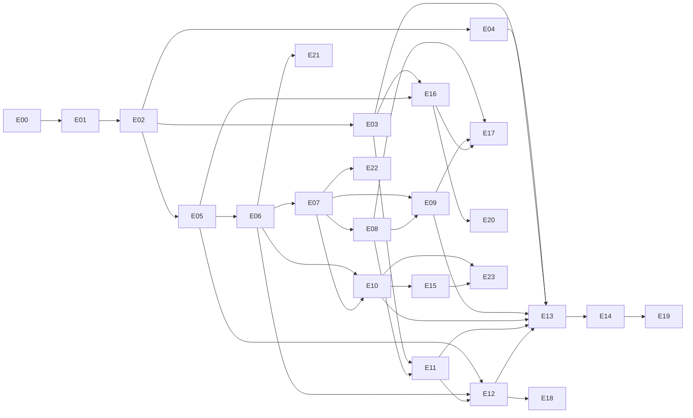

# Immo Suite — Roadmap d'implémentation

| Champ | Valeur |
|---|---|
| Statut | Proposition à valider par Mimis. Aucune décision de ce document n'est prise tant qu'une entrée `DP-xx` n'existe pas dans `DECISIONS.md` (décisions ouvertes n° 96 à 103) |
| Version | 0.1 |
| Date | 30/10/2026 |
| Dépend de | `DECISIONS.md` (état au 30/10/2026), dossier de cadrage v1.0 (§7 à §9, §16 à §20), `CONTEXTE.md`, `ARCHITECTURE.md` (§7, §9), `DEPLOYMENT.md` (§4, §8.1), `TESTING_QA.md` (§11 à §13), `TRACABILITE.md`, `AUDIT_COHERENCE_2.md` (section H) |
| Alimente | `roadmap/etape-NN-*.md`, `CLAUDE.md`, `TRACABILITE.md` |

Objectif : atteindre le plus tôt possible un premier pilote avec les données réelles d'une agence (importer, encaisser, remettre une quittance, suivre les impayés), sans jamais reporter l'intégrité des écritures, l'isolation entre organisations ni les sauvegardes avec test de restauration. Le travail avance par tranches verticales, chacune démontrable et vérifiable en une revue. Légende des marqueurs : `CLAUDE.md`.

## 1. Parti pris : un pilote en deux temps [À valider, décision n° 97]

| | T1 (`CONTEXTE.md`) | T2 | Lot 1 proposé (avant J3) | Lot 2 proposé (avant la bascule `live`) |
|---|---|---|---|---|
| Socle, comptes, rôles, audit (F01 à F03, F39) | oui | | oui | |
| Biens, lots, locataires, baux, échéances (F04, F06 à F08) | oui | | oui | |
| Paiements, quittances, corrections (F09, F10) | oui | | oui | |
| Impayés (F11) | oui | | oui | |
| Relances et promesses (F12) | oui | | non | oui (étape 15) |
| Import (F14) | | oui | moteur et commande HABEK (étape 12) | assistant S16 (étape 18) |
| Console HABEK (F40) | | oui | ligne de commande (étape 11) | |
| Mandats, dépense minimale, compte rendu (F05, F15 min., F13) | | oui | non | oui (étapes 16, 17) |

**Justification.** Le plus petit ensemble qui permet à une agence de travailler réellement est : importer, encaisser, remettre une quittance, suivre les impayés, avec comptes nominatifs, audit, isolation et sauvegardes. Le compte rendu propriétaire et les relances sont de vraies fonctions de T1 et T2, mais ni l'un ni l'autre ne bloque les premières semaines : la phase `setup` (import, essais, **deux semaines de double tenue**, `DEPLOYMENT.md` §8.1) laisse le temps de les livrer avant la première clôture de mois réelle. Les construire avant le pilote (ordre de `DP-57`) repousserait de 56 JD, soit environ 7 semaines à deux développeurs, les premières données réelles, l'apprentissage sur l'import (risque « Excel plus sale que prévu ») et la confirmation des règles R-098 à R-109.
**Conséquences à valider.** (1) Écart à `DP-57` : le pilote démarre en `setup` à la fin du lot 1 et non à la fin de T2. (2) `TESTING_QA.md` PP-05, PP-06, PP-07 s'entendent « pour le périmètre livré » ; les cas de relance et de reddition sont vérifiés aux étapes 15 à 17. (3) **Pas de bascule `live` avant l'étape 17** (décision n° 103). **Option stricte** : placer l'étape 14 après l'étape 18 ; le jalon J3 se décale alors de 56 JD, rien d'autre ne change.

## 2. Jalons

| Jalon | Ce qui doit être vrai | Comment le vérifier | Étape |
|---|---|---|---|
| **J0 — Environnement prêt** | Dépôt protégé, CI qui bloque, trois environnements séparés, image déployée sur l'essai à la fusion, copie chiffrée chez un second fournisseur, première restauration complète chronométrée sous 4 h, à partir d'une copie logique (DP-69 : 6 heures d'historique au plan gratuit) | Compte rendu de restauration, journal de déploiement, alerte de sauvegarde testée (PP-13 à PP-15, PP-20) | 01 |
| **J1 — Squelette déployé** | Une personne se connecte sur l'essai en HTTPS ; isolation et audit prouvés ; mise en production et retour arrière exercés | Rapport d'isolation, procès-verbal de mise en production et de retour arrière (PP-08, PP-09, PP-17, PP-21, PP-22 début) | 02 |
| **J2 — Démonstration interne** | La chaîne bien → bail → échéance → paiement → quittance PDF → correction → impayé se déroule seule sur téléphone | Scénario de `roadmap/etape-10-impayes-et-accueil.md` §8, consigné | 05 à 10 |
| **J3 — Prêt pour un pilote** | Les 38 cases PP-01 à PP-38 de `TESTING_QA.md` §12 ont leur preuve pour le périmètre du lot 1, aucune S1 ou S2 ouverte, décision écrite de mise en production | Tableau PP, `DEPLOYMENT.md` §10 coché | 13 |
| **J4 — Premier pilote** | Organisation en `setup` avec les données réelles importées et rapprochées, comptes nominatifs, TOTP du gérant, première semaine de double tenue | Rapprochement chiffré, comptes rendus de séance | 14 |
| **J5 — Bascule `live`** | Rapprochement sans écart, étape 17 livrée, date hors zone rouge et hors vendredi, numérotation officielle à 000001 | Note de bascule, test de refus sans TOTP (PP-31) | 14 (après 17) |
| **J6 — Cadence du pilote** | Boucle hebdomadaire de retours, livraisons mardi à jeudi, indicateurs publiés, décision de fin selon `DP-53` | Étape 19 | 19 et suivantes |

## 3. Étapes

Effort relatif : S = 2 à 5 jours-développeur (JD), M = 6 à 12, L = 13 à 25. **1 JD = 5 heures de travail effectif** (25 h par semaine et par développeur, `DP-54`). Les efforts sont nominaux ; fourchette de la section 5.

| N° | Nom | Objectif | F | Tranche | Dépend de | Effort | Jalon |
|---|---|---|---|---|---|---|---|
| 00 | Décisions et prototypes | Lever les risques techniques et enregistrer les décisions | F39 | Fondations | — | L, 13 | J0 |
| 01 | Socle, CI, environnements, sauvegardes | Chantier protégé et première restauration | F39 | Fondations | 00 | L, 14 | J0 |
| 02 | Organisations, connexion, squelette | Connexion isolée et auditée, déploiement exercé | F01, F02, F03 | T1 | 01 | M, 10 | J1 |
| 03 | Rôles, invitations, audit, accès support | Équipe nominative et droits | F01, F02, F03 | T1 | 02 | L, 15 | J3 |
| 04 | Observation et signalements | Mesurer les usages sans tiers | F39 | T1 | 02 | M, 7 | J3 |
| 05 | Biens, lots, locataires, mandants (fiche) | Représenter le patrimoine | F04, F06, F05 | T1 | 02 | M, 10 | J2 |
| 06 | Baux et échéancier | Montants dus exacts | F07, F08 | T1 | 05 | L, 18 | J2 |
| 07 | Encaisser | Paiement, affectation, numéro | F09, F10 | T1 | 06 | L, 18 | J2 |
| 08 | Quittance PDF et partage | Preuve imprimable et WhatsApp | F10 | T1 | 07 | M, 10 | J2 |
| 09 | Corrections et rectificatives | Contre-passation sans modification | F09, F10 | T1 | 07, 08 | M, 8 | J2 |
| 10 | Impayés et accueil | Voir ce qui est dû | F11 | T1 | 06, 07 | M, 8 | J2 |
| 11 | Console et cycle de vie | Créer, basculer, exporter, purger | F40, F39 | T2 | 03, 08 | M, 12 | J3 |
| 12 | Import des données d'une agence | Entrer le portefeuille réel | F14, F40 | T2 | 05, 06, 11 | L, 18 | J3 |
| 13 | Durcissement, prêt pour un pilote | Preuves PP-01 à PP-38 | F39 | T1/T2 | 03, 04, 09 à 12 | L, 15 | J3 |
| 14 | Accueil de la première agence | Procédure `DEPLOYMENT.md` §8.1 | F40 | Pilote | 13 | M, 10 | J4, J5 |
| 15 | Relances et promesses | Relancer et tracer | F12 | T1 (lot 2) | 10 | M, 9 | lot 2 |
| 16 | Mandats et dépenses minimales | Conditions de gestion | F05, F15 | T2 (lot 2) | 03, 05 | M, 11 | lot 2 |
| 17 | Compte rendu propriétaire | Commission, net, reversement | F13 | T2 (lot 2) | 08, 09, 16 | L, 18 | lot 2 |
| 18 | Assistant d'import guidé | Import par le gestionnaire | F14 | T2 (lot 2) | 12 | M, 8 | lot 2 |
| 19 | Boucle d'apprentissage | Retour → correction priorisée | F39 | Pilote | 14 | continu | J6 |
| 20 | Mémoire du bien | Travaux complets, documents | F15, F16 | T3 | 16 | L, 15 | J6 |
| 21 | Fin de bail et dépôt de garantie | Préavis, retenues | F20, F23 | T3 | 06 | L, 14 | J6 |
| 22 | Caisse et saisie du SMS | Écarts de caisse, lecture assistée | F19, F25 | T3 | 07 | L, 14 | J6 |
| 23 | Agenda, notifications, exports | Confort et comptable | F17, F22, F18 | T3 | 10, 15 | L, 13 | J6 |

Total : étapes 00 à 13 = **176 JD** ; étapes 14 à 18 (lot 2 et accueil) = 56 JD ; T1 + T2 complets = 232 JD ; T3 (20 à 23) = 56 JD.

**Pourquoi ce découpage.** L'étape 0 du plan attendu est scindée (00 décisions et prototypes, 01 socle) parce que dix jours de prototypes et un chantier de CI ne se vérifient pas en une revue. Biens/locataires et baux/échéancier sont séparés (F07 est « L »). L'encaissement est scindé en numérotation (07), PDF (08) et correction (09). L'historique du bien et les travaux (F15 complet, F16) sont en T3 (étape 20), après le pilote : `DP-02` et `DP-29` les livrent pendant le pilote car aucun ne bloque la clôture d'un mois. La fiche mandant est livrée à l'étape 05 parce que l'import et le bien en dépendent.



**Chemin critique jusqu'à J3** : 00 → 01 → 02 → 05 → 06 → 07 → 08 → 11 → 12 → 13, soit 138 JD. **Piste parallèle** : 03 (15), 04 (7), 09 (8), 10 (8) = 38 JD, sans dépendance entre elles après 02, 07 et 08.

**Répartition de deux développeurs** (chacun avec Claude Code ; relecture croisée obligatoire pour les chemins sensibles de `CODING_RULES.md` §8.3) :

| Période (semaines cumulées) | Développeur A | Développeur B |
|---|---|---|
| S1 à S4 | Prototypes b, c ; dépôt, CI, base | Prototypes a, d, e ; environnements, sauvegardes |
| S4 à S5 | Étape 02 (authentification, `OrgTx`, audit) | Étape 02 (interface, déploiement, retour arrière) |
| S5 à S9 | Étape 03 | Étapes 04 puis 05 |
| S9 à S15 | Étapes 06, 07 (domaine, base) | Étapes 06, 07 (API, écrans), puis 08 |
| S15 à S21 | Étapes 09, 11 | Étapes 10, puis 12 |
| S21 à S23 | Étape 13 (sécurité, exercices) | Étape 13 (accessibilité, mesures, documents) |
| S23 et après | Étape 14 puis 17 | Étapes 15, 16, 18 |

## 4. Avancement (mis à jour par Claude Code en fin d'étape)

| Étape | Statut | Début | Fin | Écarts constatés |
|---|---|---|---|---|
| 00 | **Terminée** (validée par Mimis le 31/10/2026 : décisions DP-76 à DP-81, impression papier du PDF validée). **Deux éléments reportés** : mesure réseau (e), faite plus tard par Mimis à Ouagadougou (DP-75), et révocation des clés Neon et AI Gateway, faite par Mimis en fin de projet de prototypes | 31/10/2026 | 31/10/2026 | Neon gratuit (DP-69) ; fichiers en stockage objet et PDF émis conservés (DP-70, DP-71) ; Rust GNU et pas de Docker (poste) ; moteur PDF Typst (DP-76), `OrgTx` seul mécanisme (DP-77), rôle `immo_backup` confirmé (DP-78), numérotation (DP-79), import (DP-80), montant en lettres (DP-81) ; 197 locataires sur 36 lots dans le fichier de référence : question ouverte (R-020, `DOMAINE.md`) ; deux incidents d'outillage (arrêt d'un conhost, arrêt de processus par parenté de PID) corrigés dans `spikes/tools/` ; CU-heures Neon non relevées |
| 01 | **Terminée le 01/11/2026 sur décision de Mimis, avec des écarts reportés** (bilan : `ops/BILAN-ETAPE-01.md` : 4 critères sur 9 vérifiés, 3 partiels, 2 non vérifiés). Fait et éprouvé en local : fondation, tests de base, serveur, sauvegarde (`immo backup`, F39 validée par DP-82), file de tâches (`immo work`), front `web/`, `immo migrate`, `immo event`, processus de rendu PDF isolé, contrôles de CI (migrations immuables, secrets), `cargo audit` et `cargo deny` verts. **Reportés, à solder quand C-01, C-02, C-03 et la décision n° 89 seront fournis** : (1) CI exécutée pour de vrai (critères 1 et 2), (2) déploiement sur l'essai en moins de 15 minutes (critère 4), (3) copie chez le vrai second fournisseur avec verrouillage et refus de suppression (critère 5), (4) restauration complète chronométrée sur instance neuve chez l'hébergeur (critère 6, PP-14), (5) canal d'alerte et essai de bout en bout (critère 7, PP-15), (6) environnements essai et production, DNS, (7) couche 3 des sauvegardes, (8) exercice « personne indisponible », (9) mesure réseau (e). Workflows, Dockerfile, Compose, Caddy et scripts de déploiement : écrits, **jamais exécutés** | 31/10/2026 | 01/11/2026 | Objectifs de sauvegarde adaptés par DP-69 (6 heures, perte maximale de 24 heures) ; sqlx 0.9 (`AssertSqlSafe`), `native-tls` faute de compilateur C ; deux exceptions de sécurité datées dans `deny.toml` (via `age`) ; le jalon J0 n'est **pas atteint** tant que les points (1) à (5) ne sont pas soldés |
| 02 | **Terminée le 01/11/2026, validée par Mimis, avec écarts reportés** (faite et éprouvée en local) : fiches F01, F02, F03 validées ; migrations d'identité et d'audit, matrice des droits (175 couples, 0 écart), connexion, sessions, limitation, audit dans la même transaction, détection inter-organisations, API, interface, commandes `immo user create` et `immo org create` ; 174 tests Rust, 21 tests du front, 12 parcours simulés et 10 parcours sur la pile réelle ; rapport : `ops/rapports/ETAPE-02.md`. **Reportés, à solder avec l'essai et la production (C-01, C-02, C-03)** : critère 10 et point 5 de la démonstration (mise en production puis retour arrière : essai et production inexistants, dette de l'étape 01) ; second avis sur la migration de garde (C-19), à désigner par Mimis avant la promotion en production ; calibrage argon2id sur le serveur retenu | 01/11/2026 | 01/11/2026 | `--prefix` retiré de `immo org create` (DP-85) ; calibrage argon2id à refaire sur le serveur retenu (19 ms mesurés, cible 100–500 ms, DP-87) ; plafond général de débit en mémoire (DP-87) |
| 03 | **Terminée le 01/11/2026, validée par Mimis, avec écarts reportés** (faite et éprouvée en local) : fiches F01 §9, F02 §7, F03 §8 et F40 validées (DP-88) ; migration de l'étape (invitations, réinitialisation, TOTP, droits réglables, paramètres, accès support, dernier gérant), confirmation du mot de passe, journal lisible ; 236 tests Rust, 35 tests du front, 12 parcours simulés et 10 sur la pile réelle ; rapport : `ops/rapports/ETAPE-03.md`. **À solder** : second avis sur les migrations de garde des étapes 02 et 03 (C-19), contre-passation du critère 9 (étape 06), essai et production (C-01, C-02, C-03) | 01/11/2026 | 01/11/2026 | écarts d'implémentation DP-89 à relire ; clé `FIELD_ENCRYPTION_KEY` à créer par environnement et à copier hors ligne |
| 04 | **Terminée le 03/11/2026, validée par Mimis (« vas-y, juste à la suite », après la démonstration rejouée sur le nouveau poste : 270 tests Rust, 51 du front, 12 parcours sur la pile réelle), avec écarts reportés** : fiche F39-observation validée (DP-90) ; migration de l'étape (événements, erreurs, signalements, purge de 13 mois), liste blanche versionnée, trois routes, alerte par tâche, suivi d'erreurs par empreinte, bouton « Signaler un problème », `indicateurs.sql` ; 270 tests Rust, 51 tests du front, 12 parcours sur la pile réelle ; rapport : `ops/rapports/ETAPE-04.md`. **À solder** : second avis C-19 (dont `platform_read`), canal d'alerte réel (C-01, C-02), essai et production | 01/11/2026 | 03/11/2026 | écarts d'implémentation DP-91 à relire ; exception à R-009 (lecture de la télémétrie sans accord support) |
| 05 | **Terminée le 04/11/2026, validée par Mimis** (« fait le avant pour l'étape 5 quand c'est bon fait direct la 6 », après le sélecteur S18) : fiches F04, F06, F05 (partie fiche) validées (DP-92) ; migration de l'étape (mandants, biens, lots, locataires, recherche pliée sans extension, clé des lots assignés, fiche `is_self`), 23 routes, écrans S06 à S09, recherche unique ; 295 tests Rust, 60 tests du front, 14 parcours sur la pile réelle (dont la démonstration 5 : lots assignés dans S18) ; rapport : `ops/rapports/ETAPE-05.md`. **À solder** : mesure des 150 ms de la recherche, second avis C-19 (`organizations_defaults()`), essai et production | 03/11/2026 | 04/11/2026 | écarts d'implémentation DP-93 à relire ; curseur de pagination non signé (dette commune avec le journal) |
| 06 | **Terminée le 04/11/2026 (validée par Mimis)** : fiches F07, F08 validées (DP-94) ; migration (baux, échéances en écriture seule, exclusion des chevauchements, gardes, vue des soldes), domaine `schedule` (13 tests d'or et propriétés), 12 routes, génération quotidienne, S10 simple ; 319 tests Rust, 60 du front ; rapport : `ops/rapports/ETAPE-06.md`. Puis : S10 complet (création en trois étapes, lignes d'arriéré, avenants), onglets Baux de S07 et S09, « Mettre en travaux », alerte de 02 h 00 ; 320 tests Rust, 66 du front, 16 parcours réels dont la démonstration §8. **Reste** : second avis C-19 | 04/11/2026 | | écarts DP-95 à relire |
| 07 | **En cours** : fiches `specs/F09-paiements.md` et `specs/F10-numerotation-et-instantane.md` validées par Mimis le 04/11/2026 (DP-96) ; **terminée le 06/11/2026 (validée par Mimis)** : migration (paiements, affectations, clés d'idempotence, compteurs et quittances en écriture seule, contrôles différés), domaine (affectation, montant en lettres, numéro), 11 routes, S04, S11, S25 ; rapport `ops/rapports/ETAPE-07.md` | 04/11/2026 | | écarts DP-97 à relire |
| 08 | **En cours** : fiche `specs/F10-quittance-pdf-et-partage.md` validée par Mimis le 06/11/2026 (DP-98) ; code en cours | 06/11/2026 | | |
| 09 | À faire | | | |
| 10 | À faire | | | |
| 11 | À faire | | | |
| 12 | À faire | | | |
| 13 | À faire | | | |
| 14 | À faire | | | |
| 15 | À faire | | | |
| 16 | À faire | | | |
| 17 | À faire | | | |
| 18 | À faire | | | |
| 19 | À faire | | | |
| 20 | À faire | | | |
| 21 | À faire | | | |
| 22 | À faire | | | |
| 23 | À faire | | | |

## 5. Estimation

**Estimation de planification, à recaler à la fin des étapes 00 et 01** (vitesse réelle avec Claude Code, durée des prototypes, coût de la CI). Hypothèses : 1 JD = 5 h ; effort nominal 176 JD pour J3, fourchette de 0,8 à 1,4 fois (141 à 246 JD) ; rendement d'équipe de 0,70 à 0,85 à deux (0,78 nominal : revues, dépendances, coordination) et de 0,85 à 0,95 seul ; aucune astreinte ; pas de congé ni de jour férié compté ; hors temps d'attente des contenus de la section 6.

**Vitesse constatée à la fin de l'étape 00 (31/10/2026)** : environ **un jour calendaire** de séance, Mimis à distance, pour 13 JD (65 h) estimés, cinq prototypes dont quatre exécutés ; plusieurs mesures de plus d'une heure tournaient en tâche de fond pendant la rédaction du code suivant. **Cette vitesse n'est pas extrapolable** : prototypes jetables sans interface, sans revue de code ni intégration continue, sans validation juridique, avec un poste déjà préparé la veille. La grille de dates n'est donc **pas** recalée ; le recalage se fait à la fin de l'étape 01 avec la première mesure d'un chantier protégé (DP-72).

| Scénario | Semaines pour J3 (nominal ; fourchette) | Jours ouvrés | Pour T1 + T2 complets (232 JD, nominal) |
|---|---|---|---|
| **Deux développeurs à 25 h par semaine** (consigne de cette roadmap) | 23 ; 17 à 35 | 113 ; 83 à 175 | 30 semaines |
| Deux développeurs à 40 h par semaine | 14 ; 10 à 22 | 70 ; 50 à 110 | 19 semaines |
| **Un développeur à 25 h par semaine** (`DP-54`, en vigueur) | 39 ; 30 à 58 | 195 ; 150 à 290 | 52 semaines |

Semaine cumulée de fin d'étape (deux développeurs, nominal) : 00 S2 ; 01 S4 ; 02 S5 ; 03 à 05 S9 ; 06 S12 ; 07 S14 ; 08 S15 ; 09 et 10 S17 ; 11 S19 ; 12 S21 ; 13 **S23** ; lot 2 (14 à 18) S30. Comparaison avec `DP-54` : les complexités du dossier donnent 22 à 40 semaines-développeur pour T1 et T2 ; cette roadmap ajoute les prototypes, la CI, les exercices de sécurité et l'exploitation que le dossier ne chiffrait pas. **`DP-54` dit un développeur ; la consigne dit deux : décision n° 96.**

## 6. Pistes hors code (propriétaire : Mimis)

| Réf. | Contenu ou démarche | Propriétaire | Échéance |
|---|---|---|---|
| C-01 | Comptes d'organisation (dépôt, CI, registrar, hébergeur, second fournisseur), double authentification, gestionnaire de mots de passe, codes de secours, deux administrateurs | Mimis | Avant l'étape 00 |
| C-02 | Budget mensuel d'infrastructure, plan Neon (historique), choix du serveur, du stockage objet et du second fournisseur (grille `DEPLOYMENT.md` §1.2) | Mimis | Avant l'étape 00 (Neon) et l'étape 01 |
| C-03 | Domaine technique provisoire tant que le nom du produit n'est pas choisi (n° 13, 100) | Mimis | Avant l'étape 01 |
| C-04 | Avis juridique sur les cinq sujets de `DP-62` (mentions de quittance et montant en lettres ; plafond de dépôt, bail commercial ; CIL et hébergement hors du pays ; conservation ; engagement de confidentialité) ou risque accepté par écrit | Mimis | Volet « mentions » avant l'étape 08 ; reste avant l'étape 13 |
| C-05 | Engagement de confidentialité et accord de pilote (données de test anonymisées, droit de purge en `setup`) | Mimis, relu par un juriste | Avant l'étape 13 |
| C-06 | Recrutement des agences pilotes, lettre d'intention, référent désigné ; une agence candidate pour valider la quittance | Mimis | Liste avant l'étape 08 ; signature avant l'étape 13 |
| C-07 | Conditions du pilote : durée (proposition : double tenue de 2 semaines puis suivi à J+30, J+60, J+90), gratuité, critères de réussite (`DP-53`) | Mimis | Avant l'étape 11 |
| C-08 | Mentions légales de la quittance | Mimis, avec le juriste | Avant l'étape 08 |
| C-09 | Modèle Excel d'import et un ou deux fichiers d'exemple anonymisés d'une agence (accord écrit, n° 15) | Mimis | Avant l'étape 05 (champs), avant l'étape 12 (fichiers) |
| C-10 | Modèles de relance (J−3, J+1, J+5, J+10 ; courtois, ferme, dernier avis) | Mimis | Avant l'étape 15 |
| C-11 | Grille de tarifs à tester (méthode « trop cher / bon marché / limite », jamais annoncée) | Mimis | Avant l'étape 14 |
| C-12 | Heures de couverture, personne de repli, numéro d'urgence (n° 84) | Mimis | Avant l'étape 13 |
| C-13 | Téléphone Android d'entrée de gamme pour les mesures | Mimis | Avant l'étape 07 |
| C-14 | Bons usages (une page), certificat de destruction, plan d'incident, guide d'accueil | Mimis | Avant l'étape 13 |
| C-15 | Mesures de départ de l'agence (clôture mensuelle, taux d'impayés à J+30, litiges par trimestre) | Mimis | Avant l'étape 14 |
| C-16 | Exemples réels de SMS Orange Money et Moov Money | Mimis | Avant l'étape 22 |
| C-17 | Calendrier des jours fériés burkinabè | Mimis | Avant l'étape 14 |
| C-18 | Régénérer le site, le prospectus et le film avant toute diffusion (constats C2-024, C2-025) | Mimis | Avant l'étape 14 |
| C-19 | Désigner la personne du second avis externe et de l'auto-test d'intrusion si un seul développeur écrit le code | Mimis | Avant l'étape 02 |
| C-20 | Règle de conservation et de départ d'une agence (`DEPLOYMENT.md` §8.2, n° 94) | Mimis, avec le juriste | Avant l'étape 21 et avant le premier départ |

## 7. Boucle d'apprentissage pendant le pilote

Détail complet : `roadmap/etape-19-boucle-apprentissage.md`. Résumé :
- **Retour → correction** : consigner le jour même, qualifier (bogue, friction, demande, question), reproduire, gravité S1 à S4, priorité = gravité × fréquence × portée (S1 toujours en premier), arbitrage par la règle des trois clients, test de non-régression, livraison derrière un interrupteur, confirmation par l'agence, mesure à J+7.
- **Délais cibles** (n° 84) : S1 correctif en 24 h (prise en compte en 1 h) ; S2 en 72 h ; S3 au prochain lot hebdomadaire (14 jours au plus) ; S4 par tri hebdomadaire.
- **Indicateurs** (journal d'événements) : médiane de `payment_recorded.duration_ms` (30 s) ; part des paiements saisis sous 48 h (60 %, `DP-53`) ; abandons de formulaire ; erreurs d'import par type ; échecs de PDF ; utilisateurs actifs par semaine ; signalements ouverts et leur âge.
- **Rythme** : point hebdomadaire de 30 minutes par agence ; livraisons mardi à jeudi de 06 h 00 à 07 h 30, zone verte du 11 au 24 ; test de restauration en 3ᵉ semaine du mois.
- **Entrer dans une tranche suivante (étapes 20 à 23)** : aucune S1 ouverte, deux semaines stables, besoin exprimé, corrections sous 20 % de la capacité, une fonction à la fois derrière un interrupteur [À valider, n° 102].

## 8. Procédure standard d'exécution d'une étape

À appliquer à chaque fichier `roadmap/etape-NN-*.md` :
1. Lire `CLAUDE.md`, puis le fichier de l'étape, et seulement les sections de documents qu'il cite.
2. Rédiger ou compléter les fiches `specs/F-xx` demandées par l'étape, puis **s'arrêter pour la validation de Mimis**.
3. Écrire d'abord les tests des règles financières concernées (cas `E-xx`), les voir échouer.
4. Implémenter, en petits changements (moins de 400 lignes), un commit par intention avec les identifiants `F`, `R`, `DP`.
5. Lancer tests, analyse statique et vérifications (`CLAUDE.md` « Pile et commandes ») et rapporter les résultats réels.
6. Mettre à jour la documentation et `DECISIONS.md` (avant d'appliquer une décision structurante), noter les écarts dans le tableau d'avancement.
7. Dérouler la liste de démonstration de l'étape et la présenter à Mimis.
8. Attendre la validation de Mimis avant l'étape suivante.

**Commande de démarrage** (à coller dans Claude Code) :

```text
Démarre l'étape NN. Lis CLAUDE.md, puis roadmap/etape-NN-<nom>.md, puis uniquement les sections qu'il cite. Applique la procédure de ROADMAP.md §8 : fiches specs d'abord, arrêt pour ma validation, tests d'argent avant le code, démonstration à la fin, mise à jour du tableau d'avancement.
```

## 9. Registre des risques de planification

| Risque | Probabilité | Impact | Mesure |
|---|---|---|---|
| Capacité réelle inférieure à l'hypothèse (`DP-54` contre deux développeurs) | Élevée | Élevé | Décision n° 96 ; recalage après les étapes 00 et 01 ; trois scénarios ci-dessus |
| Neon refuse `pg_dump` sous RLS forcée ou limite l'historique | Moyenne | Moyen | Prototype (b) dès l'étape 00, repli n° 46, copies logiques quotidiennes |
| Moteur PDF insuffisant | Moyenne | Moyen | Prototype (a), aperçu HTML en repli |
| Excel de l'agence plus sale que prévu | Élevée | Moyen | Prototype (d), import assisté, annulation |
| Règles R-071, R-096, R-098 à R-109 infirmées par l'agence | Moyenne | Moyen | Dates d'effet, jamais de recalcul, confirmation à la découverte |
| Avis juridique tardif | Moyenne | Moyen | Risque accepté par écrit (`DP-62`) |
| Aucune agence prête à temps | Moyenne | Élevé | Recrutement dès maintenant (C-06) ; démonstration avec la maquette |
| Périmètre qui gonfle (T3, P2) | Élevée | Élevé | Une fonction à la fois derrière un interrupteur ; critères d'entrée de l'étape 19 |
| Estimation optimiste | Élevée | Moyen | Fourchette large, recalage, journal des écarts |
| Support qui absorbe la capacité | Élevée | Moyen | Plafond de 20 %, services facturés |
| Point de défaillance unique sur les accès | Moyenne | Élevé | C-01, inventaire daté, exercice trimestriel |
| Bascule `live` sans compte rendu | Moyenne | Moyen | Décision n° 103 : pas de `live` avant l'étape 17 |
| Supports marketing incohérents avec le produit (site, film) | Moyenne | Faible | C-18 avant toute diffusion |

## 10. Questions ouvertes qui bloquent le démarrage

1. **Capacité** : deux développeurs, combien d'heures chacun ? Révision de `DP-54` (n° 96). Bloque les durées et la règle de revue.
2. **Neon, hébergeurs, budget, dépôt et CI** : compte et plan Neon, serveur, stockage objet, second fournisseur, plateforme de code (n° 5, 86, 87) et budget mensuel (42 à 111 €). Bloque les étapes 00 et 01.
3. **Dépôt et domaine** : racine du dépôt (dossiers marketing exclus, `CODING_RULES.md` question 4) ; domaine technique provisoire (n° 13, 100). Bloque les étapes 01 et 02.
4. **Pilote en deux temps** : accepter l'écart à `DP-57` et la lecture de PP-05 à PP-07 (n° 97, 103), ou choisir l'option stricte. Bloque le séquencement.
5. **Avis juridique** : qui, avant quelle date, quel budget (`DP-62`, C-04). Bloque l'étape 08 (mentions) et l'étape 13.
6. Autres, non bloquantes pour l'étape 00 : console du pilote en ligne de commande (n° 98), migrations incrémentales (n° 99), conditions du pilote (n° 101), heures de couverture (n° 84), personne du second avis (C-19).

## 11. Contrôle de couverture

Vérifié par `roadmap/verifier-couverture.py` (commande : `python -I -X utf8 roadmap/verifier-couverture.py`), résultat du 30/10/2026 :

```text
Étapes lues : 24
- Fonctionnalités T1, T2 et T3 (F01-F14, F39, F40, F15-F20, F22, F23, F25) : OK
- Règles R-001 à R-110 : OK
- Critères PP-01 à PP-38 : OK
- Contenus cités (19) avec propriétaire et échéance : OK
- Contenus de ROADMAP.md (20) complets : OK
- Graphe Mermaid identique aux « Dépend de » des étapes : OK
- Graphe de dépendances sans cycle : OK
RÉSULTAT GLOBAL : VERT
```

Le script relit la section « Couverture » de chaque fichier d'étape et la table des contenus de la section 6. Il est à relancer après toute modification d'une étape.


